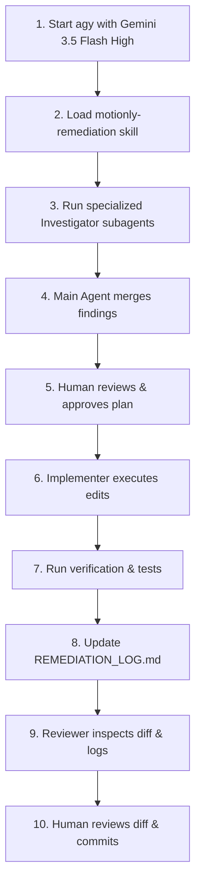

# AI Agent Operating Guidelines & Remediation Workflow

This document defines the repo-wide rules and execution workflows for all AI coding agents working on the **Motionly** repository. These rules are non-negotiable and are designed to ensure safety, correctness, and transparency.

---

## 1. Repo-Wide Operating Rules for AI Agents

All AI agents must follow these rules before making any modifications to the codebase:

1. **Verify Before Modifying**  
   Audits and remediation plans are evidence, not ground truth. Before editing any file:
   * Open the file and inspect the actual lines of code.
   * Confirm that the target function, variable, endpoint, class, or behavior exists.
   * Confirm that the audit claim or bug description is still true.
   * Record the verified file paths and line numbers in [REMEDIATION_LOG.md](file:///workspaces/Motionly-claude/motionly-main/Motionly-main/REMEDIATION_LOG.md).
   * **Stop and escalate** immediately if there is a discrepancy. Do not invent a replacement fix.

2. **One Phase / Task at a Time**  
   Never attempt multiple phases or tasks simultaneously. Each task must be scoped, executed, tested, and reviewed in isolation.

3. **No Invented Infrastructure**  
   Do not introduce new services, external provider tools, queues, databases, or infrastructure layers (such as Kubernetes, Helm, Terraform, or HPA autoscaling) unless there is existing repository evidence or the human operator explicitly approves it.
   * *Known supported infrastructure:* Docker, Docker Compose, Caddy, Redis, BullMQ, Postgres/Supabase, FFmpeg, Remotion, and GitHub Actions.
   * *Kubernetes autoscaling is explicitly a **DECISION NEEDED** gate.*

4. **No Silent Product Decisions**  
   If a task involves a product design gate, business rule assumption, or high-risk architectural trade-off, stop and ask the human operator. Never make these assumptions silently. Examples include:
   * Deciding which database migration tree is canonical.
   * Disabling/relabeling features vs. building complex alternatives.
   * Determining per-worker VRAM budgets, cost caps, and per-workspace quotas.
   * Deciding data retention and purging durations for uploads/transcripts.

5. **No Drive-By Refactors**  
   Preserve existing codebase behavior unless the task explicitly instructs otherwise. Do not rename public APIs, upgrade unrelated dependencies, or reformat unrelated files. Keep changes to the absolute minimum required to safely resolve the task.

6. **Log and Track Progress**  
   You must update [REMEDIATION_LOG.md](file:///workspaces/Motionly-claude/motionly-main/Motionly-main/REMEDIATION_LOG.md) at the repository root immediately after completing each task (using the exact Markdown schema defined in the rules).

7. **Human Sign-Off on Security-Sensitive Changes**  
   Any changes affecting authentication, authorization, migrations, secrets handling, third-party provider data sharing, billing, data retention, or production configuration require explicit human review and approval.

8. **Readiness Gate Assertion**  
   Do not declare Motionly "production-ready" until Phase 13 of the remediation plan has been successfully executed, verified, and signed off with explicit evidence.

---

## 2. Reusable Prompt & Tool Sitemap

The agent ecosystem is configured as follows:

* **Configuration & Skills:**
  * [.agents/skills/motionly-remediation/SKILL.md](file:///workspaces/Motionly-claude/motionly-main/Motionly-main/.agents/skills/motionly-remediation/SKILL.md): The core skill containing remediation logic, rules, and decision gates.
* **Orchestration Roles:**
  * [.agents/prompts/main-agent.md](file:///workspaces/Motionly-claude/motionly-main/Motionly-main/.agents/prompts/main-agent.md): Prompt template for the Main Agent/Orchestrator.
  * [.agents/prompts/implementer-agent.md](file:///workspaces/Motionly-claude/motionly-main/Motionly-main/.agents/prompts/implementer-agent.md): Prompt template for the code editor and writer.
  * [.agents/prompts/reviewer-agent.md](file:///workspaces/Motionly-claude/motionly-main/Motionly-main/.agents/prompts/reviewer-agent.md): Prompt template for checking changes against guidelines and logs.
* **Specialized Investigator Subagents:**
  * [.agents/prompts/subagents/code-searcher.md](file:///workspaces/Motionly-claude/motionly-main/Motionly-main/.agents/prompts/subagents/code-searcher.md): Locates specific symbols, behaviors, and files.
  * [.agents/prompts/subagents/test-finder.md](file:///workspaces/Motionly-claude/motionly-main/Motionly-main/.agents/prompts/subagents/test-finder.md): Locates tests, fixtures, and CI patterns.
  * [.agents/prompts/subagents/config-checker.md](file:///workspaces/Motionly-claude/motionly-main/Motionly-main/.agents/prompts/subagents/config-checker.md): Reviews deployment configs, scripts, env vars, and workflows.
  * [.agents/prompts/subagents/risk-reviewer.md](file:///workspaces/Motionly-claude/motionly-main/Motionly-main/.agents/prompts/subagents/risk-reviewer.md): Detects scope creep, invented infra, and silent assumptions.
  * [.agents/prompts/subagents/migration-inspector.md](file:///workspaces/Motionly-claude/motionly-main/Motionly-main/.agents/prompts/subagents/migration-inspector.md): Compares database schema migrations for drift/conflicts.
  * [.agents/prompts/subagents/queue-inspector.md](file:///workspaces/Motionly-claude/motionly-main/Motionly-main/.agents/prompts/subagents/queue-inspector.md): Inspects queues, job payloads, handlers, and endpoints.
  * [.agents/prompts/subagents/storage-inspector.md](file:///workspaces/Motionly-claude/motionly-main/Motionly-main/.agents/prompts/subagents/storage-inspector.md): Inspects render storage upload patterns and stream vs buffer use.
  * [.agents/prompts/subagents/provider-inspector.md](file:///workspaces/Motionly-claude/motionly-main/Motionly-main/.agents/prompts/subagents/provider-inspector.md): Audits external AI/ML provider interactions, retries, and errors.
  * [.agents/prompts/subagents/gpu-inspector.md](file:///workspaces/Motionly-claude/motionly-main/Motionly-main/.agents/prompts/subagents/gpu-inspector.md): Reviews GPU worker concurrency, model caching, and OOM boundaries.
  * [.agents/prompts/subagents/frontend-flow-inspector.md](file:///workspaces/Motionly-claude/motionly-main/Motionly-main/.agents/prompts/subagents/frontend-flow-inspector.md): Reviews frontend call-sites, status polling, and UX copy.

---

## 3. Remediation Workflow Execution Guide

To execute a remediation phase or task safely, follow this 10-step workflow:

### Detailed Workflow Step-by-Step

1. **Start agy CLI**  
   Run `agy` using the model `Gemini 3.5 Flash (High)` for optimal performance and safety constraints.
   
2. **Use the Remediation Skill**  
   Activate the `motionly-remediation` skill to automatically ingest the plan context, operating rules, decision gates, and standard response protocols.
   
3. **Deploy Investigator Subagents**  
   Before modifying any code, spawn the necessary read-only investigator subagents (e.g., `code-searcher`, `config-checker`, `test-finder`) to perform targeted investigations.
   
4. **Merge Findings**  
   The Main Agent aggregates findings from the investigators, detailing the exact files, line numbers, and current implementations.
   
5. **Get Human Approval**  
   Present the proposed code modification plan to the human developer. **Do not modify files until the human operator gives explicit approval.**
   
6. **Implement Changes**  
   Once approved, hand off the execution to the **Implementer Agent** role to perform the narrowest possible edits needed.
   
7. **Run Tests & Verify**  
   Execute the verification commands, run automated unit/integration tests, or run local smoke tests to verify the change works as expected.
   
8. **Document in Log**  
   Append an entry summarizing the changes, audit resolution, and verification output in [REMEDIATION_LOG.md](file:///workspaces/Motionly-claude/motionly-main/Motionly-main/REMEDIATION_LOG.md).
   
9. **Run Reviewer Check**  
   Use the **Reviewer Agent** role to review the git diff, check for scope creep or silent assumptions, verify that the remediation log is correctly formatted, and check off decision gates.
   
10. **Human Review & Commit**  
    The human operator performs a final review of the diff, confirms security-sensitive gates are satisfied, and commits the changes to Git.
