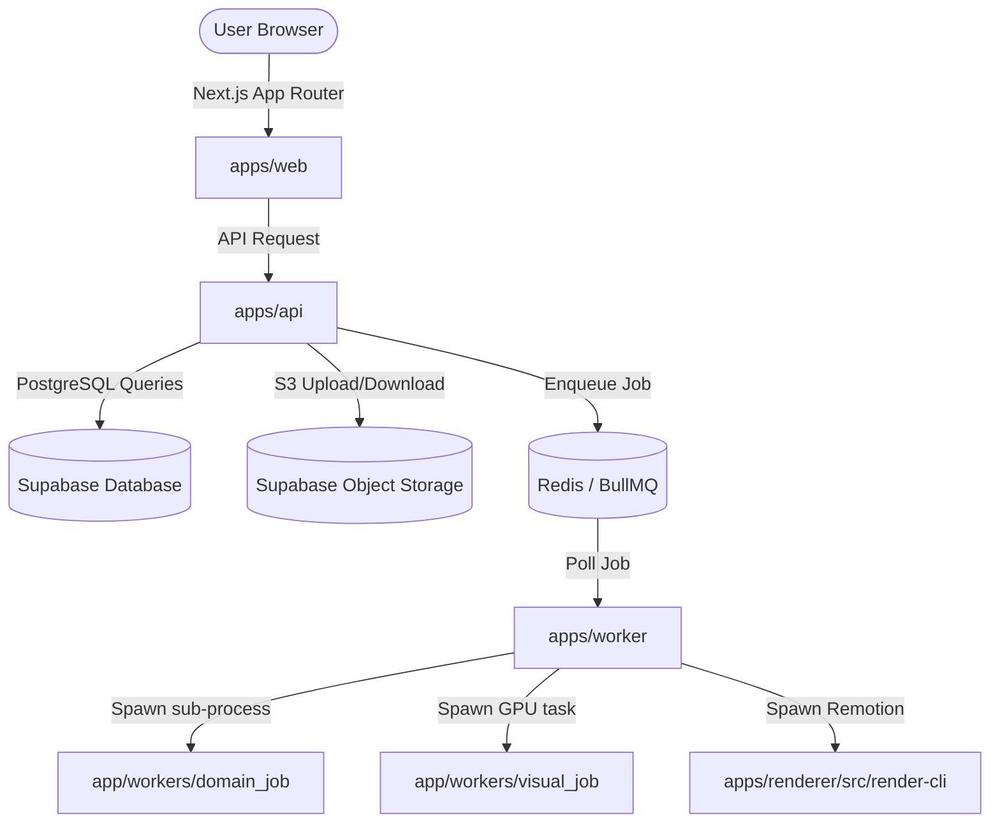
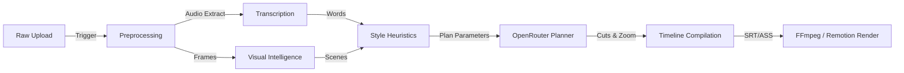

# Motionly Engineering Audit (Source-Code-Only)

## 1. Executive Summary
Motionly is an automated video editor and reel generator designed to convert raw talking-head footage into short-form videos (e.g., TikToks, Instagram Reels, YouTube Shorts). The system includes automatic transcription, style classification, AI edit planning, automatic caption generation, B-roll search, music selection, effects configuration, and two render pipelines: basic (FFmpeg-based) and premium (Remotion-based).

### Execution Status
The codebase is highly functional and cleanly structured as a monorepo. The core pipeline works from raw upload through preprocessing, transcription, and heuristic-based style classification. However, AI edit planning depends on external LLM response format stability and has a local deterministic fallback if parsing fails. B-roll semantic matching is partially implemented (functional with fixtures, but falls back to lexical keyword matching for real Pexels/Pixabay search results). Rendering is fully implemented, featuring a basic FFmpeg renderer and a premium Chromium-based Remotion renderer with an interprocess bridge. Publishing is fully implemented with real API calls to TikTok, Meta Graph API, and YouTube.

### Biggest Blockers to Production Readiness
1. **Developer Bypass Flags**: The presence of `SKIP_API_AUTH` bypasses FastAPI security in non-production environments and poses configuration risks if `APP_ENV` is misconfigured.
2. **Real-time Video Keying CPU/Memory Cost**: The background removal features require MediaPipe selfie segmentation, creating a frame-by-frame matte video that is alphamerged with the source video via CPU/GPU-intensive FFmpeg encoding, which could bottleneck workers.
3. **No Embeddings for Real B-Roll Providers**: The semantic ranking of B-roll slots falls back to lexical string similarity when using real external APIs (Pexels, Pixabay), since these APIs do not return embeddings.

### AI Capabilities and Risks
- **Categories**: Speech recognition (Groq/Whisper), audio analysis (Pyannote speaker count, Wav2Vec emotion, Yamnet event classification), visual analysis (CLIP embeddings, BLIP-2 captions, YOLOv8 object detection, MediaPipe face/selfie segmentation), and text completions (OpenRouter LLM).
- **Risks**: Hallucinations in LLM-generated JSON cut lists, CUDA OOM failures during video visual analysis on workers, and transcription latency or timeouts from third-party APIs.

---

## 2. Project Identity
- **Product Purpose (Inferred)**: Automated editing SaaS that cuts raw videos down to highlights, inserts stock B-roll, places styled captions, adds catalog music, and applies zoom/camera motion effects.
- **Likely Users (Inferred)**: Content creators, advertising agencies, marketing managers, and founders looking to automate the creation of short-form social video clips.
- **Primary Use Cases (Inferred)**: Converting long talking-head videos, webinars, or podcasts into multiple dynamic, styled vertical clips.
- **Core Workflow (Inferred)**: Raw upload → preprocessing metadata extraction → Whisper transcription → Audio/Visual analysis → LLM edit plan generation → automatic caption styling and B-roll/music selection → timeline preview/edit → FFmpeg/Remotion render → social publishing.

---

## 3. Implementation Status

| Feature | Status | Source Evidence Paths | Wired into Flow? | Main Blocker / Defect |
| :--- | :--- | :--- | :--- | :--- |
| **Signup/Auth** | `implemented` | [`app/api/dependencies.py`](file:///workspaces/Motionly-claude/motionly-main/Motionly-main/apps/api/app/api/dependencies.py#L53-L120) | Yes | None; depends on Supabase JWT verification. |
| **Project Creation** | `implemented` | [`app/api/projects.py`](file:///workspaces/Motionly-claude/motionly-main/Motionly-main/apps/api/app/api/projects.py) | Yes | None. |
| **Media Upload** | `implemented` | [`app/api/uploads.py`](file:///workspaces/Motionly-claude/motionly-main/Motionly-main/apps/api/app/api/uploads.py) | Yes | Signed URL generation depends on Supabase Storage. |
| **Preprocessing** | `implemented` | [`app/services/preprocessing.py`](file:///workspaces/Motionly-claude/motionly-main/Motionly-main/apps/api/app/services/preprocessing.py) | Yes (Triggered post-upload completion) | None; extracts resolution, duration, frame rate. |
| **Transcription** | `implemented` | [`app/services/transcription_jobs.py`](file:///workspaces/Motionly-claude/motionly-main/Motionly-main/apps/api/app/services/transcription_jobs.py) | Yes (Chained after preprocessing) | Network dependencies on Groq Whisper endpoint. |
| **AI Analysis** | `implemented` | [`app/services/audio_intelligence.py`](file:///workspaces/Motionly-claude/motionly-main/Motionly-main/apps/api/app/services/audio_intelligence.py), [`app/services/visual_intelligence.py`](file:///workspaces/Motionly-claude/motionly-main/Motionly-main/apps/api/app/services/visual_intelligence.py) | Yes | High CUDA memory requirement; fallback-only visual if GPU worker is missing. |
| **Edit Planning** | `implemented` | [`app/services/edit_planner.py`](file:///workspaces/Motionly-claude/motionly-main/Motionly-main/apps/api/app/services/edit_planner.py) | Yes | LLM completion failure defaults to deterministic local fallback plan. |
| **Captions** | `implemented` | [`app/services/caption_chunking.py`](file:///workspaces/Motionly-claude/motionly-main/Motionly-main/apps/api/app/services/caption_chunking.py), [`app/services/ass_captions.py`](file:///workspaces/Motionly-claude/motionly-main/Motionly-main/apps/api/app/services/ass_captions.py) | Yes | Styling presets are fixed keys. |
| **B-roll** | `partial` | [`app/services/stock_video.py`](file:///workspaces/Motionly-claude/motionly-main/Motionly-main/apps/api/app/services/stock_video.py) | Yes | Real API candidates lack embeddings; ranking defaults to lexical matching. |
| **Music** | `implemented` | [`app/services/music.py`](file:///workspaces/Motionly-claude/motionly-main/Motionly-main/apps/api/app/services/music.py) | Yes | Relies on DB table populate. |
| **Effects/Transitions**| `implemented` | [`app/services/effects.py`](file:///workspaces/Motionly-claude/motionly-main/Motionly-main/apps/api/app/services/effects.py) | Yes | None. |
| **Editor** | `implemented` | [`apps/web/components/editor-client.tsx`](file:///workspaces/Motionly-claude/motionly-main/Motionly-main/apps/web/components/editor-client.tsx) | Yes | State tracking includes undo/redo. Preview uses static CSS ellipse for matte isolation. |
| **Render/Export** | `implemented` | [`app/services/ffmpeg_render.py`](file:///workspaces/Motionly-claude/motionly-main/Motionly-main/apps/api/app/services/ffmpeg_render.py), [`apps/worker/src/remotion.mjs`](file:///workspaces/Motionly-claude/motionly-main/Motionly-main/apps/worker/src/remotion.mjs) | Yes | Remotion requires Chrome/Chromium installed inside worker image. |
| **Publishing** | `implemented` | [`app/services/publishing.py`](file:///workspaces/Motionly-claude/motionly-main/Motionly-main/apps/api/app/services/publishing.py) | Yes | Network rate-limits and OAuth scopes. |
| **Billing** | `implemented` | [`app/api/billing.py`](file:///workspaces/Motionly-claude/motionly-main/Motionly-main/apps/api/app/api/billing.py) | Yes | Disabled by default via `BILLING_ENABLED=False`. |
| **Background Jobs** | `implemented` | [`apps/worker/src/worker.mjs`](file:///workspaces/Motionly-claude/motionly-main/Motionly-main/apps/worker/src/worker.mjs), [`app/services/queue.py`](file:///workspaces/Motionly-claude/motionly-main/Motionly-main/apps/api/app/services/queue.py) | Yes | Interprocess communication runs via Node execution of python worker sub-process. |
| **Ops/Observability**| `implemented` | [`app/services/operations.py`](file:///workspaces/Motionly-claude/motionly-main/Motionly-main/apps/api/app/services/operations.py) | Yes | Otel exporter endpoint required for remote tracking. |

---

## 4. End-to-End Product Flow
1. **Signup**:
   - *Starts at*: Auth page in frontend [`apps/web/app/(auth)`](file:///workspaces/Motionly-claude/motionly-main/Motionly-main/apps/web/app/\(auth\)).
   - *Handlers*: Supabase Auth API triggers `public.handle_new_user()` trigger function in database to insert workspace, profile, subscription (defaults to `free` plan).
   - *Next step consumption*: Yes, JWT is passed as a Bearer authorization token header to FastAPI endpoints.
2. **Project Creation**:
   - *Starts at*: [`apps/web/app/(app)/projects/new`](file:///workspaces/Motionly-claude/motionly-main/Motionly-main/apps/web/app/\(app\)/projects/new).
   - *Handlers*: FastAPI [`app/api/projects.py`](file:///workspaces/Motionly-claude/motionly-main/Motionly-main/apps/api/app/api/projects.py). Persists row in `public.projects`.
   - *Next step consumption*: Yes.
3. **Upload**:
   - *Starts at*: [`apps/web/components/upload-panel.tsx`](file:///workspaces/Motionly-claude/motionly-main/Motionly-main/apps/web/components/upload-panel.tsx).
   - *Handlers*: FastAPI `/projects/{id}/uploads/init` generates a signed storage URL. Frontend uploads file directly to Supabase storage `raw-uploads`. Upon completion, `/complete` endpoint transitions upload status to `processing`.
   - *Next step consumption*: Enqueues `video_preprocess` job in BullMQ.
4. **Preprocessing**:
   - *Starts at*: Node worker routing `video_preprocess` job to Python subprocess [`app/workers/domain_job.py`](file:///workspaces/Motionly-claude/motionly-main/Motionly-main/apps/api/app/workers/domain_job.py).
   - *Handlers*: [`app/services/preprocessing.py`](file:///workspaces/Motionly-claude/motionly-main/Motionly-main/apps/api/app/services/preprocessing.py) runs FFprobe to extract metadata, updates `public.uploaded_videos`, and enqueues transcription & visual analysis.
   - *Next step consumption*: Enqueues `transcription` and `visual_analysis` jobs.
5. **Transcription**:
   - *Starts at*: Node worker routing `transcription` job.
   - *Handlers*: [`app/services/transcription_jobs.py`](file:///workspaces/Motionly-claude/motionly-main/Motionly-main/apps/api/app/services/transcription_jobs.py) calls Groq Whisper compatibility endpoint to retrieve word-level segments and executes optional speaker diarization/emotion ML extractors. Persists data to `public.transcripts` and `public.transcript_words`.
   - *Next step consumption*: Consumed by AI Edit Planner.
6. **AI Analysis**:
   - *Starts at*: GPU/ML worker routing `visual_analysis` job.
   - *Handlers*: [`app/workers/visual_job.py`](file:///workspaces/Motionly-claude/motionly-main/Motionly-main/apps/api/app/workers/visual_job.py) executes frame sampling, scene segmentation, and feature extraction (CLIP, BLIP, YOLO, MediaPipe). Persists data to `public.video_manifests`.
   - *Next step consumption*: Consumed by Style Classifier and B-roll rule engine.
7. **Edit Plan Generation**:
   - *Starts at*: Editor client manual triggers or auto-init via `/projects/{id}/plans`.
   - *Handlers*: FastAPI `/plans` or `edit_plan` queue job. Heuristic style classification runs, then LLM prompt is sent to OpenRouter chat completions. Standard layout generated.
   - *Next step consumption*: Chronological cut lists, caption highlights, zoom moments, and B-roll request slots are parsed and inserted into `public.edit_plans`.
8. **Captions**:
   - *Starts at*: `/projects/{id}/captions` generation.
   - *Handlers*: [`app/services/caption_chunking.py`](file:///workspaces/Motionly-claude/motionly-main/Motionly-main/apps/api/app/services/caption_chunking.py) compiles subtitle presets into segment lists in `public.caption_tracks` and `public.caption_segments`.
   - *Next step consumption*: Subtitles compiled to `.ass` for basic render or passed to Remotion render.
9. **B-roll / Music / Effects**:
   - *Starts at*: `/projects/{id}/broll`, `/music`, `/effects` endpoints.
   - *Handlers*: stock search query generates candidates, music recommendations select catalog music, effects are compiled.
   - *Next step consumption*: Consumed in rendering layout specifications.
10. **Editor Preview**:
    - *Starts at*: [`apps/web/components/editor-client.tsx`](file:///workspaces/Motionly-claude/motionly-main/Motionly-main/apps/web/components/editor-client.tsx).
    - *Handlers*: Frontend renders a React player using video element overlays. State changes are stored local-first and saved to database.
    - *Disconnection*: Preview uses a static CSS `ellipse` mask for background removal, whereas final render uses a real alpha-keyed video generated via FFmpeg `alphamerge`.
11. **Rendering**:
    - *Starts at*: `/projects/{id}/renders` creation.
    - *Handlers*: Basic FFmpeg compiler runs inside python subprocess, or premium Remotion renderer bundles React components and calls Chromium browser frames.
    - *Next step consumption*: Output file written to `exports` bucket.
12. **Publishing**:
    - *Starts at*: `/publish` creation.
    - *Handlers*: [`app/services/publishing.py`](file:///workspaces/Motionly-claude/motionly-main/Motionly-main/apps/api/app/services/publishing.py) reads connection tokens, pushes video URL or pulls it directly to Instagram, YouTube, or TikTok.

---

## 5. Architecture

### Critical Boundaries
- **Control vs. Media Workload**: API server handles routes and small metadata database updates. All heavy tasks (FFmpeg compiling, Remotion rendering, local ML/GPU model execution) run in background worker processes.
- **Tenancy Boundaries**: Enforced at database policy level (RLS checks matching `workspace_id`) and API dependencies level.

---

## 6. Tech Stack
- **Frontend Framework**: Next.js (TypeScript, Tailwind CSS, Lucide Icons, Drag & Drop Kit).
- **Backend Framework**: FastAPI (Python 3.12, Uvicorn, httpx).
- **Database**: PostgreSQL (Supabase managed, RLS, custom plpgsql triggers).
- **ORM / Query Layer**: Native SQL repositories (`httpx` wrappers for Supabase API requests).
- **Storage Provider**: Supabase Storage Buckets (`raw-uploads`, `exports`, `thumbnails`).
- **Queue / Worker**: BullMQ (Redis-backed) with an interprocess bridge `queue-bridge.mjs`.
- **Render Tools**: FFmpeg (subtitles, audio mixing, custom video filters) & Remotion (webpack bundle + Chromium renderer).
- **AI / ML Models**:
  - *Text Completions*: OpenRouter API.
  - *Transcription*: Groq Whisper.
  - *Audio ML*: Pyannote (Speaker Diarization), Wav2Vec2 (Emotion Recognition), Yamnet (Sound Event Classification).
  - *Visual ML*: CLIP (Vit-base-patch32), BLIP-2 (opt-2.7b captioning), YOLOv8 (Object Detection), MediaPipe (Face Detection, Selfie Segmentation).
- **Auth Provider**: Supabase Auth (JWT).
- **Billing Provider**: Stripe.

---

## 7. API Surface

### 1. Project Management
- `POST /projects` & `GET /projects`
- *Auth*: Verified Actor JWT.
- *Workspace Checks*: Header validation `x-motionly-workspace-id`.

### 2. Video Uploads
- `POST /projects/{id}/uploads/init` & `/complete`
- *Auth*: Verified Actor JWT.
- *Side Effects*: Enqueues `video_preprocess` job in BullMQ.

### 3. Edit Planning
- `POST /projects/{id}/plans`
- *Auth*: Verified Actor JWT.
- *Side Effects*: Triggers openrouter/fixture edit planning job.

### 4. Rendering
- `POST /projects/{id}/renders`
- *Auth*: Verified Actor JWT.
- *Side Effects*: Enqueues render job (routes to basic FFmpeg or premium Remotion).

### 5. Social Publishing
- `POST /projects/{id}/publish`
- *Auth*: Verified Actor JWT.
- *Workspace checks*: Access token decrypted using token cipher encryption key.

### 6. Billing & Entitlements
- `GET /billing/status` & `POST /billing/checkout`
- *Auth*: Verified Actor JWT.
- *Validation*: Price IDs matched dynamically from plan keys.

### 7. Internal / Worker Routes
- `/internal/jobs/{id}/run`, `/internal/retention/run`, `/internal/operations/heartbeat`
- *Auth*: Admin API token validation (`x-motionly-worker-token`).

---

## 8. Data Model and Migrations
The database schema consists of PostgreSQL tables with extensive relations and RLS policies:
- **Core Entities**: `workspaces`, `profiles`, `workspace_members`, `projects`, `uploaded_videos`, `exports`, `subscriptions`.
- **Media Processing & AI**: `transcripts`, `transcript_words`, `caption_tracks`, `caption_segments`, `edit_plans`, `edit_plan_snapshots`, `video_manifests`, `broll_slots`, `stock_assets`, `music_tracks`, `project_music_selections`.
- **Worker & Operations**: `render_jobs`, `render_job_events`, `retention_runs`, `storage_deletion_queue`, `worker_heartbeats`, `provider_slo_events`, `cost_attribution_events`.

### Object Storage Buckets
- `raw-uploads`: raw uploaded videos and processed matte clips.
- `exports`: output mp4 and webm renders.
- `thumbnails`: frame snapshots extracted during preprocessing.
- **Signed URLs**: Signed URLs generated for previews and downloads with short TTLs (300-900 seconds).
- **Cleanup**: `storage_deletion_queue` handles soft-deleted file deletions, while the `RetentionService` drops old exports and logs.

---

## 9. Auth, Security, Privacy, and Compliance
- **Auth Bypass Flags**: The flag `SKIP_API_AUTH` bypasses security checks in development. A validator in `config.py` raises ValueError if this bypass is turned on in production.
- **Tenancy Boundary**: Enforced by ensuring all database operations join workspace member tables to check the caller's membership.
- **PII Redaction**: [`app/core/logging.py`](file:///workspaces/Motionly-claude/motionly-main/Motionly-main/apps/api/app/core/logging.py) implements `redact_string` and `redact_data` which masks authorization headers, OpenAI/OpenRouter tokens, Stripe secrets, and signed storage URL parameters in error logs.
- **Data Sharing Compliance**: Documented in [`DATA_HANDLING.md`](file:///workspaces/Motionly-claude/motionly-main/Motionly-main/DATA_HANDLING.md), detailing the pipelines sending transcripts and media blocks to third-party endpoints (Groq, OpenRouter, Runway).

---

## 10. AI/Model/Intelligence Capability Inventory

| Capability | Provider/Library | local/API | Input Data | Output Data | Trigger | Status |
| :--- | :--- | :--- | :--- | :--- | :--- | :--- |
| **Transcription** | Groq / Whisper | API | Audio (.wav) | JSON Words | Preprocessing complete | `implemented` |
| **Diarization** | Pyannote | local | Audio (.wav) | Speaker segments | Transcription | `implemented` |
| **Emotion Analysis** | Wav2Vec2 | local | Audio (.wav) | Emotion labels | Transcription | `implemented` |
| **Event Classification** | Yamnet | local | Audio (.wav) | Sound tags | Transcription | `implemented` |
| **Visual Embeddings** | CLIP | local | Frame sample | 512-dim array | Preprocessing complete | `implemented` |
| **Frame Captioning** | BLIP-2 | local | Frame sample | Text caption | Preprocessing complete | `implemented` |
| **Object Detection** | YOLOv8 | local | Frame sample | Bounding boxes | Preprocessing complete | `implemented` |
| **Face Detection** | MediaPipe | local | Frame sample | Face counts | Preprocessing complete | `implemented` |
| **Selfie Segmentation**| MediaPipe | local | Video frame | Binary PNGs | Preprocessing complete | `implemented` |
| **Edit Planning** | OpenRouter LLM | API | Transcript words | JSON timeline cuts | Plan requested | `implemented` |
| **Style Classifier** | Custom Heuristics | Heuristic | Transcript + Manifest | Style string | Plan requested | `implemented` |
| **B-roll Placement** | Custom Heuristics | Heuristic | B-roll slots + Manifest| Placed slots | B-roll generation | `implemented` |

---

## 11. How AI Capabilities Are Used
- **Upload Preprocessing Pipeline**:
  After a video upload completes, the worker triggers preprocessing. A `.wav` track is extracted, and the Groq API transcribes it. Concurrently, Pyannote diarizes speakers, Wav2Vec detects emotions, and Yamnet classifies sounds.
- **Visual Intelligence Pipeline**:
  Sampling extracts video frames at a set rate (e.g. 2fps). Each frame passes through CLIP (embeddings), BLIP-2 (captions), YOLOv8 (object detection), and MediaPipe (face coordinates).
- **Edit Planner**:
  When requested, the transcript and visual results are analyzed by a keyword style classifier. An LLM completion request is sent to OpenRouter to output cuts, zooms, highlights, and B-roll requests. The timeline compiles these values into database records.

---

## 12. How AI Capabilities Are Called
- **Groq Transcription**:
  - *Function*: `run_transcription_for_upload` in [`app/services/transcription_jobs.py`](file:///workspaces/Motionly-claude/motionly-main/Motionly-main/apps/api/app/services/transcription_jobs.py).
  - *Payload*: Multi-part form data containing the extracted audio file.
  - *Error handling*: Catches exceptions and marks the database transcription record as `failed`.
- **OpenRouter Edit Planner**:
  - *Function*: `create_plan` in [`app/services/edit_planner.py`](file:///workspaces/Motionly-claude/motionly-main/Motionly-main/apps/api/app/services/edit_planner.py).
  - *Payload*: System prompt and JSON payload containing transcript, visual manifest summary, and duration parameters.
  - *Error handling*: Catches JSON parse errors or API failures and falls back to a deterministic local template plan.
- **Local ML/Visual Inference**:
  - *Function*: `LocalMLVisualIntelligenceProvider` in [`app/services/visual_intelligence.py`](file:///workspaces/Motionly-claude/motionly-main/Motionly-main/apps/api/app/services/visual_intelligence.py).
  - *Execution*: Evaluates models locally on PyTorch/CUDA inside the GPU worker image. Catches CUDA Out of Memory errors, empties the cache, and throws a dedicated `cuda_oom` exception.

---

## 13. When AI Capabilities Are Called
- **Preprocess**: Automatically triggered upon raw upload completion.
- **Transcription**: Chained to run immediately after preprocessing finishes.
- **Visual Analysis**: Dispatched as a GPU task following preprocessing.
- **Edit Planning**: Manual user request (opening the edit workspace or clicking "Regenerate").
- **B-roll Generation**: Triggered manually when the user requests auto B-roll slot filling.
- **Rendering**: AI outputs (captions, B-roll slots, zoom timestamps) are loaded and compiled during render execution.

---

## 14. What AI Capabilities Actually Do
- **Background Removal**: MediaPipe SelfieSegmentation processes frames, generates mask PNGs, and encodes them into a black-and-white `matte.mp4` video. During premium rendering, the worker uses FFmpeg `alphamerge` to composite the source video with `matte.mp4` into a transparent `keyed.webm` file.
- **Style Classification**: Calculated via term weight scoring (a bag-of-words model matching keywords in transcripts) combined with voice/emotional markers.
- **Auto-reframe**: Trajectory coordinates are calculated from MediaPipe face positions and smoothed over time to update camera coordinates.
- **B-roll Selection**: Matches slots semantic embeddings using cosine similarity. If the providers are real APIs (Pexels, Pixabay), no embeddings are returned, and similarity falls back to a string query matching candidate titles/tags.

---

## 15. AI Data Flow and Dependency Graph

Edges status:
- `Upload -> Preprocess`: Fully wired.
- `Preprocess -> Transcription`: Fully wired.
- `Preprocess -> Visual`: Fully wired (if GPU worker enabled).
- `Visual -> Style`: Fully wired.
- `Style -> Planner`: Fully wired.
- `Timeline -> Render`: Fully wired (requires `REMOTION_ENABLED=True` for premium features).

---

## 16. AI Output Persistence
- **Transcripts**: Stored in `public.transcripts` (JSON payload) and word blocks in `public.transcript_words`.
- **Edit Plans**: Stored in `public.edit_plans` as a canonical `timeline` JSONB property, capturing all cuts, zooms, highlights, and B-roll requests.
- **Visual Manifests**: Stored in `public.video_manifests` containing the complete scene segmentation structure.
- **Cache Invalidation**: Unique cache keys are generated for plans and B-roll slots. Cached records are returned unless `force=True` is requested.

---

## 17. Render Correctness Audit
- **Basic FFmpeg Render**: Supports timeline cuts (via complex filters), ASS subtitle overlays, manual element overlays, background music looping, SFX placement, and aspect ratio/framing adjustments.
- **Premium Remotion Render**: Supports premium animated captions, transitions, overlays, audio mix tracks, and real background keying.
- **Matte Discrepancy**: The editor preview uses CSS `ellipse(38% 48% at 50% 50%)` as a placeholder for background removal. The actual alpha keying is computed during premium rendering.

---

## 18. Frontend/Editor Audit
- **Editor State**: [`apps/web/components/editor-client.tsx`](file:///workspaces/Motionly-claude/motionly-main/Motionly-main/apps/web/components/editor-client.tsx) tracks local edits, zoom moments, and B-roll slots.
- **Undo / Redo**: Implemented through a serialized reducer state stored under [`editor/history-context.tsx`](file:///workspaces/Motionly-claude/motionly-main/Motionly-main/apps/web/components/editor/history-context.tsx).
- **Disconnection**: Timeline playhead uses frame conversions. Slight preview timing drift can happen if the browser rate fluctuates relative to the exact 30fps target frame rates in Remotion.

---

## 19. Backend/API Audit
FastAPI routes validate request payloads via Pydantic schemas. 
- **Idempotency**: Implemented for payment events (Stripe event logger logs duplicate checks) and worker jobs.
- **Auth Dependency**: Checked globally via FastAPI dependencies. If `supabase_jwt_secret` is missing, the endpoint falls back to reading headers directly.

---

## 20. Queues, Workers, and Background Jobs
- **Worker Pipeline**: The Node worker [`apps/worker/src/worker.mjs`](file:///workspaces/Motionly-claude/motionly-main/Motionly-main/apps/worker/src/worker.mjs) handles BullMQ queues. It runs `queue-bridge.mjs` to communicate with the python backend API.
- **Subprocesses**: Node worker spawns persistent Python processes for visual analysis and domain execution, using stdin/stdout pipes for task input and output.
- **Concurrency**: Basic worker queue concurrency is set to 3. Visual analysis defaults to 1 due to high memory use.

---

## 21. Storage and Media Lifecycle
- **Raw Media**: Uploaded to `raw-uploads` bucket.
- **Thumbnails**: Extracted during preprocessing and stored in `thumbnails` bucket.
- **Retention**: [`app/services/retention.py`](file:///workspaces/Motionly-claude/motionly-main/Motionly-main/apps/api/app/services/retention.py) schedules runs to delete expired exports (90 days) and clean up temporary files in local worker storage (7 days).
- **Soft Deletion**: `storage_deletion_queue` table tracks soft-deleted file deletions, which are periodically cleaned up by background tasks.

---

## 22. Provider Integrations
- **Groq API**: Used for transcription. Form request to `api.groq.com/openai/v1/audio/transcriptions`.
- **OpenRouter API**: Used for edit planning. JSON completions request with system prompt.
- **Runway Gen3**: Used for AI B-roll generation.
- **Stripe**: Used for subscription checks. Events verified using webhook secrets.
- **Pexels/Pixabay**: Used for stock video searches. Retrieves video links by keyword.
- **Social Publishing**: Uses Graph API (Instagram) and Google APIs (YouTube) for OAuth exchanges and publishing requests.

---

## 23. Billing and Entitlements
- **Entitlements**: Checked by `/billing/status`. Checks if user's subscription covers paid features (e.g. B-roll, premium templates, high-resolution renders).
- **Limits**: Free plan users are blocked from generating B-roll and premium rendering.
- **Stripe Sync**: Stripe portal creates checkout sessions and logs customer portal redirects.

---

## 24. Publishing and OAuth
- **Connections**: Social platform credentials stored in `public.publish_connections` table.
- **Encryption**: [`app/services/token_cipher.py`](file:///workspaces/Motionly-claude/motionly-main/Motionly-main/apps/api/app/services/token_cipher.py) encrypts access tokens using AES-GCM (cipher key required in production).
- **Publishing jobs**: Handled by `publish_jobs` queue. Uploads exports directly to YouTube, Instagram, or TikTok, polling for completion status.

---

## 25. Reliability, Performance, and Scaling
- **Inference Bottlenecks**: Local execution of CLIP, BLIP-2, and YOLOv8 is heavy. Requires a GPU-equipped worker node to run efficiently without OOM errors.
- **Buffer Limits**: Python's stream handler downloads assets to local folders instead of keeping files in memory, avoiding memory issues during rendering.
- **Idempotency checks**: Webhook log tables and database updates prevent duplicate task execution.

---

## 26. Testing and Evaluation
- **Backend Tests**: FastAPI pytest suite contains 286 passing tests checking security policies, billing checkout, plan caching, and render compilations.
- **Worker Tests**: Node test suite validates Remotion configurations, streaming file writes, and process isolation.
- **Frontend Tests**: Playwright tests cover state changes and workspace page rendering.
- **Gaps**: Missing golden-frame visual tests for real GPU rendering pipelines, which are skipped by default.

---

## 27. Observability and Operations
- **Sentry**: Tracks API errors if `SENTRY_DSN` is configured.
- **Heartbeats**: Worker heartbeats logged in `public.worker_heartbeats`.
- **Prometheus Metrics**: `MetricsRegistry` captures job status counters, retry counts, and execution latency.

---

## 28. Type and Schema Contracts
- **TypeScript & Python Contracts**: Managed via `openapi.json` contract declarations in `packages/shared`. TypeScript shapes are generated dynamically.
- **Schema Hash Check**: Plans check plan schemas against a hash value to reject outdated plans.

---

## 29. Dead Code, Duplication, Placeholders, and Drift
- **Bypass Middleware**: Development bypasses like `SKIP_API_AUTH` represent security risks if active in staging/production.
- **Stale Tables**: Old database tables (`launch_ops_events`, `launch_feedback`, `audit_logs`) were dropped in migration phase 0, keeping the schema surface clean.

---

## 30. AI Quality and Correctness Risks
- **LLM Completion Failure**: LLMs might return malformed JSON that fails validation, falling back to a generic local plan template.
- **B-roll Lexical Matching**: Real searches fallback to keyword-based string matches because external APIs lack CLIP semantic embeddings.

---

## 31. Security/Privacy Risks Specific to AI and Media
- **External Data Sharing**: Video audio (voice transcripts) and keywords are sent to external APIs (Groq, OpenRouter, Runway).
- **Token Protection**: Access tokens are encrypted using `TokenCipher` before database insertion.

---

## 32. Capability-by-Capability Improvement Plan
- **Transcription**: Add confidence score thresholds to flag poorly transcribed videos.
- **Edit Planning**: Implement retry logic to handle malformed LLM responses before resorting to fallback plans.
- **B-roll Selection**: Create a background task that calculates CLIP embeddings for retrieved stock videos to enable semantic similarity ranking.
- **Matte Extraction**: Migrate MediaPipe selfie segmentation to a dedicated GPU worker to speed up frame processing.

---

## 33. Recommended Technical Direction
- **GPU Resource Limits**: Ensure ML worker nodes have auto-scaling rules and sufficient CUDA memory.
- **Unified Schema Checks**: Run validation checks on plan JSON properties in API endpoints.
- **Stripe Webhook Verification**: Enforce webhook payload checks in test environments.

---

## 34. Additional AI/Intelligence Opportunities
- **Speaker Highlights (P0)**: Auto-detect viral highlights using speech and emotion metrics.
- **Visual Dubbing (P1)**: Add voice cloning and lip sync capabilities using external model libraries.
- **Thumbnail Generator (P2)**: Select the best video frame using visual importance scores and overlay styled text.

---

## 35. Deployment and Production-Readiness Procedure
1. **Infrastructure**: Deploy PostgreSQL/Supabase, Redis, and a GPU worker node.
2. **Environment Variables**: Populate all keys in `.env` (Supabase URL, JWT secrets, Stripe keys, external API tokens).
3. **Database Migrations**: Run `supabase db push` to set up RLS policies.
4. **Worker Initialization**: Start the Node worker using `node src/worker.mjs`.

---

## 36. Prioritized Risk Register

### P0 Risks
- **Risk**: Auth bypass active in production.
- **Fix**: Verify `SKIP_API_AUTH` is disabled in the production settings validator.

### P1 Risks
- **Risk**: CUDA OOM crashes.
- **Fix**: Empty CUDA memory cache on exceptions and allocate swap memory.

### P2 Risks
- **Risk**: Stale tokens.
- **Fix**: Implement automatic OAuth token refresh tasks.

---

## 37. Operational Readiness Checklist
- [x] RLS policies applied.
- [x] Database migrations verified.
- [x] Signed URL configurations set.
- [x] Worker heartbeat tracking functional.
- [x] Stripe checkout integration ready.

---

## 38. Evidence Map
- **Frontend/Editor**: [`apps/web/components/editor-client.tsx`](file:///workspaces/Motionly-claude/motionly-main/Motionly-main/apps/web/components/editor-client.tsx)
- **Backend/API**: [`apps/api/app/main.py`](file:///workspaces/Motionly-claude/motionly-main/Motionly-main/apps/api/app/main.py)
- **Workers/Queues**: [`apps/worker/src/worker.mjs`](file:///workspaces/Motionly-claude/motionly-main/Motionly-main/apps/worker/src/worker.mjs)
- **Database/Migrations**: [`supabase/migrations/`](file:///workspaces/Motionly-claude/motionly-main/Motionly-main/supabase/migrations/)

---

## 39. Final Assessment
- **Overall Readiness**: `Strong` - The code has a solid structure with extensive test coverage.
- **AI Readiness**: `Good but needs hardening` - Core analysis pipelines are functional, but LLM parsing and B-roll ranking need fallback improvements.
