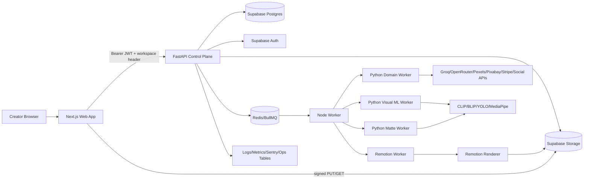
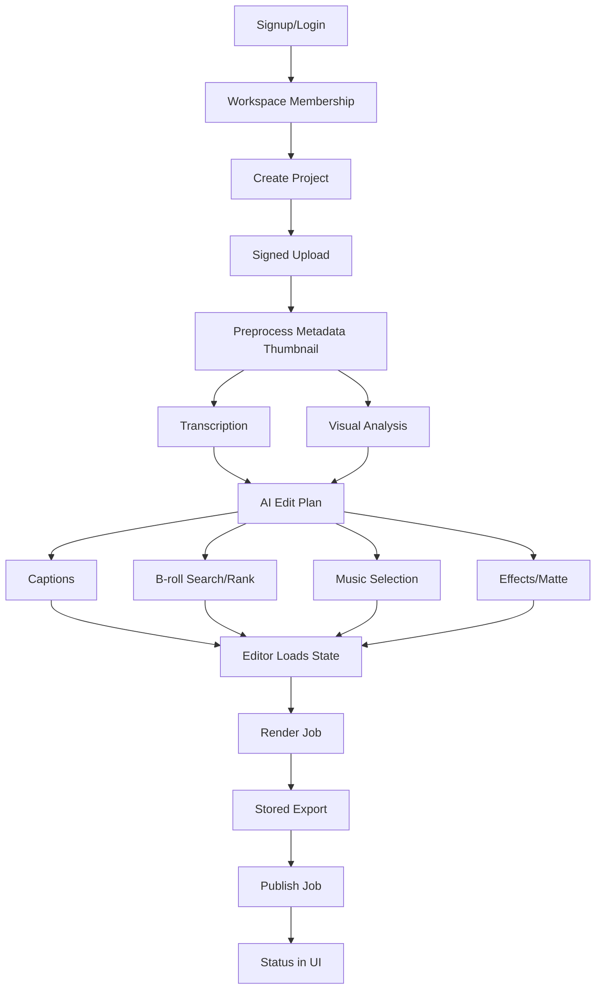
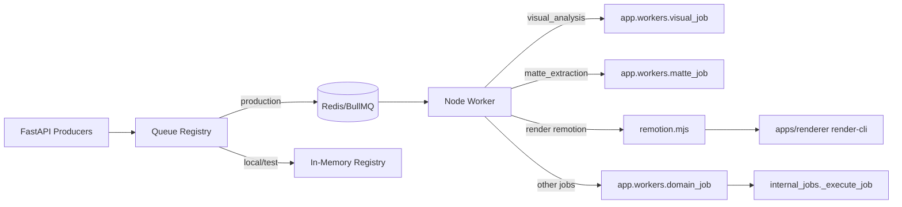
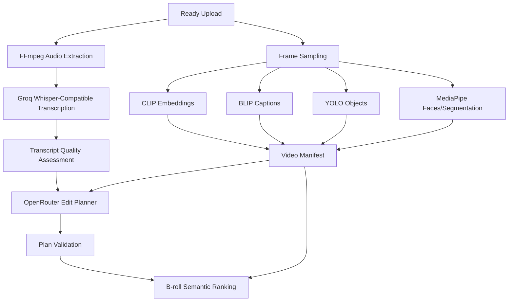
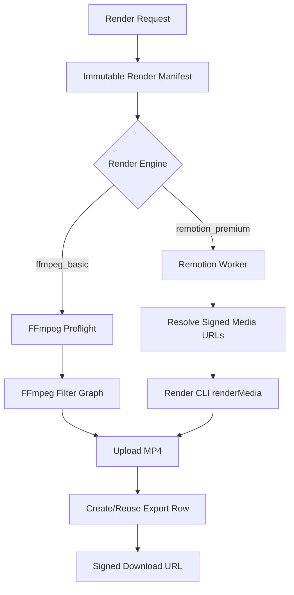
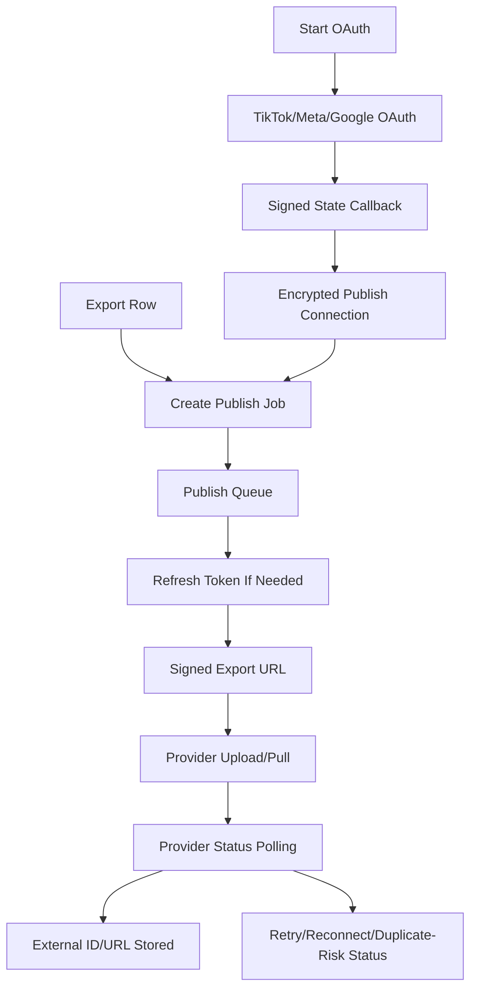

# Motionly Tech Stack and Architecture

Generated from repository inspection of `/workspaces/Motionly-claude/motionly-main/Motionly-main`. This document describes code that is present in the repo; uncertain or externally dependent behavior is called out as **Needs verification**.

## 1. Executive Summary

Motionly appears to be a short-form video creation and publishing product for creators. A user signs in, works inside a workspace, creates a project, uploads a source video, lets the system preprocess media, transcribe audio, analyze visuals, generate an AI edit plan, select captions/B-roll/music/effects, edit the timeline, render an export, and optionally publish that export to TikTok, Instagram, or YouTube.

The high-level architecture is a monorepo with these runtime surfaces:

| Surface                 | Role                                                                                             | Key files                                                                                                            |
| ----------------------- | ------------------------------------------------------------------------------------------------ | -------------------------------------------------------------------------------------------------------------------- |
| Next.js web app         | Authenticated UI, dashboard, editor, upload, export, billing, publishing                         | `apps/web/package.json`, `apps/web/app/(app)/projects/[projectId]/page.tsx`, `apps/web/components/editor-client.tsx` |
| FastAPI API             | Control plane, auth/tenancy checks, repository orchestration, provider adapters, queue producers | `apps/api/app/main.py`, `apps/api/app/api/*.py`, `apps/api/app/services/*.py`                                        |
| Node worker             | BullMQ consumers, persistent Python subprocess supervision, Remotion rendering handoff           | `apps/worker/src/worker.mjs`, `apps/worker/src/queue-common.mjs`, `apps/worker/src/remotion.mjs`                     |
| Python worker modules   | Domain jobs, visual ML inference, matte extraction                                               | `apps/api/app/workers/domain_job.py`, `apps/api/app/workers/visual_job.py`, `apps/api/app/workers/matte_job.py`      |
| Remotion renderer       | Premium React-based video renderer                                                               | `apps/renderer/src/render-cli.ts`, `apps/renderer/src/Composition.tsx`, `apps/renderer/src/components/*`             |
| Supabase                | Postgres, Auth, Storage, RLS, migrations                                                         | `supabase/migrations/*.sql`, `supabase/config.toml`                                                                  |
| Shared contract package | OpenAPI-derived TypeScript types                                                                 | `packages/shared/src/generated/api.ts`, `packages/shared/openapi.json`                                               |

The API uses Supabase-backed repositories when Supabase URL and service-role config are present, otherwise local/in-memory repositories for development and tests (`apps/api/app/main.py`). Production settings require Supabase JWT verification, service-role-backed workspace membership checks, Redis/BullMQ queueing, admin worker token, metrics token, and Sentry DSN (`apps/api/app/core/config.py`, `apps/api/app/main.py`).

## 2. Repository Structure

| Path              | Purpose                                                                        | Main technologies                                                                                   | Important entrypoints                                                                                                                       |
| ----------------- | ------------------------------------------------------------------------------ | --------------------------------------------------------------------------------------------------- | ------------------------------------------------------------------------------------------------------------------------------------------- |
| `apps/web`        | Product web UI, auth pages, dashboard, editor, billing, admin ops              | Next.js 16, React 19, Supabase SSR, Tailwind, Sentry, Playwright                                    | `apps/web/app/layout.tsx`, `apps/web/proxy.ts`, `apps/web/app/(app)/projects/[projectId]/page.tsx`, `apps/web/components/editor-client.tsx` |
| `apps/api`        | FastAPI backend/control plane, schemas, repositories, services, Python workers | Python 3.12, FastAPI, Pydantic, httpx, Redis, Uvicorn, optional Torch/MediaPipe/OpenCV/Transformers | `apps/api/app/main.py`, `apps/api/app/api/dependencies.py`, `apps/api/app/api/internal_jobs.py`, `apps/api/app/workers/*.py`                |
| `apps/worker`     | BullMQ consumers and media/render worker process                               | Node ESM, BullMQ, ioredis, Supabase JS, child_process                                               | `apps/worker/src/worker.mjs`, `apps/worker/src/queue-bridge.mjs`, `apps/worker/src/remotion.mjs`                                            |
| `apps/renderer`   | Remotion premium renderer                                                      | Remotion 4, React 19, TypeScript, Zod                                                               | `apps/renderer/src/render-cli.ts`, `apps/renderer/src/root.tsx`, `apps/renderer/src/Composition.tsx`                                        |
| `packages/shared` | Shared TypeScript types and generated OpenAPI contract                         | TypeScript, generated OpenAPI types                                                                 | `packages/shared/src/generated/api.ts`, `packages/shared/src/index.ts`, `packages/shared/openapi.json`                                      |
| `supabase`        | Active Supabase project config, migrations, SQL tests                          | Supabase/Postgres, SQL, RLS, Storage buckets                                                        | `supabase/migrations/*.sql`, `supabase/tests/*.sql`, `supabase/config.toml`                                                                 |
| `infra`           | Supporting infra examples and legacy migrations                                | Caddy, Docker Compose, Supabase Kong, SQL                                                           | `infra/docker-compose.gpu.yml`, `infra/Caddyfile`, `infra/migrations_legacy`                                                                |
| `docs`            | Operational, security, renderer, worker, retention docs                        | Markdown                                                                                            | `docs/operations.md`, `docs/ops/gpu-media-workers.md`, `docs/security/edit-plan-integrity.md`, `docs/workers/job-idempotency-matrix.md`     |
| `scripts`         | Operational verification scripts                                               | Shell, Node                                                                                         | `scripts/check_forward_migrations.sh`, `scripts/verify_backup_restore.sh`, `scripts/verify_prelaunch_evidence.mjs`                          |
| root              | Turborepo workspace and package orchestration                                  | pnpm, Turbo, TypeScript, Supabase CLI                                                               | `package.json`, `turbo.json`, `.env.example`                                                                                                |

## 3. Technology Stack Overview

| Area                      | Technology                                                               | Where used                                                          | Why it appears to be used                                     | Key files                                                                                                                             | Runtime/config requirements                                                     |
| ------------------------- | ------------------------------------------------------------------------ | ------------------------------------------------------------------- | ------------------------------------------------------------- | ------------------------------------------------------------------------------------------------------------------------------------- | ------------------------------------------------------------------------------- |
| Frontend                  | Next.js app router                                                       | Web app pages, protected routes, server actions                     | Server-render authenticated app with client editor islands    | `apps/web/package.json`, `apps/web/app/*`, `apps/web/proxy.ts`                                                                        | `SUPABASE_URL`, `SUPABASE_ANON_KEY`, API base URL env via `apps/web/lib/env.ts` |
| Frontend                  | React 19                                                                 | Editor, preview, dashboard, billing                                 | Interactive editor state and video preview                    | `apps/web/components/editor-client.tsx`, `apps/web/components/editor/preview/VideoPreview.tsx`                                        | Browser runtime                                                                 |
| Frontend                  | Tailwind CSS                                                             | UI styling                                                          | Pixel/retro-styled product UI                                 | `apps/web/app/globals.css`, `apps/web/tailwind.config.ts`                                                                             | PostCSS/Tailwind build                                                          |
| Frontend                  | Supabase SSR/JS                                                          | Web auth/session cookies and browser API token retrieval            | Login, session refresh, bearer token for API                  | `apps/web/lib/supabase/server.ts`, `apps/web/lib/supabase/browser.ts`, `apps/web/app/(auth)/actions.ts`                               | Supabase anon key and URL                                                       |
| Backend/API               | FastAPI                                                                  | All backend HTTP routes                                             | Python control plane and typed schemas                        | `apps/api/app/main.py`, `apps/api/app/api/*.py`                                                                                       | Python 3.12, Uvicorn                                                            |
| Backend/API               | Pydantic/Pydantic Settings                                               | Config and request/response schemas                                 | Runtime validation and OpenAPI generation                     | `apps/api/app/core/config.py`, `apps/api/app/schemas/*.py`                                                                            | Env vars listed in config                                                       |
| Database                  | Supabase Postgres                                                        | Workspace/project/media/plan/render/publish/billing/ops persistence | Multi-tenant relational data with RLS                         | `supabase/migrations/*.sql`, `apps/api/app/repositories/*.py`                                                                         | `SUPABASE_URL`, `SUPABASE_SERVICE_ROLE_KEY`, `SUPABASE_JWT_SECRET`              |
| Auth                      | Supabase Auth JWTs                                                       | Web session and API bearer verification                             | Authenticated users with workspace membership                 | `apps/api/app/services/auth.py`, `apps/api/app/api/dependencies.py`, `apps/web/proxy.ts`                                              | HS256 JWT secret or Supabase Auth API fallback                                  |
| Storage                   | Supabase Storage or local object storage                                 | Uploads, thumbnails, stock copies, exports, mattes                  | Private media storage with signed URLs                        | `apps/api/app/services/storage.py`, `apps/api/app/services/local_storage.py`, `apps/api/app/api/local_storage.py`                     | Supabase storage config or `FORCE_LOCAL_MEDIA_STORAGE` in non-prod              |
| Queue/job system          | BullMQ + Redis with in-memory fallback                                   | Async jobs and worker dispatch                                      | Production durable queues; local/test in-memory jobs          | `apps/api/app/services/queue.py`, `apps/worker/src/queue-common.mjs`, `apps/worker/src/queue-bridge.mjs`                              | `REDIS_URL` required in production                                              |
| Workers                   | Node BullMQ worker + Python subprocess modules                           | Queue consumption and media/ML execution                            | Isolate control plane from heavy media/ML workloads           | `apps/worker/src/worker.mjs`, `apps/api/app/workers/*.py`                                                                             | `ADMIN_API_TOKEN`, Supabase service-role env, Python command                    |
| AI/ML                     | Groq/OpenAI-compatible Whisper                                           | Transcription                                                       | Word-level transcript generation                              | `apps/api/app/services/transcription_provider.py`, `apps/api/app/services/transcription_jobs.py`                                      | `GROQ_API_KEY`, transcription model/provider env                                |
| AI/ML                     | OpenRouter/OpenAI-compatible chat                                        | Edit planning                                                       | Structured JSON edit plan generation                          | `apps/api/app/services/edit_planner.py`, `apps/api/app/services/edit_plan_validation.py`                                              | `OPENROUTER_API_KEY`, planner model/provider env                                |
| AI/ML                     | CLIP, BLIP-2, YOLO, MediaPipe, OpenCV, Torch                             | Visual intelligence and local embeddings                            | Frame embeddings, captions, object/faces, scene types, mattes | `apps/api/app/services/visual_intelligence.py`, `apps/api/app/services/stock_video.py`, `apps/api/app/services/segmentation_matte.py` | Optional `visual-ml` deps, model cache, GPU/CPU                                 |
| AI/ML                     | Pyannote, Wav2Vec, YAMNet, Demucs                                        | Audio intelligence and stem separation                              | Speaker/emotion/sound insights and music/dialogue separation  | `apps/api/app/services/audio_ml_providers.py`, `apps/api/app/services/audio_intelligence.py`, `apps/api/app/services/scale.py`        | Optional `audio-ml`/`demucs` deps and model tokens                              |
| Rendering                 | FFmpeg                                                                   | Basic render path and matte encoding                                | Captions, cuts, B-roll overlays, music/SFX, effects, exports  | `apps/api/app/services/ffmpeg_render.py`, `apps/api/app/services/render_jobs.py`                                                      | `ffmpeg` binary, optional NVENC GPU encoder                                     |
| Rendering                 | Remotion                                                                 | Premium render path                                                 | React composition rendering and complex effects               | `apps/renderer/src/render-cli.ts`, `apps/worker/src/remotion.mjs`                                                                     | Chromium/browser executable, renderer package, Supabase storage                 |
| Publishing                | TikTok, Meta Graph API, YouTube/Google APIs                              | OAuth and upload/poll publish jobs                                  | Social publishing from exports                                | `apps/api/app/services/publishing.py`, `apps/api/app/api/publishing.py`                                                               | Provider client IDs/secrets, token encryption key                               |
| Billing                   | Stripe                                                                   | Checkout, portal, webhooks, entitlements                            | Subscription and render quotas                                | `apps/api/app/services/billing.py`, `apps/api/app/api/billing.py`, `apps/web/app/(app)/billing/page.tsx`                              | `BILLING_ENABLED`, Stripe secret/webhook/price envs                             |
| Observability             | JSON logging, request IDs, traceparent, metrics registry, Sentry         | API/web error and request tracing                                   | Operational diagnostics and redaction                         | `apps/api/app/core/logging.py`, `apps/api/app/core/middleware.py`, `apps/web/instrumentation.ts`, `apps/api/app/api/operations.py`    | `SENTRY_DSN`, `METRICS_BEARER_TOKEN`, optional OTEL env                         |
| Testing                   | pytest, Node test runner, Playwright, renderer tests, Supabase SQL tests | API, web, worker, renderer, RLS coverage                            | Safety net across routes, queues, media, contracts            | `apps/api/tests/*`, `apps/web/tests/*`, `apps/worker/src/*.test.mjs`, `apps/renderer/src/*.test.*`, `supabase/tests/*.sql`            | Local deps, optional external services for integration tests                    |
| Deployment/infrastructure | Dockerfiles, GPU compose, Caddy, Supabase config                         | Containerized API/web/worker/GPU topology examples                  | Production-like runtime packaging                             | `apps/api/Dockerfile*`, `apps/web/Dockerfile`, `apps/worker/Dockerfile*`, `infra/docker-compose.gpu.yml`                              | Docker, GPU runtime for GPU images                                              |

## 4. Frontend Architecture

Motionly web is a Next.js app-router application. Protected pages are guarded by `apps/web/proxy.ts`, which refreshes Supabase cookies through `@supabase/ssr` and redirects unauthenticated users to `/login`. Local development can bypass middleware with `SKIP_AUTH_MIDDLEWARE=true`, but production validation rejects unsafe bypass settings in `apps/web/lib/env.ts` and tests in `apps/web/tests/config.test.mjs`.

### Key Frontend Components

| Component/file                                        | Purpose                                                        | API data consumed                                                                                                   | API data sent                                                             |
| ----------------------------------------------------- | -------------------------------------------------------------- | ------------------------------------------------------------------------------------------------------------------- | ------------------------------------------------------------------------- |
| `apps/web/app/(app)/dashboard/page.tsx`               | Loads workspace name and recent projects                       | `/projects`, optional active upload                                                                                 | None directly                                                             |
| `apps/web/components/DashboardClient.tsx`             | Project list UI and interactions                               | Initial project list                                                                                                | Project create/delete/update via API helpers                              |
| `apps/web/app/(app)/projects/[projectId]/page.tsx`    | Server-loads editor aggregate                                  | Project, upload URLs, transcript, captions, plans, B-roll, music, effects, renders, exports, billing, visual status | None directly                                                             |
| `apps/web/components/editor-client.tsx`               | Main editor coordinator                                        | All editor aggregate data                                                                                           | Plan/caption/timeline/state mutation through panel callbacks              |
| `apps/web/components/editor-layout.tsx`               | Responsive editor shell                                        | Editor state props                                                                                                  | UI selection/navigation events                                            |
| `apps/web/components/upload-panel.tsx`                | Browser preflight, signed upload, completion polling           | Upload init/complete/status/asset URL responses                                                                     | File metadata, upload completion/cancel                                   |
| `apps/web/components/editor/preview/VideoPreview.tsx` | Source media preview with captions/effects/matte approximation | Source URL, captions, B-roll, effects, matte preview state                                                          | Preview state callbacks                                                   |
| `apps/web/components/editor/tabs/captions-tab.tsx`    | Caption style, language, segment edits, highlights             | Transcript and caption tracks                                                                                       | Caption generation, caption track/segment patches, plan highlight patches |
| `apps/web/components/editor/tabs/broll-tab.tsx`       | B-roll generation, search, swap, region edits                  | B-roll slots and assets                                                                                             | B-roll generate/search/swap/region requests                               |
| `apps/web/components/editor/tabs/audio-tab.tsx`       | Music selection and SFX intensity                              | Music selection/tracks                                                                                              | Music select and region updates                                           |
| `apps/web/components/editor/tabs/look-tab.tsx`        | Effects, color grade, background removal, motion design        | Effects config, billing entitlements                                                                                | Effects config updates                                                    |
| `apps/web/components/editor/export-step.tsx`          | Render/export/publish UI                                       | Render jobs, exports, publish connections/jobs, billing caps                                                        | Render create/retry/cancel, download URL, publish connection/job actions  |
| `apps/web/components/editor/history-context.tsx`      | Local undo/redo stack                                          | Timeline/editor state                                                                                               | Serialized edits per project/workspace                                    |
| `apps/web/lib/client-api.ts`                          | Browser API request helper                                     | API error envelopes                                                                                                 | Bearer token, workspace header, JSON bodies                               |

### Frontend Data Flow

The project page retrieves a Supabase session, finds an active workspace membership, builds API headers, and fetches the full editor state from the FastAPI service (`apps/web/app/(app)/projects/[projectId]/page.tsx`). It passes `projectId`, `workspaceId`, `userId`, `apiAccessToken`, project title, upload summary, signed source/thumbnail URLs, transcript, caption tracks, edit plans, active plan ID, B-roll slots, music selection, effects config, render jobs, exports, billing entitlement max resolution, and visual status to `EditorClient`.

Client-side requests use `buildApiHeaders` and `editorApiRequest` in `apps/web/lib/client-api.ts`. These add the Supabase bearer token plus `x-motionly-workspace-id` and `x-motionly-user-id`. API failures are mapped to `EditorApiError` with request ID and friendly messages.

### Loading and Error States

Route-level loading files are present for dashboard, project detail, billing, and admin ops under `apps/web/app/(app)/*/loading.tsx`. Global client errors are caught by `apps/web/app/global-error.tsx`. Feature-level state is localized in `components/upload-panel.tsx`, `components/editor-client.tsx`, and `components/editor/export-step.tsx`.

## 5. Backend/API Architecture

The API is a FastAPI application assembled by `create_app()` in `apps/api/app/main.py`. The app:

- validates production settings (`apps/api/app/core/config.py`, `apps/api/app/main.py`);
- configures JSON logging (`apps/api/app/core/logging.py`);
- initializes Supabase or in-memory repositories (`apps/api/app/repositories/*.py`);
- creates provider adapters for Groq/OpenRouter/stock/music/Runway/publishing/Stripe (`apps/api/app/main.py`);
- creates in-memory or BullMQ queues (`apps/api/app/services/queue.py`);
- attaches request ID/rate-limit middleware (`apps/api/app/core/middleware.py`);
- registers domain routers (`apps/api/app/api/*.py`).

### API Route Groups

| Route group                                                              | Purpose                                                                    | Auth requirements                                         | Request data                                            | Response data                             | Downstream services                                                           | Key files                                                                                                          |
| ------------------------------------------------------------------------ | -------------------------------------------------------------------------- | --------------------------------------------------------- | ------------------------------------------------------- | ----------------------------------------- | ----------------------------------------------------------------------------- | ------------------------------------------------------------------------------------------------------------------ |
| `/health/*`                                                              | Liveness/readiness/deep dependency checks                                  | Public                                                    | None                                                    | Health/dependency status                  | Repositories, Redis, storage                                                  | `apps/api/app/api/health.py`                                                                                       |
| `/projects`                                                              | Project CRUD                                                               | Actor required                                            | Project title/status changes                            | Project records                           | Project repository                                                            | `apps/api/app/api/projects.py`                                                                                     |
| `/projects/{id}/uploads/*`                                               | Signed upload init, complete, cancel, active/read, asset URLs              | Actor + workspace                                         | File metadata, video ID, completion info                | Upload records, signed URLs               | Upload repository, storage signer, preprocess queue                           | `apps/api/app/api/uploads.py`, `apps/api/app/services/upload_jobs.py`                                              |
| `/projects/{id}/transcriptions`, `/transcript`, `/captions/*`            | Transcription and captions                                                 | Actor + workspace                                         | Language hints, caption settings, segment patches       | Transcript/caption tracks                 | Caption repo, transcription queue/provider, caption chunker                   | `apps/api/app/api/captions.py`, `apps/api/app/services/transcription_jobs.py`                                      |
| `/projects/{id}/visual/*`                                                | Visual status and analysis enqueue                                         | Actor + workspace                                         | Force analyze flags                                     | Visual status/manifest                    | Visual repo, visual queue, storage signer                                     | `apps/api/app/api/visual.py`, `apps/api/app/services/visual_jobs.py`                                               |
| `/projects/{id}/plans/*`                                                 | AI plans, polling, snapshots, activate, cuts, timeline compile             | Actor + workspace                                         | Planner settings, cut/manual/timeline patches           | Plan records, job status, timeline        | Plan repo, transcript/caption repo, visual repo, planner provider, plan queue | `apps/api/app/api/plans.py`, `apps/api/app/services/edit_planner.py`                                               |
| `/projects/{id}/broll/*`                                                 | User B-roll uploads, generation, slots, search/swap/region                 | Actor + workspace                                         | Slot/search/swap/upload metadata                        | Slots/assets/search results               | B-roll repo, stock providers, storage signer, B-roll queue                    | `apps/api/app/api/broll.py`, `apps/api/app/services/stock_video.py`                                                |
| `/projects/{id}/music/*`                                                 | Music selection, tracks, regions                                           | Actor + workspace                                         | Mood/selection/region payloads                          | Music selection/tracks                    | Music repo/providers, music queue                                             | `apps/api/app/api/music.py`, `apps/api/app/services/music.py`                                                      |
| `/projects/{id}/effects`                                                 | Visual/effects config                                                      | Actor + workspace                                         | Effects/background/motion settings                      | Effects config/job state                  | Effects repo, effects queue, matte enqueue                                    | `apps/api/app/api/effects.py`, `apps/api/app/services/effects.py`                                                  |
| `/projects/{id}/regenerate`                                              | Layered regeneration                                                       | Actor + workspace                                         | Regeneration layer/action/feedback                      | Regeneration job                          | Regeneration repo/queue                                                       | `apps/api/app/api/regeneration.py`                                                                                 |
| `/projects/{id}/renders`, `/exports/*`                                   | Render create/bulk, SSE/events, retry/cancel, export list/download/restore | Actor + workspace                                         | Render options, caption/plan/template IDs               | Render jobs, events, exports, signed URLs | Render repo, billing repo, render queue, storage signer, FFmpeg path          | `apps/api/app/api/renders.py`, `apps/api/app/services/render_jobs.py`                                              |
| `/publish/*`, `/projects/{id}/publish`                                   | OAuth, connections, publish jobs                                           | Actor + workspace except OAuth callback uses signed state | OAuth codes/state, connection payloads, publish payload | Connections/jobs/redirects                | Publishing repo, publish queue, OAuth/social clients                          | `apps/api/app/api/publishing.py`, `apps/api/app/services/publishing.py`                                            |
| `/billing/*`, `/webhooks/stripe`                                         | Billing status, checkout, portal, Stripe webhooks                          | Actor for user billing; Stripe signature for webhook      | Checkout/portal payloads, Stripe raw event body         | Billing status/session URLs/webhook ack   | Billing repo, Stripe client                                                   | `apps/api/app/api/billing.py`, `apps/api/app/services/billing.py`                                                  |
| `/admin/*`                                                               | Ops overview, queue retry/cancel, render admin retry/cancel                | Actor plus admin user/workspace or token                  | Queue/render IDs                                        | Queue/render/admin state                  | Queue registry, operations repo, render repo                                  | `apps/api/app/api/admin.py`                                                                                        |
| `/internal/jobs/*`                                                       | Worker domain job execution callback                                       | `x-motionly-worker-token`                                 | Queue job ID                                            | Worker run result                         | Repositories/services by job kind                                             | `apps/api/app/api/internal_jobs.py`                                                                                |
| `/internal/renders/*`                                                    | Worker render load/progress/failure/complete                               | `x-motionly-worker-token`                                 | Render IDs/progress/failure/complete payloads           | Render job/export state                   | Render repo/storage                                                           | `apps/api/app/api/internal_renders.py`                                                                             |
| `/internal/batches/*`, `/internal/retention/*`, `/internal/operations/*` | Batch, retention, heartbeat/SLO operations                                 | Worker/admin token                                        | Batch/retention/provider status                         | Operational result                        | Scale/retention/operations repos                                              | `apps/api/app/api/internal_batches.py`, `apps/api/app/api/internal_retention.py`, `apps/api/app/api/operations.py` |

Dependency injection is mostly explicit through `apps/api/app/api/dependencies.py`. Route handlers receive `Actor`, repositories, queues, providers, and storage signer through FastAPI `Depends`.

## 6. Database and Persistence Architecture

Supabase migrations define the canonical database schema. Repositories under `apps/api/app/repositories` access Supabase REST using the service-role key, while local tests/dev use in-memory equivalents. Client direct access is constrained by RLS policies in migrations, but most product reads/writes flow through the API service role.

| Entity/table                                                      | Purpose                               | Key fields inferred from code/migrations                                                     | Read/write services                          | Security/tenancy considerations                                                     |
| ----------------------------------------------------------------- | ------------------------------------- | -------------------------------------------------------------------------------------------- | -------------------------------------------- | ----------------------------------------------------------------------------------- |
| `profiles`                                                        | User profile metadata                 | `id`, `email`, `company`, `role`                                                             | Supabase auth/profile flows                  | RLS enabled; user owns profile (`202605300001_week_01_foundation.sql`)              |
| `workspaces`                                                      | Tenant boundary                       | `id`, `name`, `owner_user_id`                                                                | Web dashboard, project auth                  | RLS member read; API checks membership                                              |
| `workspace_members`                                               | Workspace membership and roles        | `workspace_id`, `user_id`, `role`, `status`                                                  | Auth dependency, dashboard membership lookup | Active membership required in `apps/api/app/services/auth.py`                       |
| `projects`                                                        | User projects                         | `id`, `workspace_id`, `created_by`, `title`, `status`, `active_video_id`                     | Project/upload/render/plan repos             | Project-scoped routes pass actor workspace                                          |
| `uploaded_videos`                                                 | Source uploads                        | `workspace_id`, `project_id`, `storage_bucket`, `storage_path`, status, metadata, thumbnail  | Upload/preprocess/render/caption repos       | Signed URLs generated only after workspace checks                                   |
| `upload_events`                                                   | Upload lifecycle history              | Upload/project/workspace event fields                                                        | Upload repository                            | Workspace RLS                                                                       |
| `transcripts`                                                     | Transcription result header           | `uploaded_video_id`, provider/model, status, confidence, quality fields                      | Caption repo, transcription jobs             | Workspace/project scoped                                                            |
| `transcript_words`                                                | Word-level timings                    | transcript ID, word text, start/end/confidence                                               | Caption repo                                 | Workspace policies via parent                                                       |
| `caption_tracks`/`caption_segments`                               | Generated/editable captions           | Track preset/style, segments, words, timings, highlights                                     | Caption API, render API                      | Cross-workspace checks in tests                                                     |
| `edit_plans`                                                      | AI edit plan versions                 | Plan JSON, summary, provider/model, planner source, retry/fallback metadata, active/version  | Plan repo/API, render API                    | Validation before writes; render-safe validation docs                               |
| `edit_plan_snapshots`                                             | Saved/restorable plan snapshots       | Source plan/version, name, notes, plan, summary                                              | Plan snapshot endpoints                      | Workspace RLS                                                                       |
| `stock_assets`                                                    | Stock video candidate records         | Provider IDs, URLs, dimensions, duration, score, metadata, owned-copy fields                 | B-roll repo, stock video service             | Owned stock copies use workspace/project storage paths                              |
| `broll_slots`                                                     | B-roll placement slots                | Plan/project, slot timing, asset selection, semantic metadata, status                        | B-roll repo/API, render API                  | Workspace/project scoped                                                            |
| `music_tracks`, `licensed_music_tracks`                           | Music catalog                         | Provider track IDs, license, duration, mood/BPM/energy, raw metadata                         | Music repo/provider                          | Catalog may be global or workspace-specific; Needs verification for catalog tenancy |
| `project_music_selections`                                        | Project music/SFX config              | Track ID, volume, SFX intensity, regions                                                     | Music repo, render API                       | Workspace/project scoped                                                            |
| `visual_presets`                                                  | Effects/color/motion config           | Preset key, values, motion/background config                                                 | Effects repo/API, render API                 | Workspace/project scoped                                                            |
| `project_control_settings`                                        | User control preferences              | Caption/B-roll/music/effects/duration knobs                                                  | Regeneration/plan services                   | Workspace/project scoped                                                            |
| `artifact_versions`                                               | Versioning for artifacts              | Project/layer/version payloads                                                               | Regeneration/plans                           | Workspace RLS                                                                       |
| `video_manifests`                                                 | Visual analysis output                | Uploaded video ID, provider/model, manifest JSON, status/version/error                       | Visual repo/worker/planner                   | Workspace/project/video scoped                                                      |
| `segmentation_mattes`                                             | Matte extraction cache/status         | Upload/effects cache key, status, storage path, preview, error                               | Matte jobs, visual status, render            | Workspace RLS; cache collapses duplicate pending work                               |
| `render_jobs`                                                     | Render queue/job record               | Upload/caption IDs, status, manifest, specs, engine, progress, artifact/error/logs           | Render repo/API, workers                     | Duplicate export prevention; workspace checked before access                        |
| `render_job_events`                                               | Render status history                 | Render job ID, status transition, progress, metadata                                         | Render repo/API/workers                      | Workspace/project scoped                                                            |
| `exports`                                                         | Rendered MP4 artifacts                | Render job ID, version, storage bucket/path, format, dimensions, file size                   | Render repo/API, publishing                  | Signed download URL after workspace check                                           |
| `publish_connections`                                             | Social account credentials            | Platform, account ID/name, encrypted tokens, status/refresh fields                           | Publishing repo/API                          | Tokens encrypted by `TokenCipher`; no broad client policy per migration comments    |
| `publish_jobs`                                                    | Social publish lifecycle              | Export/connection IDs, platform, status, title/caption/privacy, external IDs, retry metadata | Publishing repo/API/worker                   | Active duplicate publish blocked by API and partial unique index                    |
| `subscriptions`                                                   | Workspace billing state               | Plan, status, Stripe customer/subscription/price, period, flags                              | Billing repo/API/webhooks                    | Workspace RLS; service role writes webhook updates                                  |
| `usage_ledger`                                                    | Usage accounting                      | Event type, workspace, quantity, period/outcome metadata                                     | Billing/render/operations services           | Workspace RLS                                                                       |
| `stripe_webhook_events`                                           | Webhook idempotency                   | Event ID/type                                                                                | Billing webhook                              | Prevents duplicate Stripe application                                               |
| `billing_adjustments`                                             | Refund/adjustment records             | Workspace, Stripe refund/event, amount/reason                                                | Billing services                             | Workspace RLS                                                                       |
| `phase5_resources`                                                | Scale/intelligence resources          | Kind, payload/result, status, revision/error                                                 | Scale API/jobs                               | Workspace RLS                                                                       |
| `worker_heartbeats`                                               | Worker liveness                       | Worker ID, role, queue, heartbeat timestamp                                                  | Operations API/worker                        | Service-role operations                                                             |
| `provider_slo_events`                                             | Provider latency/failure events       | Provider, operation, status/latency/error                                                    | Operations/provider services                 | Used for SLO/cost observability                                                     |
| `cost_attribution_events`                                         | Provider/storage/render cost tracking | Workspace/project/render/export/provider/category/quantity                                   | Operations/billing/render                    | Used for quota/cost dashboards                                                      |
| `retention_runs`, `storage_deletion_queue`                        | Data retention and deletion workflow  | Run/deletion status and object paths                                                         | Retention service/internal route             | Service-role only per migrations                                                    |
| `launch_feedback`, `ai_edit_feedback_events`, `launch_ops_events` | Feedback/analytics/ops events         | User/project/layer/rating/event payloads                                                     | Feedback/analytics/operations repos          | Workspace RLS or API-only writes                                                    |

## 7. Auth, Tenancy, and Security Architecture

Identity starts in Supabase Auth. The web app reads Supabase sessions via `apps/web/lib/supabase/server.ts` and `apps/web/lib/supabase/browser.ts`. API calls include `Authorization: Bearer <Supabase access token>` and `x-motionly-workspace-id` (`apps/web/lib/client-api.ts`).

On the API:

- `get_actor` verifies the JWT with `SUPABASE_JWT_SECRET` and requires `x-motionly-workspace-id` (`apps/api/app/api/dependencies.py`).
- If token algorithm is unsupported for local verification, the API can verify through Supabase Auth API when `SUPABASE_URL` and service role key are present (`apps/api/app/services/auth.py`).
- `require_workspace_membership` checks `workspace_members` for active membership before constructing `Actor` (`apps/api/app/services/auth.py`).
- Route handlers pass `actor.workspace_id` to repository reads/writes; tests cover cross-workspace denial (`apps/api/tests/security/test_phase0_tenancy.py`, `apps/api/tests/test_auth_projects_storage.py`).
- `SKIP_API_AUTH` is allowed only in `development` or `local`; production/staging-like settings fail closed if auth or membership config is missing (`apps/api/app/core/config.py`, `apps/api/tests/test_config.py`).
- Internal worker/admin routes use `x-motionly-worker-token` or admin token/allowlists (`apps/api/app/api/internal_jobs.py`, `apps/api/app/api/admin.py`).
- Signed upload/download URLs are generated after project/workspace ownership checks (`apps/api/app/api/uploads.py`, `apps/api/app/api/renders.py`, `apps/api/app/services/storage.py`).
- Provider credentials and signed URLs are redacted from logs (`apps/api/app/core/logging.py`, `apps/api/tests/test_phase12_security.py`).
- Publishing tokens are encrypted at rest with `TokenCipher` and migrated/encrypted by the Supabase publishing repository (`apps/api/app/services/token_cipher.py`, `apps/api/app/repositories/publishing.py`).

**Needs verification:** Internal worker routes appear to compare against the admin API token. Confirm whether admin and worker tokens are intentionally shared or should be separated before production.

## 8. AI/ML Architecture

| Component                           | Purpose                                          | Input data                                                      | Output data                                                                          | Model/provider                                                | Called from                                      | Stored in                                                           | Fallback/failure behavior                                                                                                              | Key files/tests                                                                                                                                                                        |
| ----------------------------------- | ------------------------------------------------ | --------------------------------------------------------------- | ------------------------------------------------------------------------------------ | ------------------------------------------------------------- | ------------------------------------------------ | ------------------------------------------------------------------- | -------------------------------------------------------------------------------------------------------------------------------------- | -------------------------------------------------------------------------------------------------------------------------------------------------------------------------------------- |
| Transcription                       | Generate word-level transcript                   | Uploaded video audio WAV, language hint                         | Transcript words, language, confidence, raw payload, quality status                  | Groq/OpenAI-compatible Whisper or fixture                     | Captions API and worker job                      | `transcripts`, `transcript_words`                                   | Retries HTTP errors with circuit breaker; no-audio becomes `captions_unavailable`; extraction/provider failure marks transcript failed | `apps/api/app/services/transcription_provider.py`, `apps/api/app/services/transcription_jobs.py`, `apps/api/tests/test_captions.py`, `apps/api/tests/test_phase3_ai_ml_reliability.py` |
| Transcript quality                  | Gate planning/captions based on quality          | Words, duration, confidence, language, raw payload              | `OK`, `LOW_CONFIDENCE`, `PARTIAL`, `EMPTY`, `AUDIO_FAILED` plus reasons              | Deterministic checks                                          | Transcription job, captions/plans APIs           | Transcript quality fields                                           | Empty/audio-failed/partial block automatic planning/captions; low-confidence is flagged but still usable                               | `apps/api/app/services/transcript_quality.py`, `apps/api/app/api/plans.py`, `apps/api/app/api/captions.py`                                                                             |
| Edit planning                       | Generate structured edit plan                    | Transcript, plan settings, visual manifest, audio/style signals | `EditPlan`, summary, provider metadata                                               | OpenRouter/OpenAI-compatible chat or fixture planner          | Plans API/job                                    | `edit_plans`                                                        | Attempts `llm`, `llm_retry`, `llm_minimal`; deterministic fallback records fallback metadata                                           | `apps/api/app/services/edit_planner.py`, `apps/api/app/services/edit_plan_validation.py`, `apps/api/tests/test_plans.py`                                                               |
| Plan schema validation              | Keep generated plans render-safe                 | Raw LLM JSON or plan model                                      | Validated `EditPlan` or validation errors                                            | Pydantic + custom bounds checks                               | Planner, plan repo, render path                  | N/A or persisted valid plan                                         | Missing fields, stale schema/prompt, overlaps, out-of-bounds ranges fail validation                                                    | `apps/api/app/services/edit_plan_validation.py`, `docs/security/edit-plan-integrity.md`                                                                                                |
| Visual intelligence                 | Build video manifest                             | Source video, metadata, sample FPS, scene threshold             | Frame samples, embeddings, captions, objects, faces, colors, motion, scenes, summary | CLIP, BLIP-2, YOLOv8, MediaPipe, OpenCV, Torch or fixture     | Visual API/job, planner/B-roll                   | `video_manifests`                                                   | API provider sentinel requires GPU worker for real inference; CUDA OOM maps to `cuda_oom` after cache cleanup                          | `apps/api/app/services/visual_intelligence.py`, `apps/api/app/workers/visual_job.py`, `apps/api/tests/test_visual.py`                                                                  |
| CLIP embeddings                     | Semantic frame/query matching                    | Frames or stock/query text                                      | Numeric embeddings                                                                   | Local CLIP or compatible hash fallback for stock embeddings   | Visual intelligence, stock ranking               | Manifest scenes/frames, B-roll metadata                             | Stock embedding provider falls back to hash embeddings if local CLIP unavailable                                                       | `apps/api/app/services/visual_intelligence.py`, `apps/api/app/services/stock_video.py`                                                                                                 |
| B-roll semantic enrichment/ranking  | Generate/search/select B-roll slots              | Edit plan B-roll requests, visual manifest, stock results       | Slots with selected assets, semantic metadata, scores                                | Pexels/Pixabay/fixture plus semantic ranking                  | B-roll API/jobs, render manifest                 | `stock_assets`, `broll_slots`                                       | Provider errors are recorded; fixture allowed outside production or when enabled; stock copies ingested into owned storage             | `apps/api/app/services/broll_intelligence.py`, `apps/api/app/services/stock_video.py`, `apps/api/app/api/broll.py`, `apps/api/tests/test_broll.py`                                     |
| Music selection/audio intelligence  | Select music and infer audio style               | Plan/audio signals, catalog tracks                              | Music selection, regions, SFX intensity                                              | Licensed catalog or fixture; optional Pyannote/Wav2Vec/YAMNet | Music API/jobs, planner, render                  | `project_music_selections`, `music_tracks`, `licensed_music_tracks` | Fixture in non-prod; catalog requires Supabase config                                                                                  | `apps/api/app/services/music.py`, `apps/api/app/services/audio_intelligence.py`, `apps/api/tests/test_music.py`                                                                        |
| Effects/motion design               | Generate/update visual preset and motion effects | Plan/style/user settings                                        | Effects config, background removal request                                           | Deterministic service; matte job for background removal       | Effects API/jobs, render                         | `visual_presets`, `segmentation_mattes`                             | Premium effects enforced when billing enabled; matte jobs can fail/retry                                                               | `apps/api/app/services/effects.py`, `apps/api/app/services/layer_jobs.py`, `apps/api/tests/test_effects.py`                                                                            |
| Matte extraction/background removal | Create segmentation matte for source             | Uploaded video, effects settings/cache key                      | Matte video/preview storage paths and status                                         | MediaPipe selfie segmentation + FFmpeg                        | Matte queue/Python worker, visual status, render | `segmentation_mattes`, storage                                      | Cache collapses duplicates; recoverable failures stored; render detects available/unavailable states                                   | `apps/api/app/services/matte_jobs.py`, `apps/api/app/services/segmentation_matte.py`, `apps/api/app/workers/matte_job.py`, `apps/api/tests/test_phase4_gpu_media_workers.py`           |
| Provider resilience                 | Prevent provider floods and normalize failures   | Provider exceptions/status codes                                | Retryable error info, backoff, circuit-open state                                    | Deterministic service                                         | Transcription/planner/publishing provider calls  | Provider SLO events                                                 | Timeout/network/429/5xx retry; auth/quota/request rejected usually terminal                                                            | `apps/api/app/services/provider_resilience.py`, `apps/api/tests/test_phase3_ai_ml_reliability.py`                                                                                      |

**Needs verification:**

- Production visual-worker images must preload or have access to CLIP/BLIP/YOLO weights. Code uses local model loading; stock embeddings can hash-fallback (`apps/api/app/services/stock_video.py`).
- “Low-confidence transcript gates” are not hard blocks for `LOW_CONFIDENCE`; only empty/audio-failed/partial are blocked by `is_transcript_usable_for_planning` (`apps/api/app/services/transcript_quality.py`).

## 9. External Provider Integrations

| Provider                                  | Feature/function                                                | Data sent                                                                               | Data received                                        | User media/transcripts sent?                                                                 | Auth/config/env vars                                                                    | Retry/fallback behavior                                                                 | Failure behavior                                                          | Key files/tests                                                                                                                               |
| ----------------------------------------- | --------------------------------------------------------------- | --------------------------------------------------------------------------------------- | ---------------------------------------------------- | -------------------------------------------------------------------------------------------- | --------------------------------------------------------------------------------------- | --------------------------------------------------------------------------------------- | ------------------------------------------------------------------------- | --------------------------------------------------------------------------------------------------------------------------------------------- |
| Supabase                                  | Auth, Postgres REST, Storage signed URLs/download/upload        | JWTs, service-role REST queries, storage object paths/content                           | User/session, DB records, signed URLs, media objects | Yes, media stored in Supabase Storage; transcripts/plans in DB                               | `SUPABASE_URL`, `SUPABASE_ANON_KEY`, `SUPABASE_SERVICE_ROLE_KEY`, `SUPABASE_JWT_SECRET` | In-memory/local storage fallback outside production                                     | Production fails closed if missing                                        | `apps/api/app/main.py`, `apps/api/app/services/auth.py`, `apps/api/app/services/storage.py`, `apps/web/lib/supabase/*`, `supabase/migrations` |
| Stripe                                    | Checkout, customer portal, webhooks, subscription sync          | Workspace/plan/price/customer metadata, raw webhook bodies                              | Checkout/portal URLs, webhook events                 | No media/transcripts                                                                         | `STRIPE_SECRET_KEY`, `STRIPE_WEBHOOK_SECRET`, `STRIPE_PRICE_*`, `BILLING_ENABLED`       | Webhook idempotency through `stripe_webhook_events`                                     | Missing/bad signature rejected; disabled billing returns 503              | `apps/api/app/services/billing.py`, `apps/api/app/api/billing.py`, `apps/api/tests/test_billing.py`                                           |
| Groq                                      | Whisper-compatible transcription                                | Extracted audio WAV, language hint, model                                               | Word-level transcript JSON                           | Yes, extracted audio is sent                                                                 | `GROQ_API_KEY`, `TRANSCRIPTION_PROVIDER`, `TRANSCRIPTION_MODEL`                         | 3 attempts, bounded backoff, circuit breaker; fixture fallback if no key/non-prod setup | Transcript marked failed with safe error                                  | `apps/api/app/services/transcription_provider.py`, `apps/api/tests/test_provider_contracts.py`                                                |
| OpenRouter                                | Chat completions for edit plan                                  | Transcript words, plan prompt/settings, visual/audio/style context, schema instructions | JSON edit plan, usage metadata                       | Yes, transcript/context sent                                                                 | `OPENROUTER_API_KEY`, `EDIT_PLANNER_PROVIDER`, `EDIT_PLANNER_MODEL`                     | `llm`, `llm_retry`, `llm_minimal`, deterministic fallback                               | Validation/provider failures recorded in plan metadata                    | `apps/api/app/services/edit_planner.py`, `apps/api/tests/test_plans.py`                                                                       |
| Runway                                    | Generated B-roll/scale resources                                | Prompt/image/resource payloads                                                          | Generated resource/job result                        | Potentially image URLs/prompts; exact media flow Needs verification                          | `RUNWAY_API_KEY`, `RUNWAY_MODEL`, quota envs                                            | Fixture provider if no key; cost/quota checks                                           | Quota blocks with 402; provider failures tracked                          | `apps/api/app/services/scale.py`, `apps/api/app/api/scale.py`, `apps/api/tests/test_phase10_cost_controls.py`                                 |
| Pexels                                    | Stock video search/ingest                                       | Search query/orientation/min dimensions; selected download URL fetched                  | Video candidates, metadata, URLs                     | No user source media; semantic query derived from plan/transcript/visual context may be sent | `PEXELS_API_KEY`, `STOCK_VIDEO_PROVIDER`                                                | Provider errors collected; fixture fallback outside production                          | B-roll generation may continue with other providers/fixtures              | `apps/api/app/services/stock_video.py`, `apps/api/app/api/broll.py`, `apps/api/tests/test_broll.py`                                           |
| Pixabay                                   | Stock video search/ingest                                       | Search query/orientation/min dimensions                                                 | Video candidates, metadata, URLs                     | No user source media; semantic query may be sent                                             | `PIXABAY_API_KEY`, `STOCK_VIDEO_PROVIDER`                                               | Same as Pexels                                                                          | Same as Pexels                                                            | `apps/api/app/services/stock_video.py`                                                                                                        |
| Meta Graph API                            | Instagram OAuth, Reels media container/status/publish/permalink | OAuth codes, tokens, video signed URL, caption/title                                    | Tokens/account info/media IDs/permalink/status       | Export signed URL is sent to Meta for pull upload                                            | `META_APP_ID`, `META_APP_SECRET`, `META_GRAPH_API_VERSION`                              | Token refresh for long-lived/page tokens; publish retry metadata                        | Reconnect for auth/scope; duplicate-risk on uncertain processing failures | `apps/api/app/services/publishing.py`, `apps/api/tests/test_publishing.py`                                                                    |
| YouTube/Google APIs                       | YouTube OAuth and resumable upload                              | OAuth code/tokens, export bytes/URL flow, metadata                                      | Channel info, video ID/status                        | Export media is uploaded to YouTube                                                          | `GOOGLE_CLIENT_ID`, `GOOGLE_CLIENT_SECRET`                                              | Refresh token before expiry; retry mapping                                              | Reconnect when refresh missing/expired                                    | `apps/api/app/services/publishing.py`                                                                                                         |
| TikTok APIs                               | TikTok OAuth, pull-from-URL publish/status polling              | OAuth code/tokens, export signed URL, caption/privacy                                   | Account info, publish ID/status                      | Export signed URL sent to TikTok                                                             | `TIKTOK_CLIENT_KEY`, `TIKTOK_CLIENT_SECRET`                                             | Refresh token; status polling; retry/rate-limit mapping                                 | Reconnect/auth failure, duplicate-risk on processing uncertainty          | `apps/api/app/services/publishing.py`                                                                                                         |
| Sentry                                    | Web/API error capture                                           | Error/event metadata                                                                    | Error dashboards                                     | No intentional media/transcripts; Needs verification for captured payload filtering          | `SENTRY_DSN`, `NEXT_PUBLIC_SENTRY_DSN`                                                  | Disabled if DSN absent                                                                  | No capture if absent                                                      | `apps/web/instrumentation.ts`, `apps/web/sentry.server.config.ts`, `apps/api/app/core/config.py`                                              |
| TensorFlow Hub/Hugging Face model sources | Audio/visual model loading                                      | Model names/requests during dependency/model load                                       | Model weights                                        | No user media unless model APIs are remote; code imports local ML libs                       | `PYANNOTE_AUTH_TOKEN`, model envs                                                       | Missing deps map to service errors                                                      | Visual/audio ML unavailable if dependencies missing                       | `apps/api/app/services/visual_intelligence.py`, `apps/api/app/services/audio_ml_providers.py`                                                 |

## 10. Worker and Queue Architecture

The API owns job creation; the worker owns execution. `apps/api/app/services/queue.py` provides both an in-memory registry and a `BullMQQueueRegistry` that invokes `apps/worker/src/queue-bridge.mjs`. Production requires `REDIS_URL` (`apps/api/app/main.py`).

The Node worker creates BullMQ workers per queue (`apps/worker/src/worker.mjs`). It routes:

- `visual_analysis` to a persistent Python `app.workers.visual_job`;
- `matte_extraction` to persistent Python `app.workers.matte_job`;
- Remotion render jobs to `apps/worker/src/remotion.mjs`;
- other domain jobs to `app.workers.domain_job`, which delegates to the API internal job execution function.

| Job type                 | Queue                                     | Producer                                 | Consumer                                             | Inputs                                    | Outputs                                                   | Idempotency key                               | Retry behavior                                                             | Failure state                                     |
| ------------------------ | ----------------------------------------- | ---------------------------------------- | ---------------------------------------------------- | ----------------------------------------- | --------------------------------------------------------- | --------------------------------------------- | -------------------------------------------------------------------------- | ------------------------------------------------- |
| `video_preprocess`       | `upload_preprocess`                       | Upload completion API                    | Python domain job                                    | Workspace/project/video IDs               | Metadata, thumbnail, upload ready/failed, downstream jobs | Deterministic upload/project/workspace job ID | BullMQ attempts/backoff; internal backoff in `internal_jobs.py`            | Upload failed/job dead-letter                     |
| `transcription`          | `transcription`                           | Captions/transcription API or preprocess | Python domain job                                    | Upload IDs, language hint                 | Transcript/words/quality                                  | Deterministic video job ID                    | Provider retries plus queue attempts                                       | Transcript failed                                 |
| `caption_generation`     | `transcription`                           | Captions API                             | Python domain job                                    | Transcript/caption settings               | Caption track/segments                                    | Deterministic project/job ID                  | Queue attempts                                                             | Caption job failed                                |
| `visual_analysis`        | `visual_analysis`                         | Visual API/preprocess                    | Persistent Python visual worker                      | Upload IDs                                | Video manifest                                            | Deterministic video job ID                    | Queue attempts; CUDA OOM classified                                        | Manifest failed                                   |
| `matte_extraction`       | `matte_extraction`                        | Effects/layer job                        | Persistent Python matte worker                       | Upload/effects cache key                  | Matte storage path/status/preview                         | Matte cache key/job ID                        | Queue attempts; recoverable failure metadata                               | Matte failed                                      |
| `edit_plan`              | `planning`                                | Plans API                                | Python domain job                                    | Transcript, plan settings, style/template | Edit plan and job status                                  | Project/workspace/job ID                      | LLM retry/fallback plus queue attempts                                     | Plan job failed or fallback persisted             |
| `broll_generation`       | `stock_search`                            | B-roll API                               | Python domain job                                    | Plan/B-roll requests, provider config     | Stock assets and slots                                    | Project/plan/cache key                        | Queue attempts; provider errors stored                                     | Slot failure or no candidates                     |
| `stock_asset_enrichment` | `stock_asset_enrichment`                  | Stock enrichment service                 | Needs verification                                   | Asset/query info                          | Enriched embeddings/metadata                              | Asset ID                                      | Needs verification                                                         | Needs verification                                |
| `music_selection`        | `audio`                                   | Music API                                | Python domain job                                    | Plan/music settings                       | Music selection/tracks/regions                            | Project/plan/cache key                        | Queue attempts                                                             | Selection failed                                  |
| `effects_config`         | `render`                                  | Effects API                              | Python domain job                                    | Effects settings                          | Visual preset, matte enqueue                              | Project/settings cache                        | Queue attempts                                                             | Effects failed                                    |
| `render`                 | `render`, `render_gpu`, `render_remotion` | Render API                               | Python domain job for FFmpeg or Node Remotion worker | Render job ID, manifest, engine           | Export, render events                                     | `RenderQueue.job_id_for_render`               | BullMQ attempts; FFmpeg 720p fallback; Remotion worker failure persistence | Render failed/canceled/dead-letter                |
| `publish`                | `publish`                                 | Publishing API                           | Python/domain publish execution via worker           | Publish job ID/export/connection          | External post IDs/URLs/status                             | Publish job ID                                | Provider retry/backoff persisted; BullMQ attempts                          | Publish failed/retry_scheduled/reconnect_required |
| `phase5`, `batch_plan`   | `intelligence` or `provider_calls`        | Scale API                                | Python domain job                                    | Scale/batch payloads                      | Phase5 resource results                                   | Resource/batch ID                             | Queue attempts                                                             | Resource failed/canceled                          |
| `layer_regeneration`     | `planning`                                | Regeneration API                         | Python domain job                                    | Layer/action/feedback                     | Updated downstream artifacts                              | Project/layer job ID                          | Queue attempts                                                             | Regeneration failed                               |
| retention                | `maintenance`                             | Worker maintenance loop                  | Python domain/internal retention route               | Retention settings                        | Deletion queue/run records                                | Maintenance job                               | Needs verification                                                         | Retention run failed                              |

Structured worker events are logged as JSON from `apps/worker/src/worker.mjs`, including subprocess start/restart/failure, job routing, stalled jobs, and Remotion events. Python subprocess supervision has heartbeat, restart backoff, restart caps, and protocol validation.

**Needs verification:**

- `stock_asset_enrichment` exists in Python queue classes but was reported as absent from `allQueueNames` in `apps/worker/src/queue-common.mjs`.
- Automatic production scheduling of `recover-stuck` was not found.
- Non-render cancellation after a Python domain job starts is not clearly enforced.
- Publish service-level `retry_scheduled` persistence may require an external scheduler/reenqueue path.

## 11. Rendering and Export Architecture

Motionly has two render engines:

- `ffmpeg_basic`: API/Python worker invokes FFmpeg through `apps/api/app/services/render_jobs.py` and `apps/api/app/services/ffmpeg_render.py`.
- `remotion_premium`: Node worker invokes `apps/worker/src/remotion.mjs`, which spawns `apps/renderer/src/render-cli.ts`.

### Render Input Structure

The render API builds a render job manifest from:

- active upload/source video (`apps/api/app/api/renders.py`);
- caption track and retimed caption segments;
- active edit plan cuts and timeline;
- selected B-roll assets and retimed placements;
- music/SFX selection and regions;
- effects/motion/background-removal config;
- output specs, platform preset, aspect/fit/crop, template, entitlement constraints;
- render engine and compute tier.

### Render Output Structure

Outputs are:

- `render_jobs` status/progress/events;
- an MP4 in export storage at deterministic paths like `workspaces/{workspace_id}/projects/{project_id}/exports/{render_job_id}.mp4`;
- an `exports` DB row with version, dimensions, FPS, duration, file size, settings summary;
- a signed download URL generated on demand.

### FFmpeg Path

`complete_render_job` transitions job status through preparing, rendering, uploading, complete (`apps/api/app/services/render_jobs.py`). Preflight resolves source assets, checks temp/export writability, validates source, ASS captions, B-roll/music assets, and checks cancellation. `FFmpegCaptionRenderer.render` builds a filter graph for cuts, framing, captions, B-roll overlays, manual elements, effects, matte background removal, watermark, music, dialogue, SFX, and encoder options (`apps/api/app/services/ffmpeg_render.py`). FFmpeg failures can fall back to 720p when appropriate (`apps/api/app/services/render_jobs.py`).

### Remotion Path

`apps/worker/src/remotion.mjs` loads the render job directly from Supabase, resolves `supabase://` media references to signed URLs, filters fixture assets, writes Remotion props to a temp JSON file, spawns the renderer CLI, uploads the MP4 to Supabase Storage, finalizes the render job/export rows, and cleans up temp files. The renderer CLI bundles/caches the Remotion composition and calls `renderMedia` using system Chrome if configured (`apps/renderer/src/render-cli.ts`). Tests check Remotion smoke/cancellation contracts (`apps/worker/src/remotion-smoke-contract.test.mjs`) and renderer timeline/golden/encoded behavior (`apps/renderer/src/*.test.*`).

### Known Failure Reasons

| Failure                               | Source                                                                                                                                  |
| ------------------------------------- | --------------------------------------------------------------------------------------------------------------------------------------- |
| `ffmpeg_unavailable`                  | Missing FFmpeg binary in `apps/api/app/services/ffmpeg_render.py`                                                                       |
| `ffmpeg_render_failed`                | FFmpeg non-zero exit, stderr tail preserved                                                                                             |
| `render_output_empty`                 | Rendered MP4 missing/empty                                                                                                              |
| `missing_source_video`                | Source object unavailable during preflight                                                                                              |
| invalid ASS/render props              | Preflight validation in `apps/api/app/services/render_jobs.py`                                                                          |
| `render_cancelled`                    | API or worker cancellation checks                                                                                                       |
| fixture media in production Remotion  | `apps/renderer/src/render-cli.ts`, `apps/worker/src/remotion.mjs`                                                                       |
| Chromium/browser missing for Remotion | Needs runtime verification; docs note Chromium requirement in `motionly-production-readiness-work-plan.md` and tests in worker/renderer |
| matte unavailable/failed              | Render can detect matte availability states; tests in `apps/api/tests/test_phase4_gpu_media_workers.py`                                 |

## 12. Publishing Architecture

Publishing supports TikTok, Instagram, and YouTube (`supabase/migrations/202606210002_phase_4_publishing.sql`, `apps/api/app/schemas/publishing.py`).

| Platform  | Required token/scopes                                                                                                        | Upload flow                                                                                                                 | Status flow                                                   | Failure mapping                                                                   | Key files/tests                                                                                              |
| --------- | ---------------------------------------------------------------------------------------------------------------------------- | --------------------------------------------------------------------------------------------------------------------------- | ------------------------------------------------------------- | --------------------------------------------------------------------------------- | ------------------------------------------------------------------------------------------------------------ |
| TikTok    | OAuth scopes `user.info.basic,video.publish,video.upload`; client key/secret                                                 | API starts OAuth, exchanges code, stores encrypted tokens, publish job sends signed export URL to TikTok pull-from-URL init | Polls `/v2/post/publish/status/fetch/` up to configured loops | Rate limit retry, auth/scope reconnect, processing failure/timeout duplicate-risk | `apps/api/app/services/publishing.py`, `apps/api/app/api/publishing.py`, `apps/api/tests/test_publishing.py` |
| Instagram | Meta OAuth scopes `instagram_basic`, `instagram_content_publish`, `pages_show_list`, `pages_read_engagement`; Meta app creds | Creates media container with Reels video URL and caption, then publishes container                                          | Polls container `status_code`, then fetches permalink         | Processing failure/timeout duplicate-risk; auth/scope reconnect                   | `apps/api/app/services/publishing.py`                                                                        |
| YouTube   | Google OAuth scopes `youtube.upload` and `youtube.readonly`; Google client creds                                             | Finds channel, refreshes token, performs upload flow                                                                        | External post/video ID and URL stored                         | Refresh missing/expired reconnect; provider retry mapping                         | `apps/api/app/services/publishing.py`                                                                        |

OAuth state is HMAC signed, scoped to workspace/platform/return URL, and expires after 10 minutes (`apps/api/app/services/publishing.py`). Tokens are encrypted before storage (`apps/api/app/services/token_cipher.py`, `apps/api/app/repositories/publishing.py`). Active duplicate publish jobs for the same export/connection are blocked both by API lookup and a partial unique index in `supabase/migrations/202606300001_phase_7_publishing_reliability.sql`.

Publishing execution refreshes tokens when near expiry, obtains a signed export URL, calls the provider, maps provider errors into retry/reconnect/duplicate-risk statuses, and persists publish job status/external IDs (`apps/api/app/services/publishing.py`). The frontend publish UI is embedded in `apps/web/components/editor/export-step.tsx`.

**Needs verification:** For provider-level retries that persist `retry_scheduled`, confirm production scheduler/reenqueue behavior.

## 13. Billing Architecture

Billing is implemented but product copy marks it as sandbox/demo/offline depending on configuration (`apps/web/app/(app)/billing/page.tsx`). This aligns with the user note that Phase 1 billing/compliance strategy remains deferred.

Implemented pieces:

- Plan definitions and entitlements live in `apps/api/app/services/billing.py`: Free, Creator, Pro, Agency.
- Entitlements include monthly render limits, watermark, max resolution, B-roll, priority queue, premium effects, seats, brand kits, bulk uploads, API access.
- Billing status returns subscription, current plan, plan list, monthly usage, `can_render`, and entitlements (`apps/api/app/api/billing.py`).
- Render creation enforces render entitlement only when `billing_enabled` is true; otherwise personal/local use is treated as Agency-like for render caps (`apps/api/app/api/renders.py`, `apps/api/tests/test_renders.py`).
- Checkout and customer portal require `BILLING_ENABLED=true`, Stripe secret key, price IDs, and configured return URLs (`apps/api/app/api/billing.py`, `apps/api/app/services/billing.py`).
- Stripe webhooks require verified `Stripe-Signature` and use `stripe_webhook_events` for idempotency (`apps/api/app/services/billing.py`, `apps/api/tests/test_billing.py`).
- Subscription state is stored in `subscriptions`; usage in `usage_ledger`; refunds/adjustments in `billing_adjustments` (`supabase/migrations/202605310011_week_11_billing_subscriptions.sql`, `supabase/migrations/202606230001_phase_10_prelaunch_gate.sql`).

Risks/gaps:

- The billing UI explicitly displays “Billing Sandbox Preview (Demo Mode)” or “Billing Integration Offline” and “Mock Plan” badges (`apps/web/app/(app)/billing/page.tsx`).
- Production billing strategy/compliance is not finalized per task context; this document does not alter it.
- Needs verification against live Stripe test mode and production account before treating billing as launch-ready.

## 14. Observability and Operations

| Capability                  | Implementation                                                                                           | Files                                                                                                                                            |
| --------------------------- | -------------------------------------------------------------------------------------------------------- | ------------------------------------------------------------------------------------------------------------------------------------------------ |
| JSON logging                | Redacting JSON formatter, root logger setup                                                              | `apps/api/app/core/logging.py`                                                                                                                   |
| Secret redaction            | Bearer tokens, signed URL query params, JSON token/secret keys, Groq/OpenRouter/generic API key patterns | `apps/api/app/core/logging.py`, `apps/api/tests/test_phase12_security.py`                                                                        |
| Request IDs and traceparent | Middleware assigns/propagates `x-request-id` and W3C `traceparent`, logs latency/status/user/workspace   | `apps/api/app/core/middleware.py`, `apps/api/app/services/tracing.py`                                                                            |
| Rate limiting               | In-memory or Redis per verified user/IP and route                                                        | `apps/api/app/core/middleware.py`, `apps/api/tests/test_phase10_prelaunch.py`                                                                    |
| Metrics                     | Metrics registry, `/metrics`, HTTP duration observations, provider SLO events                            | `apps/api/app/services/operations.py`, `apps/api/app/api/operations.py`, `apps/api/tests/test_metrics_telemetry.py`                              |
| Worker heartbeat            | Internal heartbeat endpoint and `worker_heartbeats` table                                                | `apps/api/app/api/operations.py`, `supabase/migrations/202606220008_phase_8_operations.sql`                                                      |
| Provider SLO/cost           | `provider_slo_events` and `cost_attribution_events`                                                      | `apps/api/app/services/operations.py`, `supabase/migrations/202606220008_phase_8_operations.sql`                                                 |
| Sentry                      | Next.js Sentry init when DSN is present; API requires DSN in production config                           | `apps/web/instrumentation.ts`, `apps/web/sentry.server.config.ts`, `apps/api/app/core/config.py`                                                 |
| Ops docs/runbooks           | Operational and reliability docs                                                                         | `docs/operations.md`, `docs/ops/gpu-media-workers.md`, `docs/ops/publishing-reliability.md`, `docs/backups-restore.md`, `docs/data-retention.md` |

To trace a failed project:

1. Start with project/workspace ID from the web URL and API headers.
2. Inspect `uploaded_videos` status/error, then `transcripts`, `video_manifests`, `edit_plans`, `broll_slots`, `project_music_selections`, `visual_presets`.
3. For render failures, inspect `render_jobs`, `render_job_events`, worker logs, and export storage path.
4. For publishing failures, inspect `publish_jobs`, `publish_connections` status, provider operation ID, retry metadata, and provider SLO events.
5. Use `x-request-id` and `traceparent` in API logs to connect UI requests to backend/worker logs.

**Needs verification:** `OTEL_EXPORTER_OTLP_ENDPOINT` exists in settings, but concrete OpenTelemetry exporter wiring was not found in the inspected files.

## 15. End-to-End Data Flow

| Step                                                         | Caller                         | Callee                                               | Data passed                                                       | Data persisted                                              | Queues/jobs                                                      | External providers                | Failure behavior                                              | Key files                                                                                        |
| ------------------------------------------------------------ | ------------------------------ | ---------------------------------------------------- | ----------------------------------------------------------------- | ----------------------------------------------------------- | ---------------------------------------------------------------- | --------------------------------- | ------------------------------------------------------------- | ------------------------------------------------------------------------------------------------ |
| 1. User signs up/logs in                                     | Browser                        | Supabase Auth via web actions                        | Email/password/OAuth session data                                 | Supabase Auth user/session                                  | None                                                             | Supabase                          | Redirect/error in auth actions                                | `apps/web/app/(auth)/actions.ts`, `apps/web/lib/supabase/*`                                      |
| 2. Workspace is created/selected                             | Web/server                     | Supabase/API membership lookup                       | User ID/session                                                   | `workspaces`, `workspace_members`                           | None                                                             | Supabase                          | Redirect `workspace_missing`                                  | `apps/web/lib/api-auth.ts`, `supabase/migrations/202605300001_week_01_foundation.sql`            |
| 3. Project is created                                        | Web                            | `POST /projects`                                     | Title                                                             | `projects`                                                  | None                                                             | Supabase DB                       | API error envelope                                            | `apps/api/app/api/projects.py`                                                                   |
| 4. Video is uploaded                                         | Web upload panel               | Upload init signed URL, storage PUT, upload complete | File metadata/content                                             | `uploaded_videos`, storage object                           | Complete enqueues preprocess                                     | Supabase Storage or local storage | Browser preflight blocks bad file; server validates size/MIME | `apps/web/components/upload-panel.tsx`, `apps/api/app/api/uploads.py`                            |
| 5. Upload completion triggers jobs                           | API                            | Queue registry                                       | Workspace/project/video IDs                                       | Upload status/events                                        | `video_preprocess`; may enqueue transcription/visual/matte later | Redis/BullMQ                      | Queue failure leaves upload processing/failed                 | `apps/api/app/services/upload_jobs.py`, `apps/api/app/services/queue.py`                         |
| 6. Preprocessing extracts metadata/thumbnail/audio readiness | Worker/domain job              | Preprocessing/media probe services                   | Source object path                                                | Upload metadata, thumbnail path, ready/failed status        | Domain worker                                                    | FFmpeg/media probe                | Non-render-ready probe marks failure/warnings                 | `apps/api/app/services/preprocessing.py`, `apps/api/app/services/media_probe.py`                 |
| 7. Transcription runs                                        | Captions API/preprocess/worker | Transcription job/provider                           | Extracted audio WAV, language hint                                | `transcripts`, `transcript_words`, quality fields           | `transcription`                                                  | Groq/OpenAI-compatible or fixture | Retries provider; failed transcript marked                    | `apps/api/app/services/transcription_jobs.py`, `apps/api/app/services/transcription_provider.py` |
| 8. Visual analysis runs                                      | Visual API/preprocess          | Visual worker                                        | Source video path/metadata                                        | `video_manifests`                                           | `visual_analysis`                                                | Local ML models                   | CUDA OOM maps to retryable `cuda_oom`; manifest failed        | `apps/api/app/services/visual_intelligence.py`, `apps/api/app/workers/visual_job.py`             |
| 9. Edit plan generated and validated                         | Web/plan API                   | Plan provider/job                                    | Transcript, settings, visual/audio context, schema                | `edit_plans`, job status                                    | `planning`                                                       | OpenRouter or fixture             | Retry/minimal/fallback; invalid plans not persisted           | `apps/api/app/api/plans.py`, `apps/api/app/services/edit_planner.py`                             |
| 10. Captions generated                                       | Web/caption API                | Caption generation job                               | Transcript words, preset/settings                                 | `caption_tracks`, `caption_segments`                        | `caption_generation`                                             | None beyond existing transcript   | Blocks unusable transcript                                    | `apps/api/app/api/captions.py`, `apps/api/app/services/caption_chunking.py`                      |
| 11. B-roll searched/enriched/ranked                          | Web/B-roll API                 | B-roll job/stock providers                           | Plan B-roll requests, semantic query, visual manifest             | `stock_assets`, `broll_slots`, optional owned stock storage | `stock_search`                                                   | Pexels, Pixabay, fixture          | Provider errors stored; no candidates/slot failures           | `apps/api/app/api/broll.py`, `apps/api/app/services/stock_video.py`                              |
| 12. Music selected                                           | Web/music API                  | Music job/provider                                   | Plan/music mood/settings                                          | `project_music_selections`, tracks/regions                  | `audio`                                                          | Licensed catalog or fixture       | Selection failed or no music persisted                        | `apps/api/app/api/music.py`, `apps/api/app/services/music.py`                                    |
| 13. Effects/transitions generated                            | Web/effects API                | Effects job/matte enqueue                            | Effects/background/motion settings                                | `visual_presets`, `segmentation_mattes`                     | `render`, `matte_extraction`                                     | Local matte ML                    | Premium gate if billing enabled; matte recoverable failure    | `apps/api/app/api/effects.py`, `apps/api/app/services/layer_jobs.py`                             |
| 14. Editor loads project state                               | Next.js server page            | FastAPI aggregate calls                              | Bearer token/workspace header                                     | None new                                                    | None                                                             | Supabase via API                  | Missing resources become null/default UI                      | `apps/web/app/(app)/projects/[projectId]/page.tsx`                                               |
| 15. User edits and saves                                     | Browser editor panels          | API patch endpoints                                  | Cuts, captions, manual elements, timeline, effects, music regions | Updated plan/captions/effects/music                         | Some heavy edits enqueue jobs                                    | None or stock/music providers     | Validation errors return friendly API errors                  | `apps/web/components/editor/*`, `apps/api/app/api/plans.py`                                      |
| 16. Render job starts                                        | Export UI                      | Render API                                           | Caption/plan/template/export options                              | `render_jobs`, `render_job_events`                          | `render`/`render_gpu`/`render_remotion`                          | Supabase/Redis                    | Entitlement/source/caption readiness checks block             | `apps/api/app/api/renders.py`                                                                    |
| 17. Export is stored                                         | Worker/API render              | FFmpeg or Remotion                                   | Render manifest/media refs                                        | MP4 in storage, `exports`, completed job                    | Render job                                                       | Supabase Storage, FFmpeg/Remotion | Failure status/events/logs; 720p fallback for FFmpeg          | `apps/api/app/services/render_jobs.py`, `apps/worker/src/remotion.mjs`                           |
| 18. Publishing job uploads to provider                       | Export UI                      | Publish API/worker/provider                          | Export ID, connection ID, title/caption/privacy, signed URL       | `publish_jobs`, external IDs/URLs                           | `publish`                                                        | TikTok/Meta/YouTube               | Duplicate block, retry/reconnect/duplicate-risk statuses      | `apps/api/app/api/publishing.py`, `apps/api/app/services/publishing.py`                          |
| 19. Status shown to user                                     | Web editor                     | Render/publish polling/SSE/realtime                  | Job IDs                                                           | None new                                                    | None                                                             | Supabase realtime/API polling     | UI shows queued/rendering/failed/canceled/published           | `apps/web/components/editor/export-step.tsx`                                                     |

## 16. Architecture Diagrams

### High-Level System Architecture

### End-to-End Project Pipeline

### Worker/Queue Architecture

### AI/ML Pipeline

### Render/Export Pipeline

### Publishing Pipeline

## 17. Testing Coverage Map

| Area                    | Test files                                                                                                                                                                                                      | What it covers                                                                                                           | Gaps                                                                      |
| ----------------------- | --------------------------------------------------------------------------------------------------------------------------------------------------------------------------------------------------------------- | ------------------------------------------------------------------------------------------------------------------------ | ------------------------------------------------------------------------- |
| Auth/security           | `apps/api/tests/test_auth_projects_storage.py`, `apps/api/tests/test_config.py`, `apps/api/tests/security/test_phase0_tenancy.py`, `supabase/tests/phase_0_tenancy_rls_test.sql`                                | JWT verification, forged headers, workspace access, production fail-closed config, signed URL access, worker tokens, RLS | Live Supabase/project deployment still needs environment verification     |
| Tenancy                 | `apps/api/tests/security/test_phase0_tenancy.py`, `docs/security/phase-0-tenancy-matrix.md`                                                                                                                     | Cross-workspace route denial across uploads/renders/publishing                                                           | Storage object policy details need separate verification                  |
| Billing/webhooks        | `apps/api/tests/test_billing.py`, `apps/api/tests/test_phase10_cost_controls.py`, `apps/web/tests/trust.test.mjs`                                                                                               | Stripe signatures/idempotency, subscription sync, quota controls, UI sandbox labels                                      | Billing strategy/compliance deferred; live Stripe not run here            |
| Edit planning           | `apps/api/tests/test_plans.py`, `apps/api/tests/test_planner_eval.py`, `apps/api/tests/test_provider_contracts.py`                                                                                              | Schema validation, retries, fallback, cache keys, snapshots, cuts, provider contracts                                    | Live OpenRouter behavior not exercised here                               |
| Transcription           | `apps/api/tests/test_captions.py`, `apps/api/tests/test_phase3_ai_ml_reliability.py`, `apps/api/tests/test_provider_contracts.py`                                                                               | Transcription flow, quality gates, no-audio, provider retry/circuit                                                      | Live Groq not run here                                                    |
| Visual intelligence     | `apps/api/tests/test_visual.py`, `apps/api/tests/test_visual_golden.py`, `apps/api/tests/test_visual_tracking.py`, `apps/api/tests/test_phase8_failure_injection.py`                                            | Manifest creation/cache, worker job, visual status, tracking, CUDA OOM                                                   | Production model preload/GPU deployment not verified                      |
| B-roll                  | `apps/api/tests/test_broll.py`, `apps/api/tests/test_phase7_integrity.py`                                                                                                                                       | Generation, semantic ranking, stock ownership copy, provider metadata                                                    | Live Pexels/Pixabay not run here                                          |
| Rendering               | `apps/api/tests/test_ffmpeg_render.py`, `apps/api/tests/test_renders.py`, `apps/api/tests/test_golden_media_pipeline.py`, `apps/renderer/src/*.test.*`, `apps/worker/src/remotion-smoke-contract.test.mjs`      | FFmpeg filters, captions, B-roll, effects, mattes, render API, Remotion contracts, golden frames                         | Actual container Chromium/FFmpeg/GPU parity needs deployment verification |
| Publishing              | `apps/api/tests/test_publishing.py`, `docs/ops/publishing-reliability.md`                                                                                                                                       | OAuth state, token redaction/encryption, duplicate prevention, retry/rate-limit/reconnect mapping                        | Live provider sandbox uploads and retry scheduler need verification       |
| Workers/jobs            | `apps/api/tests/test_queue_backends.py`, `apps/api/tests/test_internal_jobs.py`, `apps/api/tests/test_phase6_worker_queue.py`, `apps/api/tests/test_phase8_worker_reliability.py`, `apps/worker/src/*.test.mjs` | BullMQ bridge, stuck jobs, routing, subprocess supervision, idempotency, storage streaming                               | Automatic stuck-job recovery scheduler not found                          |
| Observability/redaction | `apps/api/tests/test_metrics_telemetry.py`, `apps/api/tests/test_phase12_security.py`, `apps/api/tests/test_phase10_prelaunch.py`                                                                               | Metrics rendering, request/trace context, redaction, prelaunch observability inputs                                      | OTEL exporter wiring not confirmed                                        |
| Frontend/editor         | `apps/web/tests/*.test.mjs`, `apps/web/tests/e2e/*.spec.mjs`                                                                                                                                                    | Auth config, dashboard, editor polling, preview parity, responsive editor, timeline, trust labels, creator journey       | E2E depends on local/dev environment; not run here                        |
| Feature matrix          | `docs/renderer-feature-matrix.md`, `apps/api/tests/test_renders.py`, `apps/renderer/src/golden-frames.test.ts`                                                                                                  | Premium feature support and no silent drops                                                                              | Needs ongoing updates as renderer capabilities change                     |

## 18. Risks, Gaps, and Needs Verification

- Phase 1 billing/compliance is deferred. Billing code exists, but the UI labels sandbox/mock/offline behavior and production strategy should be verified before launch (`apps/web/app/(app)/billing/page.tsx`).
- Production visual ML images must have model dependencies and weights available for CLIP/BLIP/YOLO/MediaPipe; stock embedding hash fallback may reduce quality (`apps/api/app/services/visual_intelligence.py`, `apps/api/app/services/stock_video.py`).
- `LOW_CONFIDENCE` transcript quality is flagged but allowed for planning/captions; if product requires human review before AI planning, this behavior should be changed deliberately (`apps/api/app/services/transcript_quality.py`).
- Automatic production invocation of stuck-job recovery was not found (`apps/api/app/services/queue.py`, `apps/worker/src/queue-bridge.mjs`).
- `stock_asset_enrichment` queue class exists but may not be included in worker queue names; verify whether this is intentional drift (`apps/api/app/services/queue.py`, `apps/worker/src/queue-common.mjs`).
- Non-render cancellation is not clearly observed by running Python domain jobs after queue cancellation.
- Publish jobs that persist `retry_scheduled` may require a scheduler/reenqueue mechanism not obvious from inspected files (`apps/api/app/services/publishing.py`).
- Internal worker token and admin token coupling should be reviewed (`apps/api/app/api/internal_jobs.py`, `apps/api/app/api/admin.py`).
- Storage object RLS/policies beyond migrations and signed URL checks need deployment-level verification.
- OpenTelemetry exporter setting exists, but concrete OTEL exporter instrumentation was not found (`apps/api/app/core/config.py`).
- Live integrations with Groq, OpenRouter, Pexels, Pixabay, Runway, Stripe, TikTok, Meta, and YouTube were not exercised during this documentation task.
- Chromium/Remotion and FFmpeg/GPU runtime parity must be verified in production worker images.

## 19. Glossary

| Term                   | Definition                                                                                                                                                    |
| ---------------------- | ------------------------------------------------------------------------------------------------------------------------------------------------------------- |
| Project                | A workspace-scoped video editing workspace containing an upload, generated artifacts, edits, renders, and publishes.                                          |
| Workspace              | Tenant boundary used for membership, billing, projects, and data isolation.                                                                                   |
| Upload                 | A source video stored in Supabase/local storage and represented by `uploaded_videos`.                                                                         |
| Preprocessing          | Worker phase that probes uploaded media, extracts metadata/thumbnail, validates render readiness, and may trigger downstream jobs.                            |
| Transcript             | Word-level speech recognition output tied to an uploaded video.                                                                                               |
| Caption track          | User-visible caption layer generated from a transcript and editable in the UI.                                                                                |
| Edit plan              | Structured AI-generated plan containing cuts, captions highlights, B-roll requests, zooms, music mood, effects, color grade, and optional canonical timeline. |
| Timeline document      | Canonical representation of clips, captions, B-roll, audio, manual layers, transitions, effects, and metadata.                                                |
| Render                 | Job that turns project state into an MP4 export through FFmpeg or Remotion.                                                                                   |
| Export                 | Stored rendered MP4 artifact and database row used for download or publishing.                                                                                |
| Matte                  | Segmentation video/alpha mask used for background removal.                                                                                                    |
| B-roll                 | Supplemental video clips selected from user library or stock providers and placed over the source timeline.                                                   |
| Enrichment             | Adding semantic metadata, embeddings, shot type, visual-manifest references, and placement rules to B-roll requests/assets.                                   |
| Provider               | External or internal adapter that supplies transcription, planning, stock video, music, rendering, billing, or publishing functionality.                      |
| Worker                 | Background process that consumes queue jobs and executes media/ML/provider-heavy work.                                                                        |
| Fallback               | Deterministic or lower-cost alternative when a provider/model/render path fails or is unavailable.                                                            |
| Entitlement            | Billing-derived permission or limit, such as max resolution, watermark, render count, B-roll, or premium effects.                                             |
| Queue registry         | API-side abstraction that enqueues jobs into in-memory state or BullMQ/Redis.                                                                                 |
| BullMQ bridge          | Node script used by Python API to enqueue/retry/cancel/list BullMQ jobs.                                                                                      |
| Provider SLO event     | Operational record describing provider latency/status/failure for observability.                                                                              |
| Duplicate publish risk | Publishing state indicating the provider may have accepted work even though final status is uncertain.                                                        |
