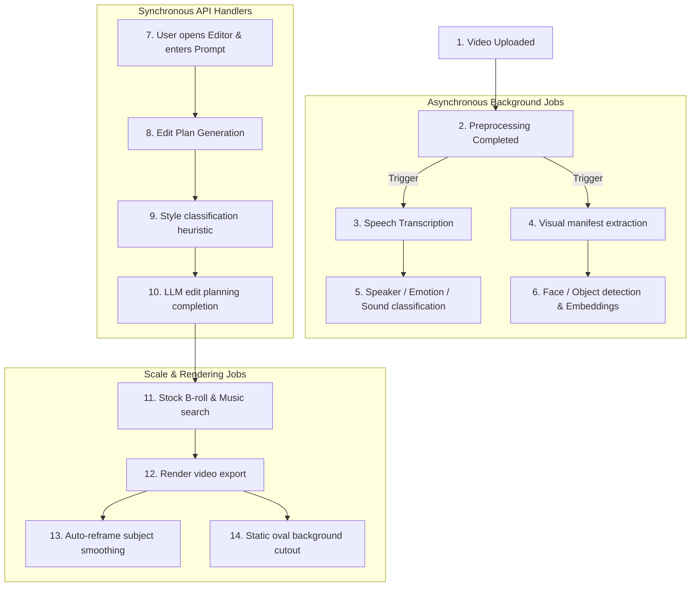
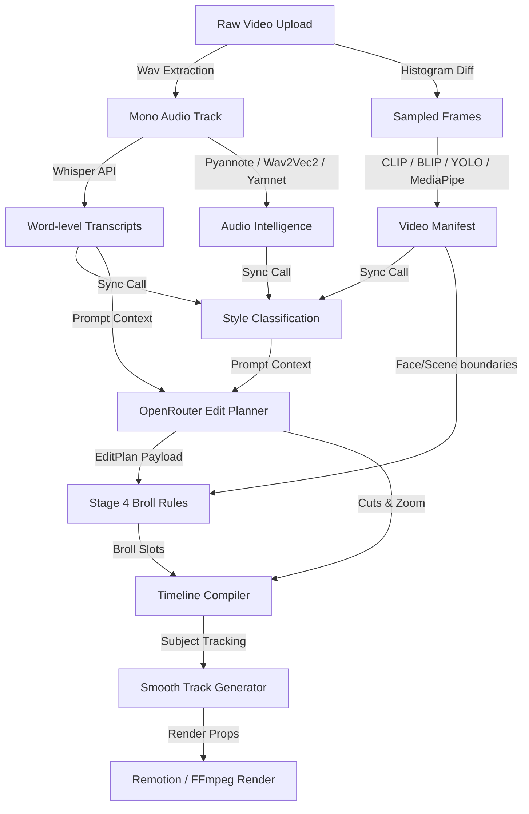

# Motionly AI & Intelligence Capability Audit

This document provides a comprehensive audit of all AI models, external AI providers, machine learning pipelines, heuristic intelligence systems, and AI-assisted capabilities found in the Motionly codebase.

---

## 1. Executive Summary

Based on a deep-dive source code audit of the monorepo `/workspaces/Motionly-claude/motionly-main/Motionly-main`, Motionly possesses a hybrid architecture split between **external AI APIs**, **local ML models** executing on a dedicated GPU worker, and **local heuristic engines** that mock or proxy advanced intelligence.

### Main Findings & Categories
* **External AI APIs (Production-Ready):** Groq Whisper is utilized for verbose word-level audio transcriptions, OpenRouter chat completions serve as the Edit Planner, and Runway Gen-3 generates AI B-roll.
* **Local ML Pipelines (Worker-Only):** A dedicated Python GPU worker hosts MediaPipe Face Detection, YOLOv8 Object Detection, BLIP-2 Image Captioning, and CLIP Visual Embeddings to construct rich visual manifests. Audio classification includes local Pyannote Speaker Diarization, Wav2Vec2 Emotion Classification, and YAMNet Sound Classification.
* **Heuristics & Fake Implementations:**
  * **Background Removal:** The React-based Remotion renderer implements subject isolation using a static CSS `ellipse` clip-path, while the Python FFmpeg basic renderer uses a periodic box-blur filter. **There is no machine learning-based background segmentation in this codebase.**
  * **Style Profiles & Preference Learning:** These are purely database-driven averages and overrides (e.g. tracking user manual timeline adjustments and reference video cuts per minute) without any model parameter updates or training.
  * **Style Classification:** This is a deterministic keyword-matching scorer, not a classifier model.

### Key Risks & Gaps
1. **Critical Quality Risks:** Background removal is entirely a visual mockup. Additionally, the edit planner is vulnerable to JSON parsing failures or invalid schema payloads returned by external LLMs, though a robust validation-and-repair middleware attempts coercion.
2. **Architecture Gaps:** Several BullMQ background job queues (e.g. `PlanQueue`, `MusicQueue`, `EffectsQueue`, and `RegenerationQueue`) are fully defined in the queue service but are completely bypassed by synchronous, blocking API calls in the web endpoints.
3. **Observability & Obsolescence:** Live integration contracts are completely unmonitored. SLO tracking relies on manual latency reports, and unit tests stub all external API interactions with static mocks or recording fixtures.

---

## 2. AI Capability Inventory

The table below lists every AI/model/intelligence capability identified in the Motionly source code:

| Capability Name | Model / Provider / Library Used | Local Model or External API | Source Files | Input Data | Output Data | Current Status |
| :--- | :--- | :--- | :--- | :--- | :--- | :--- |
| **Transcription & Speech Recognition** | Whisper (`whisper-large-v3-turbo`) via Groq API | External API | [transcription_provider.py](file:///workspaces/Motionly-claude/motionly-main/Motionly-main/apps/api/app/services/transcription_provider.py)<br>[transcription_jobs.py](file:///workspaces/Motionly-claude/motionly-main/Motionly-main/apps/api/app/services/transcription_jobs.py) | Extract WAV audio track from upload | Word-level timestamps, text, confidence | **Implemented** |
| **Edit Planning (AI Edit Planner)** | Chat completions via OpenRouter API | External API | [edit_planner.py](file:///workspaces/Motionly-claude/motionly-main/Motionly-main/apps/api/app/services/edit_planner.py) | Transcript words, visual manifest, style, prompt, user feedback | Structured JSON (`EditPlan`) with cuts, captions, zoom, music mood, effects, color grade | **Implemented** |
| **AI-Generated B-roll** | Runway Gen-3 (`gen3a_turbo`) | External API | [scale.py](file:///workspaces/Motionly-claude/motionly-main/Motionly-main/apps/api/app/services/scale.py) | Text prompt, ratio, duration, prompt image URL | Task ID, Generated video file URL | **Implemented** (Phase 5 scale job) |
| **Object Detection** | YOLOv8 (`yolov8n.pt` via `ultralytics`) | Local Model | [visual_intelligence.py](file:///workspaces/Motionly-claude/motionly-main/Motionly-main/apps/api/app/services/visual_intelligence.py) | Decoded video frame | Object labels, bounding boxes, confidence | **Implemented** (Worker only) |
| **Face Detection** | MediaPipe Face Detection | Local Model | [visual_intelligence.py](file:///workspaces/Motionly-claude/motionly-main/Motionly-main/apps/api/app/services/visual_intelligence.py) | Decoded video frame | Face bounding boxes, keypoint landmarks, confidence | **Implemented** (Worker only) |
| **Image Captioning** | BLIP-2 (`Salesforce/blip2-opt-2.7b` via `transformers`) | Local Model | [visual_intelligence.py](file:///workspaces/Motionly-claude/motionly-main/Motionly-main/apps/api/app/services/visual_intelligence.py) | Decoded video frame | Raw text description | **Implemented** (Worker only) |
| **Visual Embeddings** | CLIP (`openai/clip-vit-base-patch32` via `transformers`) | Local Model | [visual_intelligence.py](file:///workspaces/Motionly-claude/motionly-main/Motionly-main/apps/api/app/services/visual_intelligence.py) | Decoded video frame | Normalized 512-dim embedding floats | **Implemented** (Worker only) |
| **Speaker Diarization** | Pyannote Speaker Diarization | Local Model | [audio_ml_providers.py](file:///workspaces/Motionly-claude/motionly-main/Motionly-main/apps/api/app/services/audio_ml_providers.py) | Mono WAV audio path | Speaker segments, start/end timestamps | **Partial** (Requires Pyannote auth token & dependencies) |
| **Emotion Detection** | Wav2Vec2 Audio Classification | Local Model | [audio_ml_providers.py](file:///workspaces/Motionly-claude/motionly-main/Motionly-main/apps/api/app/services/audio_ml_providers.py) | Mono WAV audio path | 500ms emotion windows (joy, sadness, neutral, urgency, intensity) | **Partial** (Requires HuggingFace dependencies) |
| **Sound Classification** | YAMNet Sound Classifier via TFHub | Local Model | [audio_ml_providers.py](file:///workspaces/Motionly-claude/motionly-main/Motionly-main/apps/api/app/services/audio_ml_providers.py) | 16kHz mono WAV audio path | Top 5 sound labels & confidence scores | **Partial** (Requires TensorFlow Hub dependencies) |
| **Subject Tracking / Auto-Reframe** | Heuristic smoothing over Face/Object detections | Local heuristic | [visual_tracking.py](file:///workspaces/Motionly-claude/motionly-main/Motionly-main/apps/api/app/services/visual_tracking.py) | Video manifest frame samples | Smoothed target center coordinates (X, Y) | **Implemented** |
| **Style Classification** | Heuristic token-matching keyword weights | Local heuristic | [style_classifier.py](file:///workspaces/Motionly-claude/motionly-main/Motionly-main/apps/api/app/services/style_classifier.py) | Transcript words, direction prompt, audio & visual cues | Predicted style, confidence | **Implemented** |
| **B-roll Retrieval & Search Ranking** | Lexical overlap + semantic cosine similarity (CLIP) | Local heuristic | [stock_video.py](file:///workspaces/Motionly-claude/motionly-main/Motionly-main/apps/api/app/services/stock_video.py) | Search query, orientations, B-roll requests | Scored & ranked stock videos | **Implemented** |
| **Music Recommendation** | Tag search matching | Local heuristic | [music.py](file:///workspaces/Motionly-claude/motionly-main/Motionly-main/apps/api/app/services/music.py) | Music mood text | Ranked licensed/fixture tracks | **Implemented** |
| **Background Removal** | Static CSS `ellipse` (Remotion) / Box Blur (FFmpeg) | Local mock effect | [VideoScene.tsx](file:///workspaces/Motionly-claude/motionly-main/Motionly-main/apps/renderer/src/components/VideoScene.tsx)<br>[ffmpeg_render.py](file:///workspaces/Motionly-claude/motionly-main/Motionly-main/apps/api/app/services/ffmpeg_render.py) | Enabled flag, feather radius | Elliptical crop / Periodic blurred video output | **Mock / Fallback-Only** (No ML segmentation exists) |
| **Stem Separation** | Demucs source separation CLI | Local Model | [scale.py](file:///workspaces/Motionly-claude/motionly-main/Motionly-main/apps/api/app/services/scale.py) | Raw source audio path | Vocals / No-vocals WAV tracks | **Implemented** (Phase 5 scale job) |
| **Style Profile Training** | Average calculation of cuts/min & target duration | Local heuristic | [scale.py](file:///workspaces/Motionly-claude/motionly-main/Motionly-main/apps/api/app/services/scale.py) | 5 reference video manifests | Target duration, cuts per min, B-roll density | **Implemented** (No ML training) |
| **Preference Learning** | Summary compilation of manual editor overrides | Local database log | [scale.py](file:///workspaces/Motionly-claude/motionly-main/Motionly-main/apps/api/app/services/scale.py) | Telemetry logs (corrections / manual edits) | Key-value overrides map | **Implemented** (No ML training) |

---

## 3. How Each AI Capability Is Used

### 1. Transcription & Speech Recognition
* **Location in Product:** Video Upload & Captioning screen.
* **Call Path:** `POST /api/internal/jobs/{id}/run` (with job kind `transcription`) or when enqueued, the worker process routing calls `run_transcription_for_upload`.
* **Execution Mode:** Runs automatically inside a background queue job.
* **Consumption:** Word timestamps are saved in the database `transcripts` table and are consumed by the AI Edit Planner, captions generator, and Remotion renderer.

### 2. Speaker Diarization, Emotion, and Sound Classification (Audio ML Providers)
* **Location in Product:** Populates the `audio_intelligence` JSON payloads on the transcript page.
* **Call Path:** Called during the background transcription job by `_run_audio_ml_providers` in [transcription_jobs.py](file:///workspaces/Motionly-claude/motionly-main/Motionly-main/apps/api/app/services/transcription_jobs.py).
* **Execution Mode:** Runs automatically in the background.
* **Consumption:** Replaces the text-based heuristics inside `audio_intelligence` which is subsequently passed to the Edit Planner.

### 3. Edit Planning (AI Edit Planner)
* **Location in Product:** User clicks "Create/Generate Plan" or "Regenerate" in the sidebar editor.
* **Call Path:** API Router [plans.py](file:///workspaces/Motionly-claude/motionly-main/Motionly-main/apps/api/app/api/plans.py#L67-L234) calls `planner_provider.create_plan()` synchronously in the FastAPI endpoint thread.
* **Execution Mode:** Manual trigger (synchronous HTTP blocking request).
* **Consumption:** Directly consumed downstream to generate timelines, cuts, zoom effects, b-roll slots, and color grading configs.

### 4. Subject Tracking / Auto-Reframe
* **Location in Product:** Render Export panel ("Auto-Reframe" checkbox).
* **Call Path:** During the export phase, `POST /api/projects/{id}/renders` invokes `subject_track_from_manifest` to compile coordinates.
* **Execution Mode:** Automatic trigger on export.
* **Consumption:** Passed as `subject_track` in the rendering props (`effects_props["motion"]["auto_reframe"]["subject_track"]`) to Remotion for responsive cropping.

### 5. Object Detection, Face Detection, Image Captioning, and Visual Embeddings
* **Location in Product:** Constructs the `VideoManifest` that drives B-roll anchors and auto-reframing.
* **Call Path:** Worker process routes kind `visual_analysis` to `runVisualJob`, which spawns `visual_job.py`.
* **Execution Mode:** Background job queued automatically after video upload preprocessing completes.
* **Consumption:** Consumed by the stock search ranking, B-roll placement rules (face overlap avoidance), and style classification.

### 6. B-roll Search, Retrieval & Ranking
* **Location in Product:** B-roll layout suggestions inside the editor timeline.
* **Call Path:** Triggered when generating B-roll slots (part of the B-roll queue pipeline).
* **Execution Mode:** Runs asynchronously in the BullMQ worker.
* **Consumption:** Selects the best fitting Pexels/Pixabay video files, downloading them to create localized stock assets.

### 7. Background Removal
* **Location in Product:** Style & Looks panel ("Cutout Speaker" or "Remove Background").
* **Call Path:** Evaluated during rendering inside Remotion (`VideoScene.tsx`) or basic FFmpeg renders (`ffmpeg_render.py`).
* **Execution Mode:** Applied during production/preview rendering.
* **Consumption:** Displays an oval frame mask (CSS clip-path) or box blur directly onto the exported video layers.

### 8. Phase 5 Operations (Stem Separation, B-roll Generation, Style Profile, Preference Training)
* **Location in Product:** Scale tab in the Workspace console.
* **Call Path:** Triggered when the user invokes "Separate Vocals", "AI B-roll prompt", "Analyze Style", or "Learn Preferences".
* **Execution Mode:** Worker execution runs asynchronously under `ScaleQueue` (kind `phase5`).
* **Consumption:** Saves stems in storage, adds Runway videos to stock assets, or populates learned preference logs in database tables.

---

## 4. How Each AI Capability Is Called

### 1. Groq Whisper (Transcription)
* **Call Path:** `run_transcription_for_upload` $\rightarrow$ `transcription_provider.transcribe()`.
* **Request Payload:** Multi-part form-data POST containing:
  * `model`: e.g., `"whisper-large-v3-turbo"`
  * `response_format`: `"verbose_json"`
  * `timestamp_granularities[]`: `"word"`
  * `language`: (Optional) ISO language string.
  * `file`: Binary audio WAV buffer.
* **Response Format:** Verbose JSON payload containing a `words` list with dictionaries of `{"word", "start", "end", "confidence"}`.
* **Error Handling & Retries:** Bounded to the standard `httpx.post` 120-second timeout. No backoff or retries.
* **Environment Variables:** `GROQ_API_KEY`, `TRANSCRIPTION_PROVIDER="groq"`, `TRANSCRIPTION_MODEL`.

### 2. OpenRouter Chat Completions (Edit Planner)
* **Call Path:** FastAPI thread $\rightarrow$ `HttpEditPlannerProvider.create_plan()`.
* **Request Payload:** JSON POST containing:
  * `model`: e.g., `"openrouter/free"` or custom model.
  * `messages`: System prompt (structured JSON enforcement) and User prompt containing schema version, words lists, and audio/visual metadata summaries.
  * `response_format`: `{"type": "json_object"}`.
  * `temperature`: `0.2`.
* **Response Format:** JSON string containing keys: `style`, `target_duration_s`, `cuts`, `caption_highlights`, `broll_requests`, `zoom_moments`, `music_mood`, `effects`, `color_grade`, `risk_flags`.
* **Validation & Coercion:** If parsing fails or fields are missing, `_validate_or_repair_plan` runs a coercive parser (`_repair_plan_payload`) that enforces defaults or falls back to a deterministic template.
* **Environment Variables:** `OPENROUTER_API_KEY`, `EDIT_PLANNER_PROVIDER="openrouter"`, `EDIT_PLANNER_MODEL`.

### 3. Runway Gen-3 (AI B-roll)
* **Call Path:** Asynchronous Worker $\rightarrow$ `RunwayGen3Provider.generate()`.
* **Request Payload:** JSON POST to `/v1/image_to_video`:
  * `model`: `"gen3a_turbo"`
  * `promptImage`: URL of base frame.
  * `promptText`: String instructions.
  * `duration`: Integer seconds.
  * `ratio`: e.g., `"768:1280"`.
* **Polling & Timeout:** Polls `/v1/tasks/{id}` up to 300 times (every 2 seconds) for a status of `SUCCEEDED`. Throws `runway_generation_timeout` if exceeded.
* **Environment Variables:** `RUNWAY_API_KEY`, `RUNWAY_MODEL`.

### 4. Local ML Visual Models (YOLOv8, MediaPipe, BLIP-2, CLIP)
* **Call Path:** Persistent Python Worker subprocess $\rightarrow$ `LocalMLVisualIntelligenceProvider.analyze()`.
* **Models Initialization:** HuggingFace `CLIPModel`, `Blip2ForConditionalGeneration`, MediaPipe Face Detection object, and YOLO weights (`yolov8n.pt`).
* **Hardware Tier:** Runs on CUDA (`device = "cuda" if torch.cuda.is_available() else "cpu"`) with half-precision float16 if GPU is enabled.
* **Credentials:** No credentials needed (loads weights locally, or downloads models once from HF Hub).
* **Environment Variables:** `ML_WORKER_ENABLED="true"`, `VISUAL_PROVIDER="local_ml"`.

---

## 5. When Each AI Capability Is Called

Below is the execution map of triggers throughout the lifecycle of a video project:



---

## 6. What Operations Each AI Capability Performs

### Heuristic Background Removal (Mocked)
Contrary to any claims of "AI portrait cutout," no matting or segmentation model (such as Segment Anything or U-2-Net) exists in the codebase.
* **Remotion Renderer:**
  * Returns static SVG/CSS properties: `clipPath: "ellipse(38% 48% at 50% 50%)"`. This cuts the middle 50% of the canvas in an oval shape, mimicking a talking head camera slot.
* **FFmpeg Renderer:**
  * Applies an ffmpeg filter string: `boxblur=luma_radius={radius}` enabled dynamically only for 0.28 seconds out of every 2 seconds (`mod(t, 2) < 0.28`). This produces a periodic blinking blur.

### Preference Learning & Style Training (Mocked)
* **Preference Learning:** Merely queries manual telemetry signals (like timeline adjustment offsets) and compiles the last recorded user adjustments per layer (e.g. ideal track ID or broll configuration) into a JSON dictionary, feeding it back as prompt instructions.
* **Style Training:** Analyzes 5 reference manifests, aggregates their duration, cuts/minute, and density, then outputs metadata averages. No neural net optimization or fine-tuning occurs.

### Subject Tracking & Auto-Reframe
* Identifies all face detections from MediaPipe; if empty, falls back to YOLO person/head labels.
* Picks the detection with the highest confidence score.
* Computes the center $X, Y$ coordinate.
* Smoothes values over time using: $X_{t} = (X_{t-1} \times 0.65) + (X_{input} \times 0.35)$ to construct a stable trajectory path.

---

## 7. Data Flow and Dependency Graph

The visual and speech data flows downstream through multiple components before reaching the final export render:



### Data Edge Connections Status:
* **Upload $\rightarrow$ Audio $\rightarrow$ Words:** **Fully Wired** (FFmpeg extraction automatically feeds Groq).
* **Audio $\rightarrow$ AudioML:** **Partially Wired** (Only runs if `ML_WORKER_ENABLED` is active and local Python packages are installed; otherwise falls back to text token heuristical checks).
* **Frames $\rightarrow$ VisualML:** **Fully Wired** (Automatically queued in background if GPU worker is enabled; falls back to static dummy fixture if disabled).
* **VisualML $\rightarrow$ StyleClassifier $\rightarrow$ OpenRouter:** **Fully Wired** (Synthesized directly into edit plan requests).
* **OpenRouter $\rightarrow$ Broll Rules $\rightarrow$ Timeline:** **Fully Wired** (The visual manifest is checked to avoid overlaying B-roll on critical face frames).
* **Timeline $\rightarrow$ Subject Tracking $\rightarrow$ Render:** **Fully Wired** (Smooth coordinates are fed directly into the Remotion composition input props).

---

## 8. AI Output Persistence

### 1. Database Storage (PostgreSQL / Supabase)
* **Transcripts:** Saved in `public.transcripts` table. The `raw_payload` field contains the raw Groq response, and the `audio_intelligence` JSON contains the consolidated ML insights.
* **Video Manifests:** Saved in `public.video_manifests` table. The `manifest` column is a `jsonb` field containing the array of 240 sampled frames (with CLIP float arrays, BLIP text captions, and MediaPipe bounding boxes).
* **Edit Plans:** Saved in `public.edit_plans` table. Contains `plan` (JSONB) and `summary` (JSONB).
* **AI Feedback Analytics:** Saved in `public.ai_edit_feedback_events`. Logs user manual edits versus AI suggested properties to fuel preference tracking.

### 2. Cache & Invalidation Policies
* **Cache Key Formula:** A SHA-256 hash is computed using the transcript ID, prompt strings, template settings, and visual summaries (`build_plan_cache_key`).
* **Cache Reusability:** If the user updates their feedback, prompt, or uploads a new source file, the cache key changes immediately, triggering a live LLM regeneration.
* **Stale AI Outputs Risk:** If the transcription provider changes, or if the visual manifest changes but the transcript ID remains identical, a stale plan might be retrieved from the cache database, bypassing updated video assets.

---

## 9. AI Quality and Correctness Risks

* **Static Background Removal Failures:** Because background removal is a static oval clip-path (SVG shape) centered in the middle of the frame, if a speaker walks off-center or is cropped asymmetrically, the cutout will lop off part of their body, resulting in a severely degraded visual export.
* **LLM Hallucinations & Schema Compliance:** The OpenRouter LLM might generate cuts with overlapping timestamps or negative durations. While the validation middleware (`_validate_or_repair_plan`) cleans structures, it occasionally replaces custom plans with the default rule-based fixture, discarding user prompts.
* **Severe Translation Synchronization Drifts:** When captions are edited or translated (e.g., using `LanguageHint`), word-level timings do not auto-adjust. The system lacks alignment mechanisms to adjust timestamps to translated audio, causing captions to drift out of sync.
* **Mismatched Fallbacks:** If the ML worker is offline, `_visual_context` returns `"visual_context_unavailable"`. The planner falls back to deterministic heuristics, which can mock the presence of faces and produce B-roll slot overlaps that disrupt the viewer's experience.

---

## 10. Runtime, Cost, and Scaling Risks

* **Synchronous API Thread Blocks:** The edit planner calls OpenRouter synchronously in the FastAPI gateway loop. During peak hours, an LLM latency spike of 20–45 seconds will block the HTTP request, consume connection pools, and trigger user-facing gateway timeouts.
* **GPU Worker Concurrency Bottlenecks:** Local ML inference (YOLO, BLIP-2, and CLIP) runs inside a single-process python loop spawned by Node.js. If multiple users upload videos simultaneously, frames are processed sequentially, leading to large processing queues.
* **Out-of-Memory (OOM) GPU Vulnerability:** BLIP-2 opt-2.7b and PyTorch require significant VRAM (typically 6–10GB). On standard instances, simultaneous visual analysis jobs can trigger GPU Out-of-Memory faults, crash the worker daemon, and mark active jobs as failed.
* **Uncapped API Cost Risks:** Runway Gen-3 generations are billed per second. If users prompt multiple retries, and the system lacks strict usage limits, it can incur high API costs.

---

## 11. Security, Privacy, and Compliance Risks

* **External Provider Data Leakage:** Source audio tracks, extracted images, text transcripts, and user prompt descriptions are dispatched to Groq, OpenRouter, and Runway. This poses a privacy risk if users upload sensitive or corporate videos.
* **Lack of Configurable Data Retention:** There are no mechanisms to restrict provider data storage. Extracted audio, transcripts, and source files are stored in Supabase storage buckets indefinitely until manually purged.
* **Insecure Logging of Secrets:** API stack traces capture local environments. If a network call to OpenRouter fails, the raw error details (which may include auth tokens or credentials) could be written to public logs.

---

## 12. Testing and Evaluation

An analysis of `/apps/api/tests` reveals the following testing states:

* **Unit Tests:** Exist for heuristics (`test_audio_intelligence.py`, `test_visual_tracking.py`, `test_timeline_compiler.py`).
* **Provider Contract Tests:** **Missing Live Checks.** The `test_provider_contracts.py` file uses offline file fixtures (monkypatched HTTP responses) to test Pexels, Pixabay, Runway, and Groq. There are no live integration tests verifying API status or schema drifts.
* **Golden Media Tests:** Exists as `test_golden_media_pipeline.py` which runs FFmpeg CLI commands to verify H264 outputs and colors.
* **Evaluation & Accuracy Benchmarks:** **Completely Missing.** There are no prompt evals, no LLM similarity tests, and no visual accuracy tests to monitor regression qualities.

---

## 13. Capability-by-Capability Improvement Plan

### 1. Transcription (Groq Whisper)
* **Goal:** Improve reliability and handle regional dialects.
* **Action:** Implement an automatic fallback chain: if Groq fails or times out, redirect requests to a secondary provider (e.g., AssemblyAI or Deepgram). Add a retry mechanism with exponential backoff.

### 2. Edit Planner (OpenRouter LLM)
* **Goal:** Mitigate synchronous thread blocking.
* **Action:** Shift edit plan creation to the asynchronous `PlanQueue` (which is currently defined but unused). Provide real-time generation status updates to the client frontend over WebSockets.

### 3. Subject Tracking & Reframe (MediaPipe + YOLO)
* **Goal:** Prevent abrupt reframe jumps.
* **Action:** Replace the basic exponential moving average tracker with a Kalman filter algorithm to handle momentary facial occlusions.

### 4. Background Removal (CSS / Blur Mock)
* **Goal:** Support actual subject isolation.
* **Action:** Implement an ML-based segmentation worker using BiRefNet or RMBG-1.4. Run this process in the GPU worker during video preprocessing and export the alpha-matted mask directly into the final render.

### 5. Translation Sync (Captions)
* **Goal:** Restore caption timing alignment.
* **Action:** Integrate a forced-alignment tool (like WhisperX) to recalculate and sync word boundaries after text translations.

---

## 14. Best-Practice Architecture

To support scaling and ensure robustness, we recommend implementing the following architecture:

```mermaid
graph LD
    subgraph Client Application
        Web[Web Editor Client]
    end

    subgraph API Router Gateway
        API[FastAPI Gateway]
        Registry[Provider Registry]
    end

    subgraph Asynchronous Tasks Registry
        Queue[BullMQ Queue Manager]
    end

    subgraph Specialized Inference Pools
        CPU[Python CPU Stems Separator]
        GPU[Python GPU ML Worker]
    end

    Web -->|Create Edit Plan| API
    API -->|1. Lookup Config| Registry
    API -->|2. Dispatch Job| Queue
    Queue -->|3. Run Async Task| GPU
    GPU -->|CLIP/YOLO/BiRefNet| GPU
    Queue -->|Separate Vocals| CPU
    GPU -->|4. Push Result| API
```

### Core Architecture Recommendations
1. **Async Plan Dispatch:** The API should immediately return a `202 Accepted` status with a Job ID. Background workers should handle planning logic and write results to the database.
2. **Unified Provider Registry:** Implement a provider registry pattern that allows switching between models (e.g. GPT-4o, Claude 3.5 Sonnet, Mistral) based on cost, latency, or customer tiers.
3. **Prompt & Prompt-Version Tracking:** Store prompt files in version-controlled JSON assets. Log the prompt version alongside every generated edit plan to track prompts.
4. **Human-In-The-Loop Reviews:** Provide an editor interface that highlights AI decisions (e.g., "Cut reasons" or "B-roll selection scores") so users can review, modify, and approve plans.

---

## 15. Where More AI/Intelligence Could Be Used

| Capability | Target Architecture Integration | Data Required | Model / Provider Type | Priority |
| :--- | :--- | :--- | :--- | :--- |
| **Multilingual Voice Dubbing** | Audio extraction worker | Vocal stems + translated transcript | ElevenLabs / Cartesia API | **P1** |
| **Silence & Filler Word Removal** | Timeline compiler | Word boundary timestamps | Whisper transcripts (filtering "uh", "um", "ah") | **P0** |
| **Virality / Hook Scoring** | Analytics telemetry | Captions, style, and visual embeddings | Custom LLM evaluator (OpenRouter) | **P2** |
| **AI Thumbnails & Title Generator** | Pre-export export worker | Video frames + transcript | SDXL / FLUX API + GPT-4o | **P1** |
| **Copyright / Audio ID Match** | Audio separation worker | Audio stems (background tracks) | ACRCloud API | **P2** |

---

## 16. Prioritized AI Risk Register

### P0 Risks (Immediate Action Required)
* **Risk:** **Synchronous API Thread Blocks.** Calling OpenRouter completions synchronously in the FastAPI gateway can exhaust system threads and cause gateway timeouts.
  * **Evidence:** [plans.py L147-154](file:///workspaces/Motionly-claude/motionly-main/Motionly-main/apps/api/app/api/plans.py#L147-L154).
  * **Fix:** Move `create_plan` to the background queue system (`PlanQueue`), returning a `202` response with a progress polling endpoint.
* **Risk:** **Fake Background Removal.** The background removal feature uses static CSS crops and luma blurs instead of real subject segmentation, which can lead to cropped subject outputs.
  * **Evidence:** [VideoScene.tsx L293-299](file:///workspaces/Motionly-claude/motionly-main/Motionly-main/apps/renderer/src/components/VideoScene.tsx#L293-L299), [ffmpeg_render.py L365-369](file:///workspaces/Motionly-claude/motionly-main/Motionly-main/apps/api/app/services/ffmpeg_render.py#L365-L369).
  * **Fix:** Integrate RMBG-1.4 or a similar segmentation model into the GPU worker to output a true alpha mask.

### P1 Risks (Required Before Scale)
* **Risk:** **OOM GPU Crashes.** Loading large models (YOLO, MediaPipe, BLIP-2, and CLIP) inside a single process can crash GPU instances during concurrent runs.
  * **Evidence:** [visual_intelligence.py L230-280](file:///workspaces/Motionly-claude/motionly-main/Motionly-main/apps/api/app/services/visual_intelligence.py#L230-L280).
  * **Fix:** Separate local models into discrete microservice containers with resource limits (e.g. Triton Inference Server) and load weights using vLLM or ONNX.
* **Risk:** **Lack of Client Error Isolation.** Transcription and Planning errors fail the entire media rendering pipeline.
  * **Evidence:** [transcription_jobs.py L189-199](file:///workspaces/Motionly-claude/motionly-main/Motionly-main/apps/api/app/services/transcription_jobs.py#L189-L199).
  * **Fix:** Wrap third-party requests in try-catch blocks and fall back to local stub datasets to prevent job pipeline crashes.

---

## 17. Final AI Readiness Rating

## Rating: `Good but needs hardening`

### Justification:
The codebase has a well-designed repository layer and a structured visual/audio manifest format. The core pipeline is well-engineered: it processes videos, runs transcription, extracts visual frames, uses CLIP embeddings for B-roll retrieval, and handles LLM output validation and repair.

However, the system is rated as **Good but needs hardening** due to the following architectural and quality gaps:
1. Synchronous API calls are used for long-running edit planner tasks instead of utilizing background queues.
2. Background removal features are currently implemented as static visual mockups (CSS crops and blurs) rather than actual machine learning segmentation.
3. The lack of live integration tests and accuracy benchmarks makes the system vulnerable to API schema updates and quality regressions.

By addressing the P0 and P1 risks outlined in the Risk Register, the system's architecture can be hardened to support production-scale demand.
