# Motionly: Code-Derived Project Architecture and Implementation Audit

**Audit date:** 2026-06-21  
**Evidence base:** executable application source, database migrations, runtime configuration, package manifests, containers, and tests in this repository.  
**Excluded evidence:** product plans, roadmaps, README files, and other descriptive/help documents.  
**Interpretation rule:** statements labeled **inferred** describe product intent visible in the code; they are not official business claims.

## 1. Executive summary

Motionly is a browser-based, multi-tenant video editing system aimed at converting uploaded creator footage into short, styled, captioned, platform-ready videos. It combines automated transcription, audio and visual intelligence, an AI edit planner, a manual multitrack editor, stock and generated B-roll, music and sound design, two rendering engines, export versioning, direct social publishing, subscription controls, collaboration, and edit-feedback analytics.

The repository is a pnpm/Turborepo monorepo containing:

- a Next.js web application;
- a FastAPI application and the majority of business/media-processing logic;
- a BullMQ worker that dispatches jobs and runs Remotion renders;
- a React/Remotion renderer;
- shared TypeScript contracts;
- Supabase/PostgreSQL migrations and storage policies.

The implementation is substantial: roughly 54,000 lines of source, tests, and SQL were present during this audit, with 100+ API route declarations and extensive API tests. The strongest parts are domain breadth, explicit versioned artifacts, workspace-scoped repositories, direct-to-storage uploads, transcript/caption editing, render manifests/events, and the coexistence of automated and manual editing controls.

The code is not yet production-ready as a complete system. The most important blockers are:

1. A fresh sequential database migration can produce a `render_jobs`/`exports` schema and status enum incompatible with the current repositories.
2. `apps/api/Dockerfile` contains `4RUN`, which prevents the image from building.
3. The web admin page is protected by ordinary login, while its server-side calls can attach the global admin token; any signed-in user able to reach the URL may cross the intended admin boundary.
4. AI/user edit-plan cuts do not consistently control the final rendered video. The FFmpeg path recalculates pause-based keep segments, while the Remotion path does not assemble trimmed source segments.
5. Visual analysis is implemented but is neither started automatically after upload nor called by the normal web flow, weakening downstream style and B-roll intelligence.
6. Most “background” media work is executed inside the FastAPI process after a Node worker callback, so heavy FFmpeg and ML work is not isolated from request serving.

Several features are correctly implemented but narrower than their UI names imply. Examples include “model training” as preference extraction rather than model fine-tuning, background removal as an approximate visual treatment rather than segmentation, custom style training as statistical profiling, and several palette effects as metadata/placeholder overlays rather than distinct rendered effects.

## 2. Project identity

### 2.1 What the product is

Motionly is an AI-assisted non-linear editor for creator and social video. Its primary object is a workspace-owned project. A project receives a source video, generates machine-readable intelligence and an edit plan, lets the user refine layered edit decisions, and produces one or more exports for download or publishing.

The product combines three interaction modes:

- **Automation:** transcription, audio/visual analysis, style inference, edit planning, B-roll search, music selection, captions, and render assembly.
- **Direct manipulation:** drag-and-drop elements, timeline cuts, captions, overlays, audio regions, crop/framing, effects, undo/redo, and snapshots.
- **Operational workflow:** versioned renders/exports, billing entitlements, publishing connections/jobs, collaboration state, batch planning, analytics, and admin queue controls.

### 2.2 Mission, vision, and goals inferred from code

**Mission — inferred:** reduce the time and specialized knowledge needed to turn raw spoken or creator footage into polished, platform-specific video while retaining human control over the result.

**Vision — inferred:** provide one editing cockpit where AI proposes decisions, users refine them non-destructively, the system learns from those decisions, and the same project can be rendered and published across multiple formats at individual or team scale.

**Observable product goals:**

- move from raw upload to usable edit quickly;
- generate accurate word-level transcripts and styled captions;
- make AI editing decisions inspectable and editable;
- combine source footage, B-roll, music, effects, and manual overlays;
- preserve immutable/versioned render inputs and exports;
- support multiple social aspect ratios and output presets;
- learn editing preferences from retained, changed, and rejected suggestions;
- provide workspace isolation, subscriptions, usage limits, and operational tooling.

### 2.3 Likely users and use cases

The UI and platform presets indicate these likely personas:

- solo short-form creators;
- social media editors and marketers;
- agencies managing repeated styles and multiple projects;
- teams collaborating on an edit manifest;
- operators monitoring queues, render failures, and provider configuration.

Primary use cases include talking-head reels, captioned social clips, repurposed landscape video, branded edits, B-roll-enhanced explainers, multi-platform exports, and direct TikTok/Instagram/YouTube publication.

## 3. Current implementation status

The table distinguishes between code presence and a genuinely connected product path.

| Capability | Status | Code-derived assessment |
|---|---|---|
| Authentication and default workspace | Implemented | Supabase password/Google auth, SSR sessions, membership checks, and a database trigger that creates a profile, workspace, owner membership, and subscription. |
| Workspace switching and member management | Not exposed | The API enforces membership, but the web selects the first active membership and has no workspace switcher/member-management flow. |
| Project CRUD | Implemented | API and web flows exist; project lists are fetched through both API and direct Supabase paths. |
| Direct video upload | Implemented | Preflight, signed upload, completion, metadata validation, progress/status, cancellation, and asset URLs exist. |
| Media validation and thumbnailing | Implemented | FFprobe/FFmpeg validate codecs, duration, dimensions, audio, FPS, and generate thumbnails. |
| Transcription | Implemented | Groq Whisper-compatible provider, fixture mode, word timestamps, persisted transcript, and retries/errors. |
| Audio intelligence | Implemented with caveats | Keywords, delivery metrics, pause/rhythm maps, emotion, diarization, and YAMNet are implemented; model failures are not isolated and YAMNet outputs class IDs. |
| Visual intelligence | Implemented but disconnected | CLIP, BLIP-2, YOLO, MediaPipe, colors, scenes, camera motion, and manifest persistence exist, but standard upload/editor flow does not start it. |
| AI edit planning | Implemented | OpenRouter/fallback planner, style classifier, cache, normalized cuts/highlights/B-roll/zooms, versions, activation, and feedback events. |
| Plan cuts in final render | Critically partial | Edited plan cuts are not the authoritative trim list in either renderer. |
| Caption generation/editing | Implemented | Presets, modes, segment editing, highlights, filler filtering, styling, and rendering exist. |
| Caption translation | Implemented conditionally | Seven target languages use OpenRouter; unavailable without its API key and not a separate translation provider. |
| Stock B-roll | Implemented with durability gap | Pexels/Pixabay search, ranking, slots, swap, regions, and rendering exist; remote provider URLs are not ingested into owned storage. |
| User B-roll library | Implemented | Signed upload, listing, deletion, selection, and render use exist. |
| Generated B-roll | Implemented conditionally | Runway Gen-3 image-to-video polling and ingestion into storage/library exist. |
| Screen recording | Not implemented | A palette item exists, but there is no capture workflow. |
| Licensed music and regions | Implemented | Catalog/provider selection, mood metadata, regions, volume, rights flag, beat map, mixing, and ducking exist. |
| Vocal/music stem separation | Implemented conditionally | Demucs two-stem separation persists assets and can feed rendering. |
| Manual editor | Broadly implemented | Palette, drag/drop, inspector, timeline, preview, split/cut editing, manual elements, effects, undo/redo, and snapshots exist. |
| Manual palette parity | Partial | Multiple items create generic/empty overlays, have no media URL, or render differently across engines. |
| Effects and color grading | Implemented with renderer differences | Presets and controls exist; FFmpeg and Remotion implement different subsets and semantics. |
| Background removal | Misnamed/partial | It is approximate masking/blur treatment, not subject segmentation or true background removal. |
| Auto-reframe | Partial/manual | Static subject coordinates drive framing; detected faces/objects do not track the subject through time. |
| FFmpeg rendering | Implemented | Trim/concat, scale/crop, captions, B-roll, audio mix, watermark, GPU codec option, events, upload, and fallback. |
| Remotion rendering | Implemented but trim-incomplete | Animated captions/effects/templates/manual layers/audio exist, but source cut assembly is absent. |
| Export history/versioning | Implemented | Render events, immutable props/manifests, artifacts, export records, restore, signed download, and bulk variants exist. |
| Direct social publishing | Implemented conditionally | OAuth/manual connections and TikTok, Instagram, and YouTube jobs exist; refresh-token handling is absent. |
| Billing | Implemented conditionally | Stripe checkout/portal/webhooks, four plans, usage ledger, render entitlement, resolution/watermark/B-roll controls. |
| Collaboration | Implemented at manifest level | Realtime presence and optimistic revision updates exist; it is whole-document concurrency, not a CRDT. |
| Custom templates/profiles | Partially applied | Stored CRUD works, but caption/effect template settings are not applied by the learning hook. |
| Batch processing | Partial | A synchronous loop creates plans and stores results; it lacks a real batch queue, progressive status, and cancellation. |
| Preference learning | Implemented as rules, not training | Analytics become stored preference dictionaries injected into planner prompts; no model weights are trained. |
| Admin operations | Implemented with auth flaw | Overview, queue actions, and render actions exist, but the web authorization boundary is unsafe. |
| Observability | Partial | Structured logs, Sentry/GlitchTip wiring, render/job events, and health endpoints exist; readiness does not verify dependencies. |

## 4. System architecture

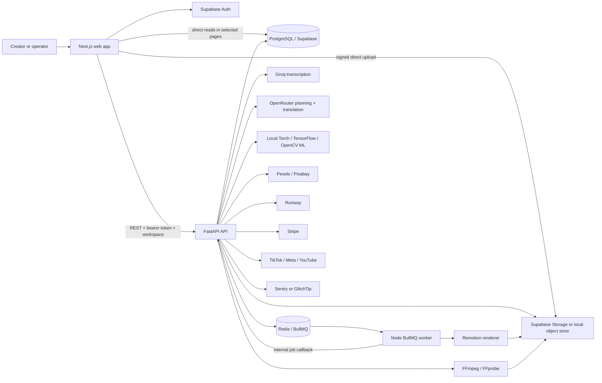

### 4.1 Important architectural reality

BullMQ is used for queue ownership, retry behavior, and worker concurrency, but the Node worker is primarily a dispatcher. For upload preprocessing, transcription, visual analysis, AI-adjacent jobs, FFmpeg render completion, publishing, and scale operations, it calls `POST /internal/jobs/{id}/run`. The API process then performs the work, often synchronously.

Consequences:

- CPU/GPU/FFmpeg/ML load competes with HTTP request handling;
- an `async` FastAPI route can call blocking libraries and block its event loop;
- adding Node workers can fan more concurrent heavy callbacks into one API instance;
- worker isolation is genuine for Remotion, but not for most other media work;
- independent API and media-worker scaling is not currently achieved.

Some endpoints perform their work before enqueuing a queue record. Plan creation, B-roll/music/effects selection, regeneration, and some scale flows can complete synchronously and then return a job ID whose later worker callback reports that the operation was already completed or skipped. This makes queue history useful for accounting, but not consistently the executor of the operation.

### 4.2 Components and responsibilities

| Component | Responsibility |
|---|---|
| `apps/web` | Public site, authentication UI, protected app shell, projects, editor, previews, timeline, billing/account/admin pages, server actions, Supabase SSR. |
| `apps/api` | Authentication enforcement, repositories, all domain APIs, provider integrations, media analysis, planning, FFmpeg rendering, billing, publishing, analytics, health/admin. |
| `apps/worker` | BullMQ consumers, queue bridge, API internal callbacks, job status, Remotion subprocess orchestration. |
| `apps/renderer` | Remotion composition, animated captions, video transformations, manual layers, B-roll, music/SFX, render CLI. |
| `packages/shared` | Cross-app TypeScript types for plans, captions, render props, effects, manual elements, audio intelligence, and API shapes. |
| `infra/migrations` | PostgreSQL schema, enums, triggers, indexes, RLS policies, storage buckets/policies, realtime publication. |
| `supabase` | Local Supabase CLI configuration and migration link. |
| `infra/docker-compose.gpu.yml` | Optional GPU API/worker deployment slice. |

## 5. Technology stack

### 5.1 Frontend

| Technology | Use |
|---|---|
| Next.js 16.2 | App Router, server rendering, routes, middleware, server actions, API proxy/tunnel. |
| React 19.2 | Editor and application UI. |
| TypeScript 5.7 | Web, renderer, and shared contracts. |
| Tailwind CSS 3.4 | Styling and responsive layouts. |
| dnd-kit | Palette/canvas/timeline drag-and-drop. |
| Framer Motion | UI animation. |
| Supabase SSR and JS clients | Session management, database reads, storage, realtime. |
| Zod | Frontend/runtime validation where used. |
| Sentry Next.js SDK | Browser/server error telemetry; configurable for GlitchTip-compatible DSNs/tunnel. |

### 5.2 Backend and media intelligence

| Technology | Use |
|---|---|
| Python 3.12+ and FastAPI | HTTP APIs, dependency injection, domain orchestration. |
| Pydantic 2 | Settings and request/response contracts. |
| httpx | Supabase REST and external provider HTTP calls. |
| FFmpeg/FFprobe | Probing, thumbnailing, audio extraction, trimming, compositing, captions, audio mixing, encoding. |
| PyTorch/Torchaudio/Transformers | CLIP, BLIP-2, wav2vec emotion and related local inference. |
| TensorFlow/TensorFlow Hub | YAMNet sound classification. |
| pyannote.audio | Optional speaker diarization. |
| OpenCV | Frame sampling, scene/color/motion analysis. |
| MediaPipe | Face detection. |
| Ultralytics YOLO | Object detection. |
| Demucs | Two-stem vocal/accompaniment separation. |
| Pillow/NumPy | Image and numerical processing. |

### 5.3 Rendering, data, infrastructure, and services

| Technology/service | Use |
|---|---|
| Remotion 4.0.431 | React-driven video composition and premium animation. |
| BullMQ 5 + Redis/ioredis | Distributed queues and retries. |
| PostgreSQL/Supabase | Durable records, RLS, realtime changes, Auth-linked tenancy. |
| Supabase Storage | Source, thumbnails, exports, previews, generated and derived media. |
| Supabase Auth | Email/password and OAuth identity/session. |
| Groq | Whisper-compatible transcription. |
| OpenRouter | Edit planning and caption translation. |
| Pexels/Pixabay | Stock-video discovery. |
| Runway Gen-3 | Generated B-roll. |
| Stripe | Subscriptions, checkout, portal, webhooks. |
| TikTok, Meta Graph, YouTube APIs | Direct publishing. |
| Turborepo 2 + pnpm 9 | Monorepo orchestration and package management. |

## 6. Repository structure

```text
Motionly-main/
├── apps/
│   ├── api/
│   │   ├── app/api/           # HTTP routes and request orchestration
│   │   ├── app/core/          # settings, auth, logging, middleware
│   │   ├── app/repositories/  # in-memory and Supabase persistence adapters
│   │   ├── app/schemas/       # Pydantic domain contracts
│   │   ├── app/services/      # providers, analysis, queues, rendering, publishing
│   │   └── tests/             # API/domain tests
│   ├── web/
│   │   ├── app/               # App Router pages, layouts, routes, server actions
│   │   ├── components/editor/ # editor panels, preview, timeline, palette, inspector
│   │   ├── lib/               # API auth/client, environment, Supabase, timeline helpers
│   │   └── public/            # static assets
│   ├── worker/src/            # BullMQ worker, queue bridge, Remotion launcher
│   └── renderer/src/          # Remotion composition and renderer CLI
├── packages/shared/src/       # shared TypeScript types
├── infra/migrations/          # ordered SQL schema and security changes
├── infra/docker-compose.gpu.yml
├── supabase/config.toml
├── package.json               # root scripts
├── turbo.json
└── pnpm-workspace.yaml
```

Generated caches, build outputs, installed dependencies, screenshots, and local test-storage artifacts are also present in working directories. Forty small committed MP4 test artifacts were observed under `.motionly/test-storage` locations; these are repository-hygiene candidates rather than product source.

## 7. Runtime environments and configuration

### 7.1 Supported operating modes

The API has two materially different modes:

- **Production-like mode:** Supabase repositories/storage, Redis/BullMQ, real external providers, FFmpeg execution, Sentry, explicit CORS/public URL, and strict startup validation.
- **Development/test mode:** in-memory repositories and queues, local object storage, fixture providers, optional synchronous completion, and optional auth bypasses.

In-memory mode is useful for tests and local demos but is process-local and ephemeral. It cannot represent multi-instance consistency or production database behavior.

### 7.2 Configuration domains

| Domain | Principal variables |
|---|---|
| Runtime | `APP_ENV`, `LOG_LEVEL`, `API_PUBLIC_BASE_URL`, `API_CORS_ORIGINS` |
| Supabase/auth | `SUPABASE_URL`, `SUPABASE_JWT_SECRET`, `SUPABASE_SERVICE_ROLE_KEY`; web public URL/anon key equivalents |
| Upload/storage | bucket names, signed URL TTLs, 512 MiB default limit, three concurrent uploads/workspace, `MEDIA_WORK_DIR` |
| Queue | `REDIS_URL`, bridge/node path, attempts, backoff, API/render concurrency |
| Rendering | FFmpeg execution/GPU encoder, synchronous completion, Remotion enablement |
| Transcription | provider/model, Groq key, debug audio retention |
| Audio ML | local provider, pyannote model/token, wav2vec model, YAMNet URL |
| Visual ML | provider, CLIP/BLIP/YOLO model names, sample FPS, scene threshold |
| Planning | OpenRouter provider/model/key |
| Stock/music | Pexels/Pixabay keys, music provider and catalog table |
| Billing | enable switch, Stripe secret/webhook/prices, return URLs |
| Publishing | OAuth state secret and TikTok/Meta/Google credentials |
| Scale | Demucs provider/model, Runway key/model |
| Operations | Sentry DSN, admin token, admin workspace allowlist, rate limit |

Production startup rejects fixture providers and requires the core Supabase, Redis, transcription/planning/stock, observability, CORS, public URL, admin, and FFmpeg settings. Demucs is required as the stem provider. Runway remains optional and its endpoint fails when unavailable.

### 7.3 Configuration drift

- Audio and visual ML settings exist in `Settings` but are missing from the inspected environment examples.
- Worker retention and demo-mode variables are used by worker code but are not consistently represented in examples.
- Development auth bypass variables are not consistently documented by examples.
- Example variables such as `RENDER_TEMP_DIR` and a GlitchTip security endpoint are not consumed by the API settings shown in code.
- `PERSONAL_USE_MODE` is defined but has no observable enforcement path.
- Root Supabase database variables are deployment/CLI concerns rather than application runtime settings.
- A tracked file named `env.local.txt` warrants secret scanning and removal from version control if it contains credentials. Its contents were deliberately not read for this audit.

## 8. User experience and user flow

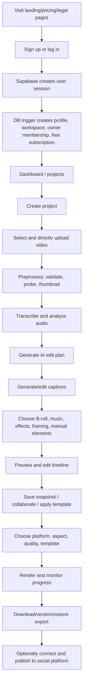

### 8.1 Public and authentication surfaces

The web includes a landing page, pricing, login, signup, copyright, privacy, terms, refund, and feedback pages. Supabase handles password authentication and optional Google OAuth. The callback exchanges the code for a session.

The feedback form opens a `mailto:` address under the local Motionly domain; it does not persist to the `launch_feedback` database table.

### 8.2 Workspace and project entry

On first authentication, a database trigger creates a personal workspace and owner membership. Web API authentication obtains the user session and resolves the first active workspace membership. The user can create, rename, list, view, and delete projects.

Two project-list data paths exist: some screens use the API while the dashboard performs direct Supabase reads. This duplicates authorization/data-loading behavior and can produce inconsistent caching/error semantics.

The app shell displays hard-coded “Creator / Free Plan” and “3/10 Exports” labels instead of live billing status. The billing page itself uses real billing data.

### 8.3 Editor interaction

The editor contains:

- media/element palette and drag targets;
- live video preview with framing/effects/caption overlays;
- inspector tabs for AI, captions, B-roll, audio, look, history, scale, and export;
- multitrack timeline for cuts, captions, B-roll, music, and manual elements;
- undo/redo with an in-memory 50-action history;
- named persisted plan snapshots;
- project title/save and selection state;
- realtime collaboration/presence controls in the scale panel.

There are two nested editor client components maintaining overlapping title, save, playhead, selection, and tab state. This is a source of drift and increases maintenance cost.

If the editor initially loads an already-processing upload, its processing screen states that it refreshes automatically but contains no polling/refresh behavior. Uploads initiated within the upload component do poll, so the bug occurs mainly on reload/direct entry during processing.

## 9. End-to-end media and data flow

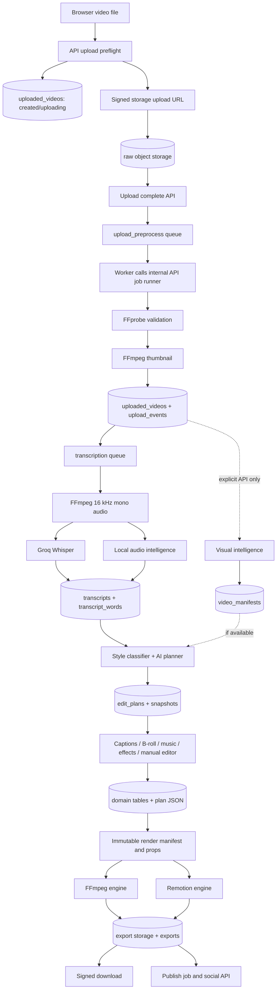

### 9.1 Upload and preprocessing

The browser asks the API to initialize an upload. The API validates filename, MIME type, declared size, workspace concurrency, and creates an upload record. It returns a signed direct-upload URL, avoiding API proxying of the initial source file. The browser uploads and then calls completion.

Supported containers are MP4/M4V, MOV/QuickTime, and WebM. Default maximum size is 512 MiB. Preprocessing verifies:

- source object availability;
- duration, dimensions, FPS, codec, and audio stream;
- duration no greater than 15 minutes;
- minimum dimension of 240 pixels;
- accepted video codec among H.264/HEVC/H.265/VP8/VP9;
- presence of audio.

Warnings are produced for long or very short media, low resolution, unusual FPS, and orientation. FFmpeg creates a JPEG thumbnail. Upload state and events represent created, uploading, uploaded, processing, ready, failed, or canceled conditions.

The storage abstraction supports local files or Supabase Storage. Path traversal is defended in local endpoints. Local storage routes are disabled in production and when Supabase is configured.

Large-object caveat: several local/Supabase adapters use whole-file reads or whole-response downloads. A 512 MiB input or generated output can therefore cause large transient memory use. Supabase-backed source objects are cached locally with no visible eviction policy.

### 9.2 Transcription and audio intelligence

After successful preprocessing, transcription is queued automatically. FFmpeg creates 16 kHz mono WAV audio. Groq is called with `whisper-large-v3-turbo` by default and verbose word timestamps. The persisted result includes transcript status, language, text, word boundaries, confidence, and audio-intelligence data.

Audio intelligence includes:

- keywords and transcript-derived style/tone indicators;
- words per minute and confidence;
- heuristic or pyannote speaker diarization;
- short emotion windows with joy, sadness, urgency, intensity, and labels;
- pause map and significant pause counts;
- onset/rhythm density and BPM-equivalent metrics;
- wav2vec2 speech emotion inference;
- YAMNet audio-event inference.

The local models are lazily loaded into the API process. One provider failure can currently fail the entire transcription/intelligence operation because model errors are not independently degraded. The YAMNet integration emits numeric class labels such as `yamnet_class_N`, not human-readable taxonomy names.

The shared TypeScript audio summary is behind the Python schema: it omits some emotion dimensions, pause-map, and rhythm fields. The scale UI compensates with generic record casts, losing type safety.

### 9.3 Visual intelligence

Visual analysis samples frames at approximately 2 FPS plus scene-change candidates, capped around 240 samples. It combines:

- OpenCV scene changes, colors, sharpness/motion and frame extraction;
- CLIP embeddings;
- BLIP-2 captions;
- YOLO objects;
- MediaPipe faces;
- dominant color, camera-motion, scene-type, and importance summaries.

The result is stored as a versioned video manifest and can influence style classification and B-roll placement/face avoidance.

This feature is not connected to the standard journey. Upload preprocessing queues transcription but not visual analysis; the web editor does not call the explicit visual-analysis route. Consequently normal projects may never acquire a visual manifest, and downstream logic silently falls back to transcript/audio-only behavior. BLIP-2 OPT 2.7B is also a very large model to host inside the API process.

### 9.4 AI planning and style classification

The planner uses OpenRouter structured JSON when configured and a deterministic fixture/fallback outside production. It receives transcript words, user prompt/feedback, audio intelligence, visual summary when present, template/profile/adapter context, and a schema-aware instruction. The cache hash covers transcript content, request inputs, intelligence summaries, and schema version.

The style classifier combines text direction, delivery/audio signals, and visual features to select among 14 styles. Planner output is normalized to word boundaries and contains:

- source cut decisions;
- target duration and hook/highlight choices;
- caption highlights;
- B-roll requests;
- zoom moments;
- music mood;
- color grade and effect suggestions;
- explanatory metadata.

Plans are versioned, can be activated, patched, snapshotted, restored, and partially regenerated. Suggestion and user-change events feed analytics.

Critical integration defect: `activePlan.plan.cuts` is editable in the timeline, but it is not consistently used to assemble exports.

- FFmpeg render creation derives `keep_segments` again from caption-word pauses instead of using the active plan cuts.
- Remotion receives cut intervals for effect timing/boundaries but plays the source video continuously rather than trimming and concatenating kept ranges.
- Captions in the FFmpeg path are retimed against the recalculated keep segments.

Therefore a user can edit cut decisions and see them represented in application state without receiving the same edit in the encoded video.

### 9.5 Captions and translation

Caption generation chunks transcript words according to preset/mode limits, optionally removes filler words, and stores tracks and segments. Users can change preset, style, position, animation, text, word timing, highlights, and segment timing. The renderer supports static ASS captions in FFmpeg and animated per-word captions in Remotion.

Translation supports English, Hindi, Spanish, Portuguese, French, German, and Arabic. It calls OpenRouter with all segment strings and requires the response array to preserve count/order. Translated words are assigned evenly across the original segment duration. This preserves timing shape but is not speech-level alignment and may produce unnatural per-word timings.

Caption generation still enqueues a transcription/caption job after performing generation synchronously, another example where queue records do not necessarily execute the core work.

### 9.6 B-roll

There are three B-roll sources:

1. Pexels/Pixabay stock search;
2. user-uploaded library clips;
3. Runway-generated clips.

Stock candidates are ranked using portrait suitability, resolution, duration, provider rank, lexical/embedding relevance, shot diversity, and duplicate avoidance. Providers are attempted sequentially and search stops when one produces results, so results are not blended across providers. Provider records generally lack embeddings; semantic ranking is therefore mainly lexical outside fixture data.

Slots can be generated from plan requests, swapped, searched, moved, resized, enabled/disabled, and rendered. Face-avoidance rules depend on a visual manifest, which standard projects usually lack because visual analysis is disconnected.

External stock URLs are stored and rendered directly rather than copied into Motionly-controlled storage. Provider URL expiry, removal, or throttling can therefore break later renders. User and Runway assets are stored internally and are more durable.

The shared `StockProviderKey` type does not include `runway`, even though Python schemas and stored assets do. This is a cross-language contract gap.

Palette entries named “B-roll Search,” “My Library,” and “Screen Record” can create manual B-roll elements without an `assetUrl`; those instances render nothing. Actual uploaded library tiles include URLs and work. No screen-capture implementation exists.

### 9.7 Music, sound design, and stems

Music is selected from a licensed Supabase catalog or fixture provider by mood. Metadata includes provider IDs, license, duration, mood tags, BPM, energy, vocals, loopability, and beat maps. A user can choose a track, disable music, force another candidate, set music/SFX intensity, confirm rights, and edit music regions.

Rendering supports:

- music regions and looping;
- music volume;
- source-dialogue-aware sidechain ducking;
- SFX cues/intensity;
- limiter/mix filters;
- optional Demucs vocals stem as dialogue source.

Demucs generates `vocals.wav` and `no_vocals.wav`, persists both, and the latest ready stem resource can be included in render props. FFmpeg trims/retimes the vocal stem with its keep segments. Remotion mutes source video and plays the vocal stem continuously; this would become incorrect once real cut assembly is added unless the stem follows the same timeline mapping.

Manual SFX with an asset URL is rendered. Static “Voice Over” has no source URL and is silent. The “Ambient Sound” item maps to a tiny bundled cue rather than a real ambient recording. Manual `music` elements can play in Remotion but are ignored by FFmpeg's manual-SFX collection.

### 9.8 Effects, motion, framing, and manual elements

Effects configuration includes presets, color grade/LUT concepts, textures, gradients, framing, motion design, keyframes, zoom/impact moments, background treatment, and After Effects handoff metadata. Dropping motion or grade items updates effect configuration; other palette items create manual plan elements.

The browser preview and Remotion implement a broad set of transforms, filters, keyframes, caption animation, and layer timing. FFmpeg implements a smaller/different subset: crop/scale, LUT/equalization, grain, vignette, motion blur, glitch-like filters, flat gradient boxes, light leak, and flare approximations. Ken Burns, speed ramps, impact/zoom-punch semantics, B-roll slide-in, and generic keyframes do not have equivalent FFmpeg behavior.

Specific parity gaps:

- many named texture/graphic items create a generic empty overlay with an `effect` property;
- emoji/sticker/smoke/sparkle/halation/bokeh items do not have unique media or procedural implementations;
- Remotion accepts CSS gradient backgrounds while FFmpeg uses a flat `backgroundColor` fallback;
- arrow/line/progress/countdown/stat graphics are mostly boxes or text glyphs, not dynamic widgets;
- Remotion distinguishes fade-like transitions from a generic sweep; named zoom/swipe/glitch/whip transitions are not distinct;
- FFmpeg ignores manual transition elements;
- manual elements appear in the timeline but normal trim/move/split/delete handlers focus mainly on cuts, captions, B-roll, and music;
- B-roll and audio are represented by preview badges/state more than by full playback/compositing fidelity.

“Background removal” is not an ML matting/segmentation pipeline. Remotion applies a center ellipse/plate treatment; FFmpeg applies a blur approximation. “Auto-reframe” is based on static subject coordinates rather than tracked face/object trajectories, and it does not consume visual detections.

The WebGL preview canvas can stretch the raw video to its canvas independently of CSS crop/object-fit transforms, so framing/motion preview may differ from render output when WebGL is active.

### 9.9 Timeline, history, snapshots, collaboration, and templates

The timeline derives clips from plan cut intervals and places caption, B-roll, music, and manual-element regions on separate tracks. Users can select, split, update, delete, and drag supported region types. Local undo/redo is not durable across page reloads.

Plan snapshots persist named copies and can restore prior plan state. Render artifacts and exports are separately versioned.

Collaboration stores a whole JSON manifest with an optimistic integer revision and broadcasts PostgreSQL changes and Supabase Realtime presence. Concurrent writes are rejected on stale revision, but there is no field-level operational transform or CRDT merge. Users editing unrelated fields can still conflict.

Custom profiles/templates are generic `phase5_resources`. Style, target duration, B-roll density, and direction can influence future plan requests. Although the template schema can store caption and effect settings, the application hook does not apply them and the UI save path does not populate them. Template support is therefore partial.

### 9.10 Rendering and export

The user can select presets for Instagram, TikTok, Shorts, landscape YouTube, Instagram post, X landscape, or custom output; choose original/9:16/1:1/4:5/16:9 aspect; fit/fill/custom crop; 720p/1080p/4K; target duration; and one of seven creative templates.

Billing entitlements cap Free at 720p and all paid tiers, including Agency, at 1080p. The 4K UI option can therefore never produce 4K under the defined plans.

Engine selection uses Remotion only when enabled/eligible and when selected features require it, such as B-roll/music/effects. Otherwise FFmpeg is used. A premium caption animation without another premium trigger can still be routed to FFmpeg and lose its intended animation.

FFmpeg pipeline capabilities include source trim/concat, crop/scale, grade filters, ASS captions, B-roll overlays, audio/music/SFX mixing and ducking, watermarking, H.264/HEVC NVENC options, upload, and a 720p fallback attempt.

Remotion capabilities include animated captions/templates, visual filters/textures, B-roll, music/ducking/SFX, manual elements, motion/keyframes, and browser-rendered composition. It does not currently assemble source cuts.

Each render captures an immutable manifest and render-props hash, job events/progress, output artifact, and export/version record. Status is available through polling, server-sent events, and Supabase realtime. Exports receive short-lived signed download URLs (five minutes by default). Bulk export creates multiple variant jobs sequentially.

Beat synchronization currently reports/alters metadata and alignment cues but does not reposition cut boundaries. After Effects handoff is stored as metadata rather than executing an AE interchange/render pipeline.

### 9.11 Publishing

Users can connect TikTok, Instagram/Meta, and YouTube through OAuth or manually supplied tokens, list/remove connections, and queue an export for publishing. OAuth state is signed and time-limited; production return origins are constrained.

TikTok and Instagram consume signed media URLs and poll provider state. YouTube downloads the complete export and constructs the full multipart request in memory, which is risky for large exports.

Access and refresh tokens are stored as plain database values in a service-role-only table. No refresh workflow uses the stored refresh token/expiry, so expired connections require reconnection. Application-level encryption/KMS is absent. The UI defaults publishing privacy to private and does not expose the full provider privacy controls observed in schemas.

### 9.12 Billing and entitlements

Plans are Free, Creator, Pro, and Agency. The code enforces monthly render counts, watermarking, maximum resolution, B-roll, priority, premium effects, seats, brand kits, bulk uploads, and API access flags where individual call sites consult them.

Stripe supports checkout, customer portal, signed/idempotent webhooks, and subscription state. Usage is recorded when a render starts, not when it succeeds, so failures consume quota. When billing is disabled, render code behaves as though high entitlements are available for development/personal use.

### 9.13 Analytics and preference learning

The system records AI-layer events for suggestions retained, changed, or rejected across cuts, captions, B-roll, music, and effects. It exposes summaries and a fine-tuning-style dataset.

“Model training” does not fine-tune a model. It selects analytics examples, creates a preference dictionary, stores it as a resource, and injects it into later planner prompts. The examples are sorted newest first, but repeated layer assignment means older rows can overwrite newer preferences. Rejected rows with empty ideal output can also overwrite useful values.

Training is initiated within one project and queries that project's events, but the latest adapter is later selected workspace-wide. One project's preferences can therefore affect all workspace projects.

Render creation records all edit layers as “kept” before render success, download, or publication. This inflates acceptance metrics. Analytics write failures are swallowed to avoid blocking editing, but are not surfaced for operational recovery.

## 10. Queue and processing model

Queues include upload preprocessing, transcription, visual analysis, planning, stock search, audio, render, GPU render, publishing, and intelligence/scale work.

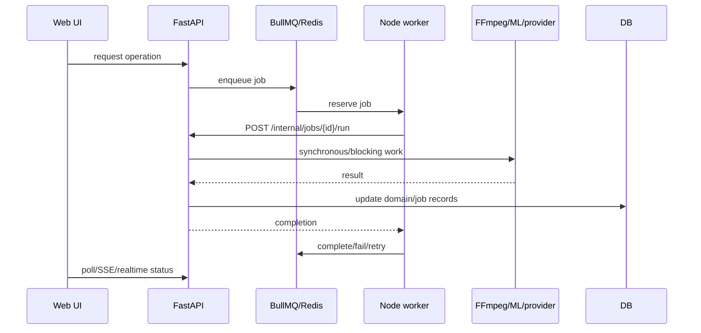

The API's BullMQ adapter launches `node queue-bridge.mjs` as a subprocess for enqueue/list/retry/cancel operations instead of holding a persistent Redis connection. This adds process-launch latency and complicates failure diagnosis. In-memory queues implement stuck-job dead-letter transitions, while BullMQ's corresponding repository method is a no-op.

Worker concurrency and retry/backoff are configurable. Render/GPU queues use lower concurrency. Retention counts/seconds are configurable in worker code. True BullMQ status is owned by Redis; some API start/complete operations mutate only local status objects.

## 11. API surface

The backend declares over 100 route handlers. Major groups are:

| Group | Operations |
|---|---|
| Health | live, ready, dependency report, deep health |
| Projects | create, list, get, rename/update, delete |
| Uploads | initialize, complete, cancel, active/get, signed asset URLs |
| Transcription/captions | create/read transcript, generate/list/update caption tracks and segments |
| Visual | start analysis, get manifest |
| Plans | create/list, activate, cuts/highlights/manual elements, snapshots, partial regeneration |
| B-roll | library upload/complete/list/delete, generate/list/search/swap/update region |
| Music | get/select/list tracks, update regions |
| Effects | get/update configuration |
| Renders/exports | create/bulk, list/get/events/SSE, retry/cancel, exports/download/restore |
| Publishing | OAuth start/callback, manual connection CRUD, publish list/create |
| Billing | status, checkout, customer portal, Stripe webhook |
| Analytics | summary, event creation, training dataset |
| Scale | resources, stems, generated B-roll, styles, training, templates, collaboration, model adapters, batches |
| Admin | overview, queue list/actions, render detail/actions |
| Internal worker | execute queued jobs and report Remotion render progress/failure/completion |
| Local storage | development-only object PUT/GET |

Public/domain routes use an actor dependency that verifies identity and workspace membership. Internal routes use service secrets/tokens and are intended for trusted worker calls. Stripe webhooks verify Stripe signatures rather than user auth.

## 12. Data model

### 12.1 Entity overview

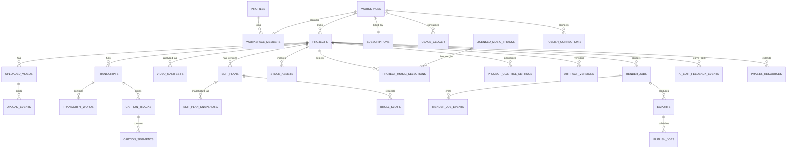

### 12.2 Tables by domain

| Domain | Tables |
|---|---|
| Identity/tenancy | `profiles`, `workspaces`, `workspace_members` |
| Projects/uploads | `projects`, `uploaded_videos`, `upload_events` |
| Speech/captions | `transcripts`, `transcript_words`, `caption_tracks`, `caption_segments` |
| Intelligence/plans | `video_manifests`, `edit_plans`, `edit_plan_snapshots`, `ai_edit_feedback_events` |
| B-roll/music/effects | `stock_assets`, `broll_slots`, `music_tracks`, `licensed_music_tracks`, `project_music_selections`, `visual_presets`, `project_control_settings` |
| Rendering | `artifact_versions`, `render_jobs`, `render_job_events`, `exports` |
| Billing | `subscriptions`, `usage_ledger`, `stripe_webhook_events` |
| Publishing | `publish_connections`, `publish_jobs` |
| Scale/generic | `phase5_resources` |
| Operations currently unused | `audit_logs`, `launch_feedback`, `launch_ops_events` |

Most domain tables carry `workspace_id` and `project_id` for explicit tenant scoping. Repositories use the Supabase service role and perform workspace checks in application code. RLS policies also use workspace-membership helper functions for permitted client operations. `publish_connections` deliberately has no ordinary client policy and is service-role only.

`phase5_resources` is a generic JSON-backed store for stems, generated video, style profiles, templates, collaboration manifests, adapter results, and batches. This accelerates feature development but weakens relational constraints and domain-specific queryability.

### 12.3 Storage

Declared buckets include raw uploads, thumbnails, exports, and temporary previews. The application also stores generated clips, B-roll library items, stems, and style-reference objects in namespaced paths. Signed URLs are used for browser access and provider pull-based publishing.

### 12.4 Critical migration-chain defect

The ordered SQL history has incompatible duplicate table definitions:

- the first migration creates `render_job_status` with `queued`, `running`, `succeeded`, `failed`, and `canceled`;
- the later export migration conditionally creates a richer enum only if it does not exist, so it never adds `preparing`, `rendering`, `uploading`, or `complete`; a still later migration adds only `processing`;
- the first migration creates minimal `render_jobs` and `exports` tables;
- the later export migration uses `CREATE TABLE IF NOT EXISTS` rather than `ALTER TABLE`, so required current columns are not added on a fresh sequential run.

Current repositories expect fields such as uploaded video/caption references, planner/schema versions, manifest, keep segments, output specs, progress, and richer export metadata. A fresh Supabase reset can therefore create a database that rejects current application writes. In-memory tests do not detect this.

The migration history also redefines subscriptions/usage structures and contains compatibility patches, duplicate indexes/policies, and similarly named timestamp migrations. It needs consolidation or an explicit repair migration tested from an empty database.

Supabase configuration enables a `./seed.sql` file that is absent.

## 13. Authentication, authorization, and security

### 13.1 Authentication model

The web uses Supabase SSR cookies. The API verifies HS256 JWTs locally when possible. For other algorithms it queries Supabase Auth using the service key, then resolves active workspace membership. Development-only header identity/auth bypasses exist and must never be enabled in production.

The middleware applies explicit CORS origins. The API defaults documentation endpoints to non-production environments. OAuth publishing state is signed and expires after roughly ten minutes.

### 13.2 Critical admin authorization issue

`/admin/ops` is inside the ordinary authenticated application group rather than an admin-only web guard. Its server-side helpers attach `ADMIN_API_TOKEN` when configured. This means a normal authenticated user who directly navigates to the unlinked route can cause trusted server code to call admin APIs with the global token.

The API's admin token check is meaningful, but the web server has converted a user-authenticated request into an admin-authenticated backend request without verifying that the user is an administrator. The fix must enforce an admin workspace/user allowlist before rendering the page or performing every admin action, and ideally avoid exposing a global privileged proxy to general sessions.

### 13.3 Other security findings

- Rate limiting is in-memory per API process and keyed using caller-provided workspace identifiers before full authentication; it is neither distributed nor resistant to header rotation/spoofing.
- Social access/refresh tokens are stored unencrypted at the application layer.
- Account updates change Supabase auth metadata, not the `profiles` row, so identity data can diverge.
- Signed URLs reduce public exposure but should be treated as bearer credentials and kept short-lived.
- Internal worker/admin secrets require strict network and secret-manager controls.
- Source/generated media and transcript/analytics data have privacy implications; no explicit retention/deletion scheduler is visible beyond project deletion and manual asset deletion.
- Local cached source files have no visible lifecycle/eviction policy.
- Whole-file memory operations create denial-of-service/resource-exhaustion risk.
- The tracked `env.local.txt` filename should be investigated with a secret scanner without copying its values into logs or documentation.

## 14. Reliability, performance, and scaling

### 14.1 Strengths

- Job attempts/backoff and queue-specific concurrency exist.
- Upload and render states/events are explicit.
- Render props/manifests are immutable and hashable.
- Signed direct upload removes the API from the largest ingress path.
- Render fallback can produce a lower-resolution result after FFmpeg failure.
- Supabase realtime, SSE, and polling provide multiple status channels.
- Provider fixtures enable deterministic local/API tests.

### 14.2 Scaling constraints

- Heavy ML and FFmpeg execute inside API callbacks.
- Large ML models coexist in one API image/process and may exceed memory/GPU capacity.
- BLIP-2, YOLO, MediaPipe, CLIP, wav2vec, YAMNet, pyannote, and Demucs have no dedicated service/resource scheduling.
- Whole-file buffering affects uploads, generated assets, and YouTube publishing.
- The BullMQ bridge launches a Node process per queue operation.
- In-memory rate limits and local caches do not coordinate across replicas.
- External stock URLs make rendering dependent on third-party availability.
- Batch planning is synchronous and serial.
- Collaboration is whole-document optimistic concurrency.
- No automatic media/cache/object retention worker is evident.

### 14.3 Health and operations

`/health/live` indicates process liveness. `/health/ready` always returns ready and does not probe Redis, Supabase, storage, FFmpeg, or providers, so it is not a safe traffic-readiness signal. `/health/dependencies` and `/health/deep` provide more useful configuration/dependency checks.

Admin endpoints expose an overview, queues, individual jobs, render details, retry, and cancellation. Provider-cost reporting is explicitly placeholder rather than metered cost accounting. Queue stuck-job handling differs between in-memory and BullMQ modes.

Structured JSON logging and Sentry integration exist. Render/upload/job domain events give operational history, but there is no visible metrics exporter, distributed trace propagation, queue-latency dashboard, provider latency/error SLO, or worker heartbeat persisted for readiness.

## 15. Deployment assessment

### 15.1 Containers

The worker container includes Chromium and Remotion dependencies, prebundles the composition, and runs the BullMQ loop. This is a reasonable renderer-oriented image.

The API Dockerfile is currently unbuildable because its package-install instruction begins with `4RUN` instead of `RUN`. It also installs the full CPU/ML dependency set in one service image, with no model prefetch or persistent model-cache volume. A GPU-specific API Dockerfile and a GPU compose slice exist.

The GPU compose file defines only a GPU API and GPU worker. It expects Redis, Supabase, web, public routing, secrets, and persistent services to exist elsewhere. There is no web Dockerfile or full local/production stack definition.

### 15.2 Missing delivery automation

No checked-in GitHub Actions or equivalent CI workflow was found. There is no automated empty-database migration test, container build check, end-to-end browser suite, production deployment manifest, rollback procedure, or infrastructure-as-code for a complete environment.

### 15.3 Minimum production topology

A defensible production deployment would require:

- web service behind HTTPS;
- API service with strict production settings;
- Redis;
- separate CPU/ML and render worker pools rather than heavy callbacks in API;
- managed Supabase/PostgreSQL/Auth/Storage or equivalent;
- persistent media/model caches with lifecycle policies;
- secret manager and token encryption;
- webhook ingress for Stripe and social providers;
- observability, metrics, alerting, and worker heartbeats;
- tested migrations and backups;
- GPU pool only for jobs that benefit from it.

## 16. Testing and engineering quality

### 16.1 Existing coverage

The API test suite is extensive relative to the other packages and covers route/domain behavior, schemas, queues, provider fixtures, render logic, billing, publishing, analytics, scale features, security boundaries, and regressions. During earlier verification of this same revision, 172 API test cases passed along with Ruff, web lint/typecheck, renderer typecheck, and worker syntax checks.

However:

- API tests primarily use in-memory repositories and fixture providers;
- they do not prove a fresh migration is compatible with Supabase repositories;
- they do not exercise real FFmpeg/ML/provider combinations end to end at production scale;
- the web `test` script only prints “No web unit tests yet”;
- shared has no tests;
- renderer “tests” are TypeScript checks;
- worker “tests” are syntax checks;
- no browser E2E or visual regression suite is wired into the root test command;
- lint configuration disables or does not enable unused-symbol checks strongly enough to prevent dead UI code.

### 16.2 Required test layers

1. Empty-database migration + Supabase repository contract tests.
2. Auth/RLS tests for each role and workspace boundary, including admin routes.
3. Upload-to-export golden-media tests for FFmpeg and Remotion.
4. Tests proving timeline cut edits alter encoded frame/time output.
5. Browser E2E for auth, upload reload, editing, render, billing, and publish.
6. Renderer parity snapshots/golden frames for effects, captions, transitions, and framing.
7. Queue failure/retry/idempotency tests against real Redis.
8. Container builds and startup health in CI.
9. Provider contract tests with recorded/sandbox responses.
10. Load/memory tests near the 512 MiB media limit.

## 17. Dead code, duplication, placeholders, and drift

### 17.1 Dead or unreachable product code

- `apps/web/components/editor/LeftMediaPanel.tsx` is not imported; the element palette supersedes it.
- `apps/web/app/projects/create/route.ts` duplicates project creation handled by current server actions and appears unused.
- `audit_logs`, `launch_feedback`, and `launch_ops_events` have no application writes/reads in the traced code.
- `PERSONAL_USE_MODE` is configured but not used for behavior.
- The feedback form bypasses its database table and uses email.
- Multiple static palette assets create objects that cannot produce visible/audible output.

### 17.2 Duplication

- Nested editor clients own overlapping local state.
- Projects are read through both API and direct Supabase code.
- SQL migrations redefine render, export, subscription, usage, policies, and indexes instead of evolving one canonical shape.
- Queue job semantics are duplicated between synchronous endpoint work and later worker callbacks.
- Cross-language schemas are manually duplicated between Pydantic and TypeScript and have drifted.
- FFmpeg, Remotion, and browser preview independently implement effect semantics, causing parity drift.

### 17.3 Placeholder or overstated features

- Admin provider costs are placeholders.
- model “training” is prompt preference extraction;
- style “training” is feature aggregation;
- background removal is an approximation;
- auto-reframe is static rather than tracked;
- screen recording is a palette label only;
- After Effects handoff is metadata only;
- named manual effects/transitions frequently share generic implementations;
- beat sync does not retime edits.

### 17.4 Contract drift

- TypeScript stock-provider types omit Runway.
- TypeScript audio intelligence omits Python fields.
- environment examples omit runtime settings and include unused settings.
- UI exposes 4K while every plan caps output at 1080p.
- app-shell plan/usage labels do not use billing state.
- normal editor UX implies processing auto-refresh and full feature rendering where those paths are incomplete.

## 18. Prioritized gap and risk register

### P0 — release blockers

| Finding | Impact | Required correction |
|---|---|---|
| Fresh migration incompatibility | Production writes/renders can fail on a new environment. | Add canonical repair migration or squash baseline; test from empty DB in CI against every repository. |
| API Docker `4RUN` | API image cannot build. | Correct syntax and add container build/start test. |
| Admin web authorization boundary | Ordinary users may invoke admin-token-backed actions. | Add server-side admin identity/allowlist enforcement on page and every action; test negative cases. |
| Plan cuts not authoritative in renders | Core user edits do not reliably affect output. | Define one timeline mapping and use it for FFmpeg trim, Remotion sequences, captions, B-roll, audio, and preview. |

### P1 — major product/infrastructure gaps

| Finding | Impact | Required correction |
|---|---|---|
| Visual analysis disconnected | Style/B-roll intelligence lacks visual context. | Queue it after preprocessing or before planning, show status, and degrade explicitly. |
| Heavy work inside API | Latency, availability, and scaling risk. | Move processors into real workers/services; make callbacks persist results only. |
| Renderer/preview parity | Users cannot trust preview or engine choice. | Create canonical effect/timeline contract and parity tests; declare unsupported combinations. |
| Social token lifecycle | Publishing fails after expiry and stores sensitive tokens plainly. | Encrypt tokens, implement refresh/rotation/revocation. |
| Upload/render memory buffering | Large media can exhaust memory. | Stream downloads/uploads/multipart and enforce resource limits. |
| Processing screen reload bug | User can remain stuck despite completed backend processing. | Poll/subscription refresh whenever page loads a processing upload. |
| Template settings partially ignored | Saved template promises are not applied. | Apply/version caption/effect settings or remove them from contract/UI. |
| Learning semantics defects | Incorrect/old feedback can shape later projects. | Latest-wins reduction, rejection semantics, scope controls, and outcome-based labels. |
| Billing usage at start | Failed renders consume quota. | Reserve then settle/refund usage based on terminal result. |

### P2 — quality and completeness

- implement actual screen capture or remove the item;
- replace placeholder palette assets with real media/procedural effects;
- make background-removal and auto-reframe labels accurate or implement ML segmentation/tracking;
- ingest stock assets into owned storage with license provenance;
- blend/rerank providers consistently;
- add distributed rate limiting after authenticated identity resolution;
- wire account updates to `profiles`;
- replace hard-coded app-shell subscription data;
- add web/shared/worker/renderer tests and CI;
- remove dead components/routes/tables after confirming no external consumer;
- reconcile all Python/TypeScript contracts through generated schemas;
- add media/cache retention and deletion jobs;
- make readiness dependency-aware;
- add full batch queues with progress/cancellation;
- decide whether 4K is sold and align entitlements/UI;
- remove committed generated media and audit environment-like files;
- add the configured seed file or disable seed loading.

## 19. Recommended technical direction

### 19.1 Establish one canonical timeline

Define a renderer-neutral timeline document containing source mapping, output time, clips, captions, B-roll, audio, manual layers, transitions, and effect keyframes. Compile the active plan and user edits into this document once. Both FFmpeg and Remotion should consume it, and preview should interpret the same mapping.

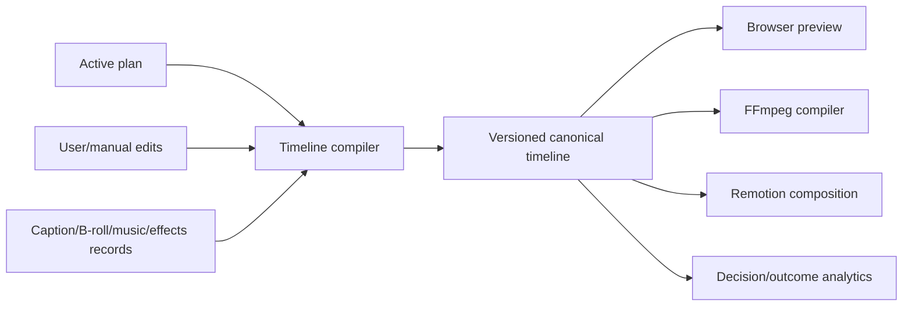

This resolves the most damaging class of bugs: the same edit having different meanings in state, preview, FFmpeg, and Remotion.

### 19.2 Separate control plane from media plane

Keep FastAPI responsible for validation, authorization, state transitions, and signed asset access. Let durable workers execute transcription, visual/audio models, FFmpeg, generation, and publishing directly. Each worker should load its domain record, execute idempotently, write progress/results, and return without routing compute through the API event loop.

Use specialized queues/images for:

- lightweight provider/API work;
- CPU FFmpeg;
- GPU analysis/inference;
- Demucs audio;
- Chromium/Remotion;
- publishing.

### 19.3 Make schemas executable contracts

Generate TypeScript clients/types from FastAPI OpenAPI or a shared schema source. Add database contract tests that compare repository payloads to a fresh migrated database. Version timeline/render manifests explicitly and provide migration functions for old JSON resources.

### 19.4 Measure outcomes, not intentions

Record suggestion displayed, user changed, render succeeded, export downloaded, and publish succeeded as separate events. Only label an edit “kept” when an outcome confirms it. Scope preferences by workspace/project/style and use deterministic latest-weighted aggregation.

## 20. Future work derived from the implementation

This is not a roadmap from a planning document; it is the work implied by code gaps and architectural pressure.

### Immediate stabilization

1. Repair and test migrations.
2. Fix container build and admin authorization.
3. Make plan cuts authoritative end to end.
4. Connect visual analysis and repair processing reload behavior.
5. Add CI for schema, containers, API, TypeScript, and minimal E2E.

### Product integrity

1. Publish a feature/engine support matrix and close preview parity gaps.
2. Implement or rename placeholder effects, background removal, auto-reframe, beat sync, and model training.
3. Complete templates and timeline manipulation for every manual element.
4. Add durable stock ingestion and asset/license provenance.
5. Add social token refresh, encryption, and provider error recovery.

### Scale and operations

1. Move compute to independent worker pools.
2. Stream all large-media paths.
3. Add queue/provider/render metrics, heartbeats, tracing, and dependency-aware readiness.
4. Add object/cache retention and quota management.
5. Implement real asynchronous batch orchestration.
6. Add recovery/idempotency tooling for partial provider jobs.

### Advanced intelligence

1. Use visual detections for tracked reframing and safe B-roll placement.
2. Add a real segmentation/matting model for background removal.
3. Build outcome-weighted preference retrieval before considering fine-tuning.
4. Add semantic stock embeddings for real provider candidates.
5. Add multilingual speech-aware caption alignment after translation.
6. Evaluate model services and quantization rather than loading all models into the API.

## 21. Operational readiness checklist

Before a production release, verify all of the following:

- [ ] Empty database migrates successfully and repository integration tests pass.
- [ ] RLS and workspace isolation tests pass for owner/member/non-member/service roles.
- [ ] Admin routes reject every non-admin authenticated user.
- [ ] API and worker images build reproducibly.
- [ ] Redis, Supabase, storage, FFmpeg, worker, and provider checks drive readiness.
- [ ] Plan cut edits are proven in encoded output for both engines.
- [ ] Visual analysis is automatically scheduled and observable.
- [ ] Large files are streamed and memory ceilings are load-tested.
- [ ] Social tokens are encrypted and refresh paths are tested.
- [ ] Secrets exist only in a secret manager; repository secret scan is clean.
- [ ] Source, cache, transcript, generated asset, and export retention policies are active.
- [ ] Render/publish idempotency and retry behavior is tested with real Redis.
- [ ] Billing failure/refund semantics and webhooks are tested in Stripe sandbox.
- [ ] Preview/renderer golden tests cover supported effects and formats.
- [ ] Provider rate limits, costs, and failure alerts are measured.
- [ ] Backups and database restore are tested.
- [ ] Accessibility, browser compatibility, privacy, and legal reviews are completed.

## 22. Evidence map

The following paths are the principal implementation evidence for this document:

| Area | Source paths |
|---|---|
| Runtime composition | `apps/api/app/main.py`, `apps/api/app/core/config.py` |
| Auth and tenancy | `apps/api/app/services/auth.py`, `apps/api/app/api/dependencies.py`, identity SQL migrations, `apps/web/proxy.ts` |
| Upload/storage | `apps/api/app/api/uploads.py`, upload repositories/services, `apps/web/components/upload-video.tsx` |
| Transcription/audio | `apps/api/app/api/captions.py`, transcription/audio services, caption repositories/schemas |
| Visual intelligence | `apps/api/app/api/visual.py`, visual services/repository/schema |
| Planning/style | `apps/api/app/api/plans.py`, `services/edit_planner.py`, `services/style_classifier.py` |
| Editor | `apps/web/components/editor-client.tsx`, `apps/web/components/editor/**`, `apps/web/lib/timeline.ts` |
| B-roll/music/effects | corresponding API, repository, schema, and service modules under `apps/api/app` |
| Rendering | `apps/api/app/api/renders.py`, `services/render_jobs.py`, `services/ffmpeg_render.py`, `apps/renderer/src/**` |
| Queues/workers | `apps/api/app/services/queue.py`, `apps/worker/src/**` |
| Billing/publishing | `apps/api/app/api/billing.py`, `services/billing.py`, publishing API/services/repositories |
| Scale/analytics | `apps/api/app/api/scale.py`, `services/scale.py`, analytics API/repository/services, `ScalePanel.tsx` |
| Database/security | `infra/migrations/*.sql`, `supabase/config.toml` |
| Toolchain/deployment | root/package manifests, Dockerfiles, `infra/docker-compose.gpu.yml`, environment examples |
| Verification | `apps/api/tests/**` and package scripts in each manifest |

## 23. Final assessment

Motionly is more than a UI prototype: it has real domain models, provider integrations, media analysis, rendering, versioning, persistence, queues, billing, publishing, and analytics. Its architecture demonstrates a coherent product direction around AI-assisted but user-controlled video editing.

Its main risk is not missing breadth; it is semantic and operational consistency. The edit timeline, preview, FFmpeg renderer, Remotion renderer, database history, queue model, and UI claims have evolved at different speeds. The next engineering milestone should therefore be correctness consolidation: one canonical timeline, one tested database baseline, true worker isolation, explicit feature parity, and production-grade authorization and token handling. Once those foundations are corrected, the existing feature surface can become a reliable end-to-end product rather than a collection of individually substantial but unevenly connected capabilities.

## 24. Detailed system architecture report

This section supplements the earlier system overview with component boundaries, runtime responsibilities, state ownership, and request execution paths. It does not replace the earlier architecture sections.

### 24.1 Logical architecture

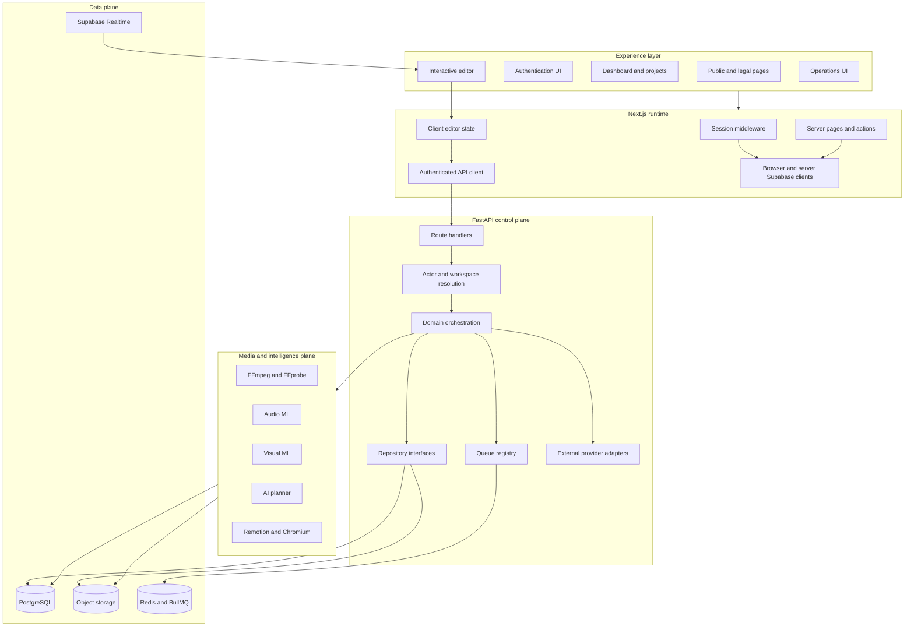

The architecture is best understood as a control plane with an incompletely separated media plane. FastAPI owns authorization, state transitions, persistence coordination, provider selection, and job creation. It also currently owns most expensive media operations, which is the principal boundary violation.

### 24.2 Deployment architecture

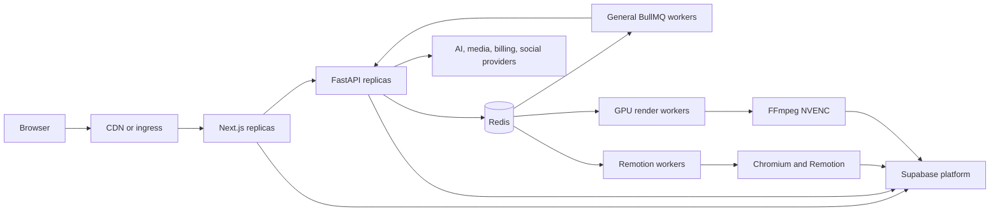

This diagram reflects the intended topology visible in code. The checked-in deployment material does not provision the complete topology. The GPU Compose file contains only GPU API/worker services, while the web application, Redis, Supabase, ingress, migrations, and secrets are external assumptions.

### 24.3 Trust boundaries

| Boundary | Trusted side | Untrusted or less-trusted side | Control |
|---|---|---|---|
| Browser to web | Next.js server | browser input/cookies | Supabase session, server validation, middleware |
| Browser to API | FastAPI | bearer token, workspace headers, payloads | JWT/user validation, membership lookup, Pydantic validation |
| Browser to storage | Supabase Storage | uploaded bytes | signed URL, object path, later FFprobe validation |
| Worker to internal API | FastAPI internal routes | worker network request | configured internal/admin token |
| Provider webhook to API | billing/publishing route | public internet payload | Stripe HMAC; provider-specific state/token controls |
| API to Supabase | service-role repositories | application code | explicit workspace-scoped repository queries |
| Web admin proxy to API | admin API | ordinary authenticated web user | currently insufficient; global token is attached before admin identity is proven |

### 24.4 State ownership

| State | Authoritative owner | Secondary/read model |
|---|---|---|
| User identity/session | Supabase Auth | web cookies and API actor |
| Workspace membership | PostgreSQL `workspace_members` | API actor context |
| Project/media domain | PostgreSQL | server page/API response state |
| Source/generated/export bytes | object storage | signed URLs and local processing cache |
| Durable queue state | BullMQ/Redis in production | API queue response objects and admin views |
| Editor unsaved interaction | browser React state | local undo stack |
| Persisted edit decisions | active `edit_plans` record and related domain tables | snapshots/render manifest |
| Collaboration manifest | `phase5_resources` JSON plus revision | browser realtime state |
| Render progress | render job/events plus BullMQ execution | SSE, polling, realtime UI |
| Subscription/usage | subscription and usage ledger tables | billing page and entitlement response |

The active edit plan should be the authoritative creative timeline, but render compilation currently derives alternative keep segments. That is a state-ownership conflict, not only a rendering defect.

## 25. Frontend architecture

### 25.1 Route architecture

The Next.js App Router separates the web surface into:

- public marketing and legal pages;
- authentication pages and callback route;
- protected application routes for dashboard, projects, account, billing, editor, and operations;
- application routes for health, GlitchTip tunneling, and legacy project creation.

The Next.js route proxy refreshes sessions and gates its configured protected route prefixes. Server components perform additional auth-context loading for individual pages. Client components own the high-frequency editor interaction state.

### 25.2 Frontend layer model

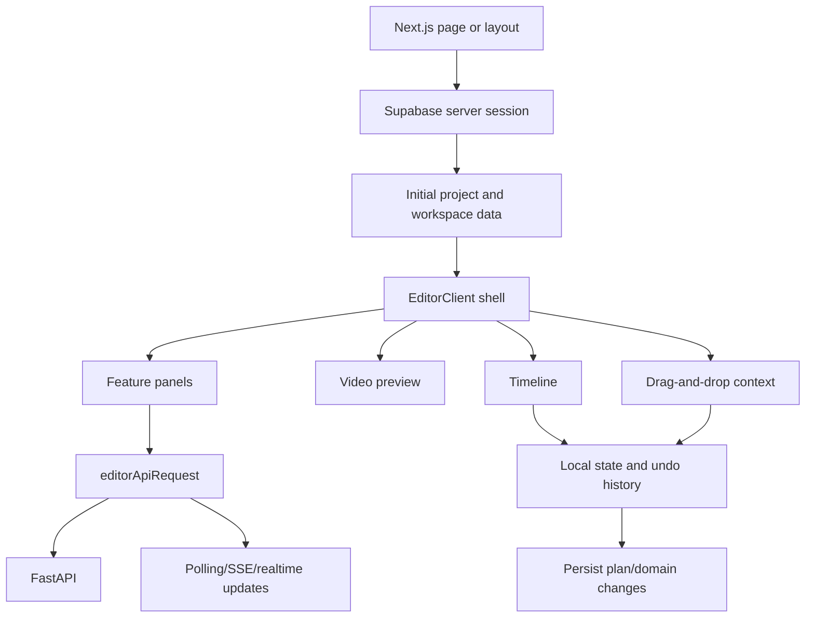

### 25.3 Data-access architecture

The frontend uses three access patterns:

1. **Supabase server reads:** server pages query user, workspace, project, upload, and related data directly.
2. **FastAPI domain requests:** editor operations, uploads, AI, rendering, billing, publishing, and analytics use an authenticated API helper.
3. **Supabase browser/realtime:** direct signed uploads and realtime project/collaboration/render updates.

Using both direct database queries and domain APIs is expedient, but creates two authorization, caching, error, and schema-coupling paths. A clear policy is needed: either expose read models through the API or formally document which read-only Supabase views are a supported web boundary.

### 25.4 Editor state architecture

The editor state contains:

- project identity/title and save status;
- active plan and cut list;
- transcript/caption tracks and segments;
- B-roll slots/library assets;
- music selection and regions;
- effects/framing/motion settings;
- manual elements;
- playhead, zoom, selection, active panel, playback state;
- local undo/redo snapshots;
- render/export/publish state.

State is partly initialized by the server, partly fetched asynchronously by panels, and partly duplicated between outer and inner editor clients. A more reliable architecture would centralize normalized editor state in one reducer/store, make API mutations explicit commands, and derive preview/timeline projections from the same canonical timeline.

### 25.5 Frontend rendering architecture

The browser preview is not the production renderer. It layers:

- an HTML video or WebGL canvas source;
- CSS/canvas transforms and effect approximations;
- caption components;
- manual overlay components;
- editor selection/handles and timeline indicators.

This is appropriate for interactive latency, but requires a declared preview fidelity contract. Unsupported or approximate output should be visually labeled so the user knows what is expected only after render.

### 25.6 Frontend strengths

- Strong feature discoverability through categorized panels.
- Direct upload avoids sending large media through Next.js.
- Server-side session and initial data reduce unauthenticated flashes.
- Shared TypeScript types improve editor/renderer consistency where current.
- Local undo/redo and server snapshots cover short- and long-term recovery.
- Polling, SSE, and realtime options support long operations.

### 25.7 Frontend gaps

- No substantive automated web tests.
- Duplicate state ownership inside the editor.
- Direct Supabase and API read paths overlap.
- Processing reload can remain stale.
- Hard-coded plan/usage text conflicts with real billing.
- Several palette options do not map to working output.
- Preview does not provide full audiovisual/render fidelity.
- No workspace switcher/team-management flow.
- No implemented screen recorder or voice-over recorder.
- Accessibility behavior, keyboard editing coverage, focus management, and screen-reader semantics are not validated by tests.
- Translation is supported for caption output, but the application UI itself is not internationalized.

## 26. Backend architecture

### 26.1 Application composition

`apps/api/app/main.py` acts as the composition root. At startup it:

1. loads settings;
2. validates production requirements;
3. selects Supabase or in-memory repositories;
4. selects local/Supabase storage;
5. creates the queue registry;
6. selects fixture or real providers;
7. creates media/ML service objects;
8. configures middleware, logging, and exception handling;
9. attaches dependencies to application state;
10. includes domain routers.

This provides explicit dependency substitution for tests. The downside is a large mutable `app.state` service locator rather than narrow constructor-injected domain services.

### 26.2 Request lifecycle

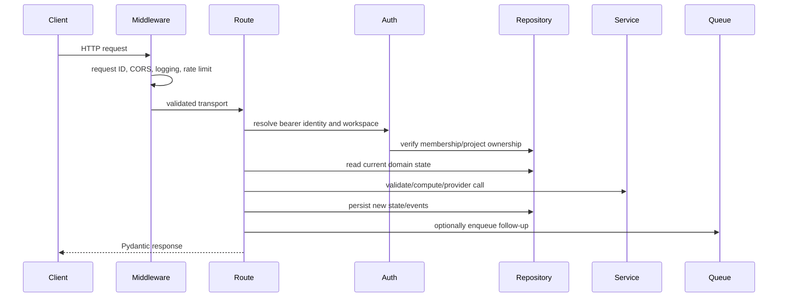

### 26.3 Backend layers

| Layer | Responsibility | Current concern |
|---|---|---|
| API routes | transport, actor dependency, orchestration, response models | some routes perform too much synchronous work |
| Schemas | Pydantic validation and serialized contracts | manually duplicated with TypeScript |
| Repositories | in-memory/Supabase CRUD and tenant filters | real schema not integration-tested from empty migrations |
| Services | provider adapters, planning, ML, FFmpeg, queue helpers | contains blocking compute called from async routes |
| Core | settings, authentication, logging, middleware | rate limiting is process-local and pre-auth keyed |
| Application state | dependency registry | broad mutable service locator |

### 26.4 Repository architecture

Each domain generally supplies an in-memory repository for deterministic tests and a Supabase REST repository for production. This is effective for fast route tests, but the two implementations can diverge because no shared conformance suite runs every repository operation against both.

The Supabase service role bypasses RLS, so repository workspace filters are security-critical. RLS remains valuable for direct web queries and defense in depth but does not protect a buggy service-role query.

Recommended repository improvements:

- define formal repository protocols/interfaces;
- run identical contract tests against in-memory and Supabase implementations;
- centralize workspace/project scope predicates;
- replace generic JSON resources with domain tables once behavior stabilizes;
- stream binary objects rather than materializing them in memory.

### 26.5 Error and status model

The API uses structured application errors with HTTP status, machine-readable code, and message. Long operations persist explicit statuses and error messages. Uploads, renders, publishing jobs, and scale resources have domain-specific states.

Status vocabularies have drifted between Python and SQL, especially rendering. All state machines should be declared once, enforced through legal transition functions, and verified against database enums/check constraints.

### 26.6 Backend strengths

- Explicit workspace actor and repository scoping.
- Pydantic validation across a large surface.
- Provider abstraction with fixtures.
- Versioned plan/render/caption/intelligence schemas.
- Domain events for uploads/renders and idempotent Stripe webhook handling.
- Production configuration validation catches many unsafe defaults.

### 26.7 Backend gaps

- Blocking work inside asynchronous API execution.
- Large composition root and state locator.
- No transactional unit of work spanning related REST writes.
- In-memory and Supabase repository behavior is not automatically compared.
- Database migrations are not the verified source of truth.
- Several analytics errors are silently discarded.
- Provider responses and large media are frequently buffered.
- Distributed rate limiting, tracing, metrics, and idempotency are incomplete.

## 27. Worker architecture

### 27.1 Worker components

| File/component | Responsibility |
|---|---|
| `queue-common.mjs` | queue names, Redis connection settings, common job options |
| `queue-bridge.mjs` | command-line bridge used by Python to enqueue/list/retry/cancel BullMQ jobs |
| `worker.mjs` | creates BullMQ workers, dispatches queue jobs, handles retries/retention and health behavior |
| `remotion.mjs` | obtains signed inputs, invokes Remotion CLI, reports progress/completion/failure |

### 27.2 Queue topology

| Queue | Intended workload | Actual execution |
|---|---|---|
| `upload_preprocess` | probe, validate, thumbnail | worker calls internal FastAPI runner |
| `transcription` | audio extraction, transcript and audio intelligence | worker calls FastAPI |
| `visual_analysis` | frame sampling and CV models | worker calls FastAPI |
| `planning` | AI plan generation | much work already synchronous; callback may skip |
| `stock_search` | B-roll search/selection | much work already synchronous; callback may skip |
| `audio` | music/caption/audio work | mixed synchronous/callback behavior |
| `render` | FFmpeg or Remotion rendering | FFmpeg via FastAPI callback; Remotion directly in worker |
| `render_gpu` | GPU FFmpeg render | FastAPI callback in GPU API topology |
| `publish` | social provider publishing | worker calls FastAPI |
| `intelligence` | stems, Runway, profiles, adapters, batch work | worker calls FastAPI for queued kinds |

### 27.3 Job lifecycle

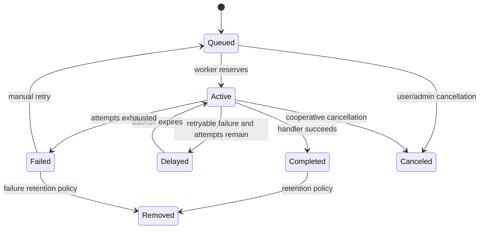

Domain render status has a richer lifecycle than BullMQ state: queued, preparing/processing, rendering, uploading, complete/succeeded, failed, and canceled. Queue state and domain state must not be treated as interchangeable.

### 27.4 Worker reliability concerns

- A completed BullMQ callback can represent work performed inside the API rather than the worker.
- Cancellation is only reliable where the executing handler checks persisted cancellation.
- Stuck-job dead-letter behavior differs between in-memory and BullMQ implementations.
- Worker/API internal callbacks need network-level protection in addition to tokens.
- API callbacks make API availability a dependency of every worker operation.
- Queue bridge subprocess creation adds overhead.
- There is no durable worker heartbeat/service-capacity registry.

### 27.5 Target worker architecture

Each queue handler should import a domain processing package or invoke a dedicated processing service directly, update progress in PostgreSQL, and upload outputs. FastAPI should enqueue and read state rather than execute the workload. Separate images should contain only the models/system packages needed for their queues.

## 28. Renderer architecture

### 28.1 Rendering decision flow

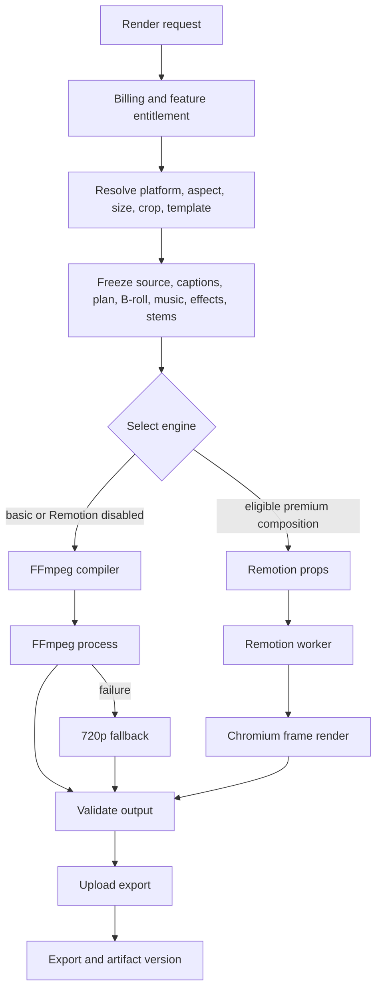

### 28.2 Immutable render input

Render creation freezes identifiers, schema versions, project/source metadata, output specifications, keep segments, captions, B-roll, music/mix, effects, manual elements, template, stems, entitlement decisions, and a props hash. This is a strong reproducibility pattern, provided all external assets remain available and the same engine version can interpret the manifest.

Current reproducibility limitations:

- stock media can remain at an external provider URL;
- provider-signed URLs expire and must be regenerated;
- renderer/application versions are not captured as immutable container digests;
- the plan cut list and render keep segments can disagree;
- generic resource JSON may change interpretation across versions.

### 28.3 FFmpeg architecture

The FFmpeg service constructs a filter graph and command line from render props. Its stages include:

1. download or resolve source and auxiliary inputs;
2. trim and concatenate calculated keep segments;
3. crop/scale/pad for the output frame;
4. apply supported grade/effect filters;
5. render ASS captions;
6. overlay timed B-roll/manual visuals;
7. trim/mix source dialogue or vocals stem, music, and SFX;
8. apply side-chain ducking/limiting;
9. add entitlement watermark;
10. encode with CPU codec or configured NVENC encoder;
11. validate and upload output;
12. retry through a 720p fallback when configured.

Its strengths are speed, deterministic media processing, and efficient basic composition. Its weakness is the difficulty of expressing rich browser-style animation and the current incomplete mapping of effect/manual-element semantics.

### 28.4 Remotion architecture

The Remotion worker obtains signed media URLs, resolves the prebundled composition, and invokes Chromium rendering. The root composition delegates to:

- video scene transformation and effect logic;
- animated caption components;
- B-roll/manual element layers;
- music/SFX and speech-aware volume functions;
- template registry components.

React composition makes captions, transforms, filters, and animated overlays easier to express. Rendering is heavier and depends on Chromium/fonts/browser media decoding. The current composition uses the continuous source video instead of building a sequence of kept source intervals.

### 28.5 Renderer parity contract

Every effect/manual element should be classified as:

- supported identically by both engines;
- supported with documented visual differences;
- Remotion-only;
- FFmpeg-only;
- preview-only/experimental;
- unsupported and rejected before render.

The UI should filter controls based on selected engine/capabilities. Silent approximation is the least reliable behavior because a successful render can still violate user intent.

### 28.6 Renderer success criteria

A render is not merely successful when an MP4 exists. Correctness requires:

- expected source intervals in expected order;
- expected duration within frame tolerance;
- captions synchronized after source-time mapping;
- B-roll and manual elements visible at requested output time;
- music/SFX/stems synchronized and free of clipping;
- correct aspect, dimensions, codec, FPS, and watermark;
- no missing remote assets;
- deterministic manifest/version traceability;
- equivalent supported semantics across preview and selected engine.

## 29. Pipeline architecture

### 29.1 Upload-to-ready pipeline

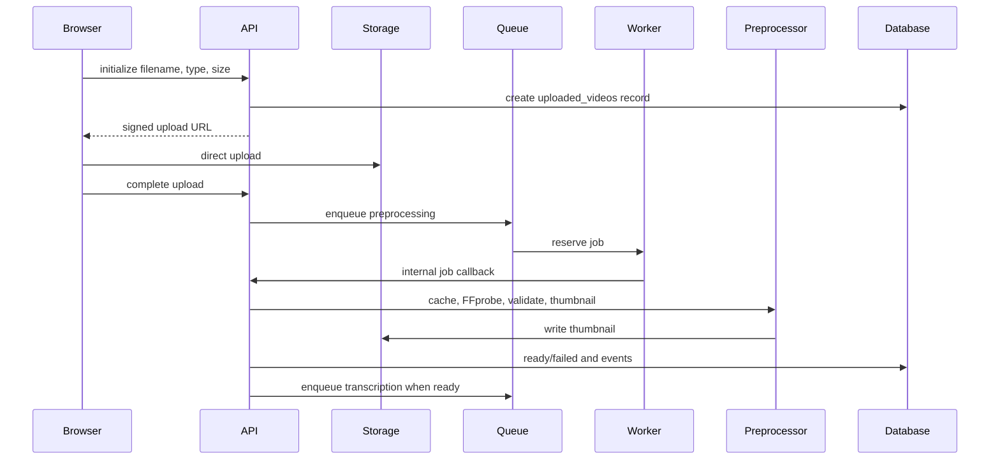

Failure points include expired/misused signed URLs, incomplete objects, unsupported codecs, absent audio, oversized/duration-limited media, FFprobe/FFmpeg failures, local disk exhaustion, and status drift between storage and database.

### 29.2 Ready-to-edit pipeline

1. Extract audio.
2. Transcribe into words and segments.
3. Derive audio intelligence.
4. Optionally analyze visuals—currently not automatic.
5. Classify style from prompt/transcript/audio/visual data.
6. Generate and normalize an edit plan.
7. Generate caption track and optional translation.
8. Resolve B-roll, music, and effects.
9. Hydrate editor state and preview.
10. Persist manual changes, feedback, and snapshots.

The largest missing dependency edge is step 4. The largest semantic break is between step 9's edited cuts and final render compilation.

### 29.3 Edit-to-export pipeline

1. Authenticate actor and workspace.
2. Load project, active upload, active plan, captions, B-roll, music, effects, manual elements, and optional stems.
3. Evaluate billing usage and feature entitlements.
4. Resolve target platform, dimensions, crop, duration, template, watermark, and queue priority.
5. Build immutable manifest/render props.
6. Record render usage and analytics “kept” events.
7. Create render job/events and enqueue.
8. Worker dispatches to FastAPI FFmpeg or local Remotion.
9. Encode, validate, upload, and create export/artifact version.
10. Emit progress/terminal events to polling/SSE/realtime clients.
11. Return signed download or allow publish selection.

Steps 3 and 6 currently charge/label intent before successful output. A reservation/finalization model would produce more accurate quota and analytics.

### 29.4 Export-to-publish pipeline

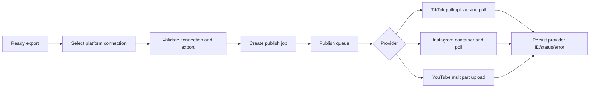

Provider status, privacy, token expiry, media constraints, and polling timeouts must be mapped into a common publish state. Token refresh is the principal missing lifecycle step.

## 30. AI and media-intelligence architecture

### 30.1 AI pipeline

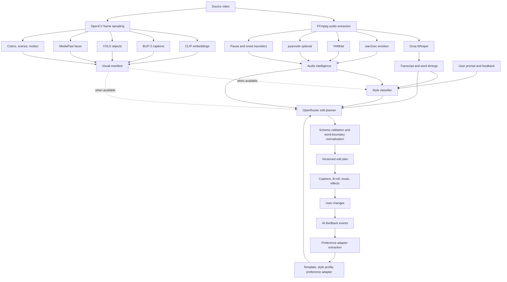

### 30.2 Model and algorithm inventory

| Function | Model/algorithm | Input | Persisted output | Fallback/degradation |
|---|---|---|---|---|
| Speech recognition | Groq Whisper `whisper-large-v3-turbo` | mono 16 kHz audio | transcript/words/language/confidence | fixture outside production |
| Speech emotion | wav2vec2 model | audio windows | emotion dimensions/label | fixture provider mode; otherwise failure can affect job |
| Audio events | YAMNet | waveform | class scores/labels | labels currently numeric IDs |
| Speaker diarization | pyannote 3.1 | audio | speaker spans | optional based on token |
| Rhythm/pause | signal and transcript heuristics | audio/words | pause map, density, BPM equivalent | deterministic heuristic |
| Scene sampling | OpenCV | source frames | timestamps/scenes/motion/colors | fixture visual provider |
| Image-text embedding | CLIP ViT-B/32 | frames | embeddings | fixture visual provider |
| Frame description | BLIP-2 OPT 2.7B | frames | captions | fixture visual provider |
| Object detection | YOLOv8n | frames | objects/confidence | fixture visual provider |
| Face detection | MediaPipe | frames | face boxes | fixture visual provider |
| Style selection | weighted rules/classifier | text/audio/visual/request | one of 14 styles and scores | transcript/audio-only when visual absent |
| Edit planning | OpenRouter chat model | transcript/intelligence/instructions | cuts, highlights, B-roll, music, effects | deterministic fixture/nonproduction fallback |
| Caption translation | OpenRouter chat model | caption segment strings | translated segments | fail unavailable; no silent original fallback |
| B-roll ranking | rules plus optional embeddings | request/candidate metadata | ranked assets/slots | lexical/provider rank when embeddings absent |
| Stem separation | Demucs `htdemucs` | source/audio | vocals and no-vocals WAV | fixture outside production |
| Generated B-roll | Runway `gen3a_turbo` | prompt image/text | generated video asset | endpoint unavailable without key |
| Preference adaptation | event reduction | changed/rejected/kept analytics | preference JSON | not machine-learning training |

### 30.3 AI data lineage

Every AI output should be traceable to:

- source upload and transcript version;
- audio/visual intelligence schema/model identifiers;
- planner provider/model and prompt/schema version;
- user request, feedback, template/profile/adapter versions;
- normalized output and original provider payload/hash;
- user changes and active plan version;
- render manifest and final outcome.

Parts of this lineage exist through IDs, schema versions, manifests, raw metadata, and hashes. Model binary/version hashes, full prompt-template versioning, and container/engine build IDs are not consistently captured.

### 30.4 AI safety and quality concerns

- Visual/audio inference processes faces, voices, emotion, and speaker identity-like information without a visible consent/retention framework.
- Planner and translation provider calls transmit transcript/content to external services.
- Provider output is schema-normalized but can still be semantically poor.
- Generated and stock media require licensing/provenance review.
- Emotion labels should not be presented as objective psychological truth.
- Preference learning can amplify incorrect or project-specific signals.
- Fixture providers must remain impossible in production; startup validation currently enforces this for core providers.

### 30.5 AI evaluation framework needed

Offline evaluation should include:

- word error rate and timestamp error by language/audio condition;
- caption segmentation readability and words-per-line;
- cut precision/recall against human edits and boundary error in milliseconds;
- style top-1 agreement and confidence calibration;
- B-roll relevance, diversity, face occlusion, and duplicate rate;
- translation adequacy, tone retention, overflow, and timing fit;
- emotion/speaker model accuracy and abstention behavior;
- render realization rate: percentage of AI decisions actually visible in final output;
- user acceptance/change/rejection by layer and content type.

## 31. State machines and consistency rules

### 31.1 Upload state

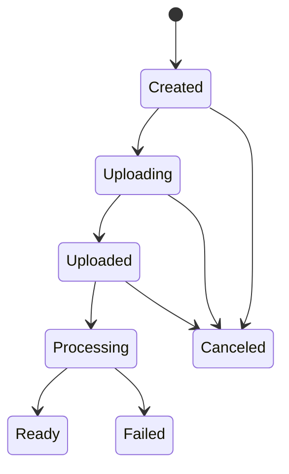

The source object, upload row, and event history must agree. Completion should verify object existence/size/type before processing; user B-roll/style-reference completion paths currently perform less validation than the primary upload path.

### 31.2 Render state

The Python domain expects states around queued, preparing/processing, rendering, uploading, complete/succeeded, failed, and canceled. SQL does not currently guarantee this vocabulary on a fresh install. Legal transition enforcement should be centralized rather than spread across API, worker, and internal-render callbacks.

### 31.3 Publishing state

Publishing moves from queued through provider submission/processing to published or failed/canceled. Provider-side async states must survive API/worker restarts. Expired credentials, rejected privacy/media settings, and provider timeouts should be separate retryability classes.

### 31.4 Consistency invariants

The system should enforce these invariants:

1. Every project-scoped record belongs to the actor's workspace.
2. A ready upload has a valid source object and probe metadata.
3. A ready transcript references a ready upload and ordered non-overlapping word times.
4. An active plan references the transcript/source version used to create it.
5. Caption/B-roll/music regions are valid within canonical output duration.
6. Render manifest input versions cannot mutate after enqueue.
7. A successful render has a validated object and exactly one canonical export relation.
8. A published job references a ready export and active authorized connection.
9. Usage and “kept” analytics reflect settled outcomes rather than job intent.
10. Every state transition is idempotent under queue retry.

## 32. Success metrics and measurement framework

No official target values are encoded in the project. The following metrics are therefore a report framework: some can be computed from current tables/events, while others require additional instrumentation. Targets should be set only after baseline collection by content type, media length, engine, provider, plan, and environment.

### 32.1 North-star metric

**Successful publish-ready exports per active workspace per week** is the most defensible product-level metric.

A successful publish-ready export should mean:

- a real uploaded source;
- an export completed without fallback-induced feature loss or missing assets;
- output passes codec/dimension/duration validation;
- the user downloads it, explicitly approves it, or successfully publishes it.

Current code can count completed exports but cannot reliably distinguish user-approved/publish-ready value because download and explicit acceptance are not fully modeled.

### 32.2 Activation funnel

| Metric | Formula | Current source | Instrumentation status |
|---|---|---|---|
| Signup-to-workspace activation | users with created workspace / signups | Auth plus workspaces | derivable with joined platform data |
| Project creation rate | users creating a project / activated users | `projects` | derivable |
| Upload start rate | projects with upload / created projects | `uploaded_videos` | derivable |
| Upload readiness rate | ready uploads / completed upload attempts | uploads/events | derivable |
| First plan rate | projects with plan / ready-upload projects | `edit_plans` | derivable |
| First export rate | projects with successful export / ready-upload projects | renders/exports | derivable after schema repair |
| Time to first export | first export completion - project/upload creation | timestamps | derivable |
| Publish/download completion | downloaded or published exports / successful exports | publish jobs plus new download event | download event missing |

### 32.3 AI/editor quality metrics

| Metric | Definition | Current status |
|---|---|---|
| Layer acceptance rate | explicit kept decisions / displayed suggestions | current “kept” is recorded too early and must be corrected |
| Change rate | changed decisions / displayed suggestions | available from feedback events |
| Rejection rate | rejected decisions / displayed suggestions | available from feedback events |
| Cut boundary correction | median absolute user boundary movement | can be derived if before/after payload is consistently captured |
| Caption correction rate | edited caption tokens / generated tokens | payload exists in events; needs aggregation/token diff |
| B-roll replacement rate | swapped/removed slots / generated slots | routes/events partly support; add explicit slot lifecycle metrics |
| Render realization rate | planned decisions represented in output / planned decisions | not instrumented; requires manifest/output validation |
| Undo-after-AI rate | AI operation followed by undo within session | local undo is not persisted |
| Regeneration rate | regenerated layers / generated layers | partially derivable from plan/events |
| Style reuse rate | projects applying profile/template / eligible projects | resources and requests can support after explicit event |

### 32.4 Media-quality metrics

- transcription word error rate on labeled evaluation media;
- word timestamp median/P95 absolute error;
- caption overflow/collision rate;
- audio loudness and true-peak compliance;
- A/V synchronization error;
- black-frame/frozen-frame incidence;
- missing asset rate;
- output duration error versus canonical timeline;
- frame-boundary accuracy of cuts;
- failed decode/encode validation rate;
- fallback-render rate and reason;
- preview-to-output difference score for supported features.

These require automated media probes and golden reference assets. They are not available from current product analytics alone.

### 32.5 Reliability and performance metrics

| Metric | Required dimensions |
|---|---|
| API availability/error rate | route, status/code, workspace plan, version |
| API latency P50/P95/P99 | route and whether it performs blocking work |
| Queue wait time | queue, priority, worker pool |
| Job processing time | job kind, input duration/size, engine/model |
| End-to-end upload-to-ready time | media duration, size, codec |
| Ready-to-plan time | transcript/visual provider |
| Render real-time factor | render seconds / output seconds, engine/resolution/features |
| Render success/retry/fallback rate | engine, codec, GPU/CPU, failure code |
| Worker saturation | active/concurrency, CPU, RAM, GPU memory/utilization |
| Provider availability/latency | provider and endpoint/model |
| Storage/cache efficiency | download bytes, cache hit, disk use, eviction |
| Stuck/orphan job count | queue and age |

Current event timestamps support portions of queue/render duration, but there is no complete metrics exporter or worker resource telemetry.

### 32.6 Business and billing metrics

- active workspaces and weekly retained workspaces;
- projects, ready uploads, and approved exports per active workspace;
- free-to-paid conversion;
- render-limit encounter and upgrade conversion;
- monthly render usage by plan;
- failed-render quota reversals;
- subscription churn, past-due recovery, and cancellation;
- provider/compute/storage cost per successful approved export;
- gross margin per plan and workload type;
- Agency seat, batch, brand-kit, and API entitlement utilization after those flows exist.

Stripe and usage tables provide plan/usage foundations. Provider cost and approved-export events are not adequately instrumented.

### 32.7 Publishing metrics

- connection completion and failure rate per platform;
- active versus expired/revoked connections;
- publish submission and completion rate;
- time from export to published state;
- provider rejection reason distribution;
- token refresh success rate once implemented;
- platform-specific media validation failure;
- user-selected privacy distribution.

### 32.8 Security, privacy, and governance metrics

- unauthorized access attempts by boundary;
- cross-workspace authorization test failures—target must always be zero;
- secret/token exposure incidents—target zero;
- admin action audit coverage;
- provider-token encryption/rotation coverage;
- data deletion completion time and orphan-object rate;
- signed URL lifetime and unexpected access alerts;
- authentication bypass enabled in production—target zero;
- vulnerable dependency age/count and remediation time;
- backup/restore success and recovery time.

### 32.9 Success metric implementation priorities

1. Correct render-created “kept” analytics.
2. Add explicit export-approved, download-started/completed, and publish-completed events.
3. Add canonical timeline/output validation metrics.
4. Export API, queue, worker, provider, FFmpeg, and Remotion metrics.
5. Attribute compute/provider/storage cost to render IDs and workspaces.
6. Define dashboards for activation, quality, reliability, cost, billing, and security separately.
7. Establish baselines before selecting numeric SLOs or business targets.

## 33. Observability and operational analytics architecture

### 33.1 Existing signals

- structured application logging;
- Sentry/GlitchTip-compatible error reporting;
- upload events;
- render job events and progress;
- BullMQ job states;
- publish job status/errors;
- Stripe webhook records;
- usage ledger;
- AI feedback events;
- health/dependency endpoints;
- admin overview and queue/render actions.

### 33.2 Missing signals

- OpenTelemetry request/job trace propagation;
- Prometheus/OpenMetrics endpoint;
- worker heartbeat and capacity;
- model/provider request metrics;
- GPU, memory, disk, and cache telemetry;
- per-render cost attribution;
- object lifecycle/orphan metrics;
- admin and sensitive-data audit trail writes;
- client performance and editor crash/recovery metrics;
- explicit user outcome events.

### 33.3 Recommended correlation model

Every request and job should carry:

- request/trace ID;
- queue job ID;
- workspace/project ID in protected structured fields;
- upload/plan/render/export/publish IDs as applicable;
- provider/model/engine version;
- retry attempt;
- normalized error code;
- timing and resource/cost fields.

Sensitive transcript/media/token content should never enter logs or metric labels.

## 34. Data lifecycle and governance

### 34.1 Data categories

| Category | Examples | Sensitivity |
|---|---|---|
| Identity/tenant | user ID, email metadata, workspace membership | personal/access data |
| Source media | video, voice, faces, surroundings | high-sensitivity user content |
| Derived intelligence | transcript, speaker spans, emotion, objects, face boxes | sensitive inferred data |
| Creative state | plans, captions, manual elements, templates, feedback | proprietary user content |
| Output media | renders, thumbnails, generated B-roll, stems | user content and IP |
| Credentials | service keys, OAuth access/refresh tokens | critical secrets |
| Commercial | subscription, usage, Stripe IDs | financial/account data |
| Operational | logs, events, errors, analytics | can contain identifiers/metadata |

### 34.2 Current lifecycle

Objects are created throughout upload, analysis, generation, rendering, and publishing. Project deletion removes domain data through API/repository behavior, while individual library assets/connections can be removed. Local processing caches and generic resources do not expose a comprehensive retention scheduler. External stock media remains remote; generated/user media remains in storage.

### 34.3 Required governance controls

- documented retention duration by object/table category;
- cascading and asynchronous deletion with orphan scanning;
- user/workspace data export and deletion verification;
- encryption for social credentials and sensitive backups;
- processor/provider inventory and consent notices;
- regional/storage residency decisions;
- access/audit logging for administrative operations;
- backup retention and restore tests;
- model/provider policy stating whether submitted content is retained or trained on;
- deletion propagation to external providers where supported.

## 35. API, schema, and versioning strategy

### 35.1 Existing versioning

The code carries schema/planner versions in several plans, captions, visual manifests, render props, and artifacts. Plans and exports also have explicit versions/snapshots. This is valuable because stored JSON and rendering decisions outlive a single deployment.

### 35.2 Versioning gaps

- no generated client guarantees Python/TypeScript compatibility;
- JSON resource migrations are not centrally defined;
- provider/model versions and code/container build IDs are not always frozen;
- database migrations do not converge reliably from empty state;
- route URL versioning is absent, which is acceptable internally but risky for a promised Agency API;
- backwards-compatibility support windows are not defined.

### 35.3 Recommended contract governance

1. Generate TypeScript API contracts from OpenAPI.
2. Publish JSON Schema for canonical timeline/render manifests.
3. Add schema migration functions for persisted JSON versions.
4. Record app commit/build, model, provider, and renderer versions in manifests.
5. Add contract-diff CI checks and compatibility rules.
6. Version any external customer API before enabling Agency API access.

## 36. Cost architecture

The largest variable cost drivers are:

- Groq transcription minutes;
- OpenRouter planning and translation tokens;
- Pexels/Pixabay provider limits or commercial terms;
- Runway generation seconds;
- CPU/GPU analysis and FFmpeg/Remotion runtime;
- object storage and egress;
- Supabase database/realtime usage;
- Sentry event volume;
- social publishing transfer;
- large-model build, cache, and cold-start overhead.

Current admin provider costs are placeholders. Reliable unit economics require attributing provider requests, tokens, generated seconds, compute duration, GPU time, storage bytes, and egress to a workspace/project/render. “Cost per completed render” is insufficient if the output is never downloaded/approved; cost per successful approved export is the more useful unit.

Cost controls should include concurrency quotas, duration/file limits, provider budgets, per-plan feature gates, Runway confirmation, cache reuse, model specialization, output lifecycle policies, and anomaly alerts.

## 37. Accessibility, localization, and device support

### 37.1 Accessibility

The UI uses semantic buttons and labels in many components, but there is no automated accessibility suite or documented keyboard-only editing path. Drag-and-drop timelines, canvas handles, color/effect controls, modals, and dynamic progress require special testing for focus order, keyboard alternatives, screen-reader announcements, contrast, reduced motion, and error recovery.

### 37.2 Localization

Caption output translation supports seven languages. The web application strings, legal content, dates/numbers, error messages, and right-to-left layout are not internationalized. Arabic captions do not imply the overall editor supports RTL layout.

### 37.3 Device/browser support

The primary editor is desktop-oriented because of its multicolumn panels, canvas, drag-and-drop, and multitrack timeline. No browser/device compatibility matrix or automated mobile editing test is present. WebGL and media codec differences make Chrome, Safari, Firefox, iOS, and Android validation necessary.

## 38. Release and change-management report

The monorepo supplies common build, lint, typecheck, test, and formatting commands through Turborepo. It does not contain a complete CI/CD workflow.

A safe release pipeline should perform:

1. dependency install with locked versions;
2. secret and dependency scanning;
3. formatting, lint, TypeScript, Python tests;
4. web browser smoke/E2E tests;
5. fresh and upgrade database migration tests;
6. API/worker/web container builds;
7. golden-media FFmpeg/Remotion tests;
8. staging deployment and provider sandbox tests;
9. backward-compatible migration deployment before application rollout;
10. canary worker/API rollout with queue and error monitoring;
11. rollback that preserves forward-compatible database state;
12. post-deploy render/publish synthetic checks.

Release artifacts should record source commit, container digest, migration version, renderer build, model identifiers, and configuration schema. Database migrations should be forward-fixable because destructive rollback is unsafe once jobs/data use the new schema.

## 39. Expanded final report conclusions

The system has four strong product foundations:

1. broad domain coverage from upload through publishing;
2. rich machine-derived media understanding;
3. editable and versioned creative decisions;
4. dual rendering paths suited to both efficient processing and rich animation.

The architecture's central weakness is split authority. The active plan, derived keep segments, browser preview, FFmpeg graph, and Remotion composition can describe different videos. Queue state and domain state can describe different execution histories. SQL migrations and repositories can describe different schemas. UI labels and underlying algorithms can describe different capabilities.

The highest-leverage engineering program is therefore to restore single sources of truth:

- one canonical edit timeline;
- one tested database end-state;
- one authoritative queue/domain transition model;
- one generated API/schema contract;
- one explicit engine capability matrix;
- one outcome-based analytics definition.

Success should be judged by reliable, approved exports—not by route count, queued jobs, AI suggestions, or generated files alone. Once successful approved exports, realization quality, time-to-output, failure rate, and cost are measurable, the team can make defensible choices about model quality, feature investment, plan limits, and infrastructure scale.
