# Motionly Technical & Product Documentation

- **Version:** 1.0.0
- **Date:** July 5, 2026 (updated October 6, 2026: social publishing, Google sign-in and Sentry were removed from the product)
- **Author:** Staff Software Architect & Technical Writer
- **Target Audience:** Founder, New CTO, and Onboarding Engineers

---

> **Inference update (October 24, 2026):** AI providers are now configured through the provider-neutral inference registry ([registry guide](../ai-registry/README.md)). Where this snapshot names a specific provider for transcription, planning, objects, diarization, stems or video generation, read it as one example route: the deployed provider is whatever the operator's registry configures. Sections 2.13, 4.1 and the integration table below are current.

## 1. How to Read This Document

This document is structured as an end-to-end technical reference and architectural blueprint for the Motionly platform. It is designed to serve a dual audience:

1. **The Non-Technical Founder:** Chapters open with high-level summaries, conceptual analogies, and plain-English walk-throughs of what the code is doing and _why_ it was built that way.
2. **The New CTO and Core Engineers:** Underneath the executive summaries, you will find exhaustive, file-by-file, table-by-table, and endpoint-by-endpoint specifications containing precise paths to the actual source code.

Throughout this document, files are cited as clickable links using absolute paths. If you need to trace how a feature is implemented, simply click the path to jump directly to the relevant file in the repository.

---

<div style="page-break-after: always;"></div>

# Table of Contents

- [1. How to Read This Document](#1-how-to-read-this-document)
- [Part I — Product & Executive Overview](#part-i--product--executive-overview)
  - [1. Executive Summary & Product Purpose](#1-executive-summary--product-purpose)
  - [2. The User Journey Narrative](#2-the-user-journey-narrative)
  - [3. High-Level System Architecture Diagram](#3-high-level-system-architecture-diagram)
- [Part II — Repository & Tech Stack](#part-ii--repository--tech-stack)
  - [1. Monorepo Map & Structure](#1-monorepo-map--structure)
  - [2. Language & Framework Inventory](#2-language--framework-inventory)
  - [3. Build, Dev, and CI/CD Tooling](#3-build-dev-and-cicd-tooling)
- [Part III — Frontend (apps/web) Deep Dive](#part-iii--frontend-appsweb-deep-dive)
  - [1. Routing & Screen Map](#1-routing--screen-map)
  - [2. Component Architecture & Design System](#2-component-architecture--design-system)
  - [3. State Management & Data Fetching](#3-state-management--data-fetching)
  - [4. Styling & Thematic Design System](#4-styling--thematic-design-system)
  - [5. Walkthrough of Core User Workflows](#5-walkthrough-of-core-user-workflows)
- [Part IV — Backend API (apps/api) Deep Dive](#part-iv--backend-api-appsapi-deep-dive)
  - [1. FastAPI Application Structure & Middleware](#1-fastapi-application-structure--middleware)
  - [2. Endpoint Index](#2-endpoint-index)
  - [3. Core Services Inventory (`app/services/*`)](#3-core-services-inventory-appservices)
  - [4. Multi-Tenancy & Auth Model](#4-multi-tenancy--auth-model)
  - [5. Config & Environment Variables (`app/core/config.py`)](#5-config--environment-variables-appcoreconfigpy)
- [Part V — Background Processing & Workers](#part-v--background-processing--workers)
  - [1. Job/Queue Architecture](#1-jobqueue-architecture)
  - [2. Worker Concurrency & Execution Process](#2-worker-concurrency--execution-process)
  - [3. Worker Job Profiles](#3-worker-job-profiles)
  - [4. GPU Autoscaling & Custom GPU Worker Pool](#4-gpu-autoscaling--custom-gpu-worker-pool)
  - [5. Render Pipelines: Basic vs Premium](#5-render-pipelines-basic-vs-premium)
  - [6. End-to-End Media Processing Sequence Diagram](#6-end-to-end-media-processing-sequence-diagram)
- [Part VI — AI / ML Capabilities](#part-vi--ai--ml-capabilities)
  - [1. AI Capabilities & Models Architecture](#1-ai-capabilities--models-architecture)
  - [2. Capability Profiles](#2-capability-profiles)
  - [3. Prefetching, GPU Memory & VRAM Configurations](#3-prefetching-gpu-memory--vram-configurations)
- [Part VII — Database & Migrations Deep Dive](#part-vii--database--migrations-deep-dive)
  - [1. Database Schema Entity-Relationship Map](#1-database-schema-entity-relationship-map)
  - [2. Table-by-Table Reference](#2-table-by-table-reference)
  - [3. Migration History Narrative](#3-migration-history-narrative)
  - [4. Tenancy & Row-Level Security Enforcements](#4-tenancy--row-level-security-enforcements)
- [Part VIII — Security, Billing & Ops](#part-viii--security-billing--ops)
  - [1. Authentication and bypass flags](#1-authentication-and-bypass-flags)
  - [2. Billing & Subscription Integrations](#2-billing--subscription-integrations)
  - [3. Analytics, Retention & Ops](#3-analytics-retention--ops)
- [Part IX — Testing & Quality](#part-ix--testing--quality)
  - [1. Test Suites Structure](#1-test-suites-structure)
  - [2. Test Execution Profiles](#2-test-execution-profiles)
  - [3. Continuous Integration Pipeline (GitHub Actions)](#3-continuous-integration-pipeline-github-actions)
- [Part X — Known Risks, Gaps & Recommendations](#part-x--known-risks-gaps--recommendations)
  - [1. Prioritized Risk Register](#1-prioritized-risk-register)
  - [2. Next-Steps Roadmap](#2-next-steps-roadmap)
- [Appendices](#appendices)
  - [Appendix A: Environment Variables Reference](#appendix-a-environment-variables-reference)
  - [Appendix B: Repository Folder & Key File Map](#appendix-b-repository-folder--key-file-map)
  - [Appendix C: Glossary of Technical Terms](#appendix-c-glossary-of-technical-terms)
  - [Appendix D: Third-Party Services Dependencies](#appendix-d-third-party-services-dependencies)

<div style="page-break-after: always;"></div>

# Part I — Product & Executive Overview

## 1. Executive Summary & Product Purpose

Motionly is an automated video editor and Reel/Short generator designed to solve a single, massive bottleneck for content creators: the manual effort of turning raw, long-form talking-head videos into high-engagement, vertical, short-form clips (TikTok, Instagram Reels, and YouTube Shorts).

For a human editor, this process takes hours:

- Scrubbing through a 15-minute video to find the most engaging 60-second hooks.
- Removing silences, "ums," and "ahs" manually.
- Adding captions, centering the speaker, styling the text, and placing emojis.
- Sourcing relevant B-roll clips (stock video) to cover cuts and keep the viewer's eyes engaged.
- Selecting appropriate background music, mixing the audio stems, and applying zoom transitions.

Motionly automates this entire pipeline using a hybrid system: local machine learning models for visual and audio intelligence, API-hosted LLMs for editing decisions, and a high-performance rendering stack (FFmpeg + Remotion).

### The Core Value Proposition

Motionly's value is centered on **automated storytelling**. The system doesn't just cut video at random intervals; it extracts semantic meaning from speech, detects emotions from tone of voice, samples visual composition, and uses a Large Language Model (LLM) acting as a "virtual director" to draft an edit plan.

### Conceptual Analogy: The Automated Assembly Line

Imagine a physical factory that takes in raw timber (long-form video) and outputs polished, ready-to-sell furniture (Shorts):

- **The Loader (Preprocessing):** Inspects the wood, checks its dimensions, and slices off the audio track.
- **The Transcribers & Inspectors (Audio/Visual ML):** Read the text, count the speakers, detect the emotional highs/lows, identify what objects are in the frame, and track where the speaker's face is located.
- **The Designer (Edit Planner LLM):** Looks at the blueprint (transcript + visual analysis) and decides exactly where to cut, when to zoom, and what stock B-roll to overlay.
- **The Assembly Worker (FFmpeg/Remotion Renderers):** Glues the pieces together, overlays the text captions, mixes the background music, and polishes the finished product.
- **The Shipping Desk (Exports):** Hands the finished video back to the creator, who downloads it through a short-lived signed link.

---

## 2. The User Journey Narrative

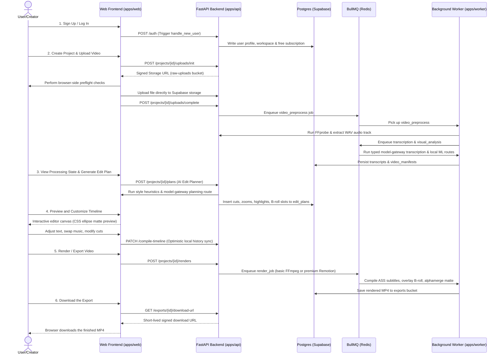

### Step 1: Onboarding and Workspace Provisioning

When a user signs up via the Web Frontend (`apps/web`), the Supabase Auth system verifies their email and password. Behind the scenes, a PostgreSQL database trigger (`public.handle_new_user()`) is fired automatically:

- Creates a `profile` record for the user.
- Provisions a default `workspace` titled "Creator's Workspace".
- Registers the user as the `owner` of the workspace in the `workspace_members` table.
- Sets up a standard `subscription` defaulting to the `free` tier.

### Step 2: Project Creation and Preflight Upload

The user lands on their dashboard, clicks "New Project," and enters a title. They are then prompted to upload their raw media.
The frontend performs **preflight checks** inside the browser before a single byte is sent over the network:

- Validates the video codec (checks for browser-supported formats).
- Enforces size limits and resolution bounds.
- Verifies aspect ratios (warning the user if they upload an already-vertical crop).

Once validated, the frontend requests a signed storage URL from the backend. It uploads the raw video file directly to the Supabase Storage bucket (`raw-uploads`) via HTTP PUT, bypassing the API server entirely to avoid memory bottlenecks. Once the upload finishes, the frontend calls the `/projects/{id}/uploads/complete` endpoint. This transitions the project's upload state to `processing` and pushes a `video_preprocess` job to the BullMQ redis queue.

### Step 3: Automated Processing (The Worker Machine)

The Node.js worker (`apps/worker`) picks up the `video_preprocess` task and spawns a Python sub-process. The process runs FFprobe to extract media metadata (exact duration, frame rate, resolution) and writes a `.wav` audio track.

From here, the pipeline forks into two concurrent tracks:

1. **Transcription & Audio Intelligence:** A typed transcription request is routed through the provider-neutral model gateway (the default production route uses Groq Whisper), returning timestamped word-level transcripts with route/revision provenance. Local Pyannote, Wav2Vec, and YAMNet audio intelligence is also registered as an explicit gateway route.
2. **Visual Intelligence:** GPU-equipped workers sample video frames at a rate of 2fps. Each frame is processed by local ML models: YOLOv8 counts faces and detects objects, CLIP extracts semantic visual embeddings, BLIP-2 captions the frame, and MediaPipe generates face trajectory maps.

All results are saved back to the Supabase database.

### Step 4: The Edit Plan (The AI Director)

The user enters the project editor workspace. The system triggers the **Edit Planner**.
First, a rule-based **Style Classifier** evaluates the transcript and audio metrics, classifying the video's theme (e.g., "High-Energy Business Coach," "Subdued Narrative Podcast," "Tech Review").
Second, the system packages the transcript, the visual scene boundaries, and the style configuration into a dense JSON payload. This is sent through the typed planning gateway; the default production route uses OpenRouter, while Azure or private OpenAI-compatible routes can be selected without changing the planner. The selected model returns a structured JSON edit plan detailing:

- A timeline cut-list (timestamps of clips to keep and parts to discard).
- Word highlights (words that should be highlighted in green/red).
- Zoom timestamps (when to apply a 1.2x camera punch-in to match vocal highlights).
- B-roll search queries (lexical search terms to retrieve related stock footage).

### Step 5: Visual Timeline and Manual Editing

The editor UI (`apps/web/components/editor-client.tsx`) renders the timeline. The user sees their talking-head video automatically sliced into a highlight reel. The transcription text is mapped to captions directly beneath the video preview. Emojis and keywords are highlighted.
As the user scrubs, plays, trims clips, changes caption styling, or drags-and-drops stock videos, these changes are pushed to an undo/redo stack managed by `EditorHistoryProvider`. Periodic background syncs patch the state to the FastAPI server using `/compile-timeline`.

_Note: For performance reasons, the frontend preview uses a simple CSS ellipse mask to simulate background removal, while the actual render will use a frame-by-frame alpha matte._

### Step 6: Rendering and Exporting

When satisfied, the user clicks "Export". The backend enqueues a `render_job`.

- **Basic Pipeline (FFmpeg):** Slices the raw video, mixes background audio tracks, generates an Advanced SubStation Alpha (`.ass`) caption overlay, and outputs an MP4.
- **Premium Pipeline (Remotion):** Bundles a React-based composition, launches a headless Chromium browser on the worker, draws every React frame (with custom animations, keyframed zooms, and particle overlays), and encodes the frames using FFmpeg nvenc (GPU-accelerated) or CPU encoders.

The output video is uploaded to the Supabase `exports` bucket.

### Step 7: Downloading the Export

The user opens the Export panel and selects "Download". The API checks that the export belongs to the user's workspace, records the download, and returns a signed URL that expires within five minutes; the browser then downloads the MP4 directly from the `exports` bucket.

---

## 3. High-Level System Architecture Diagram

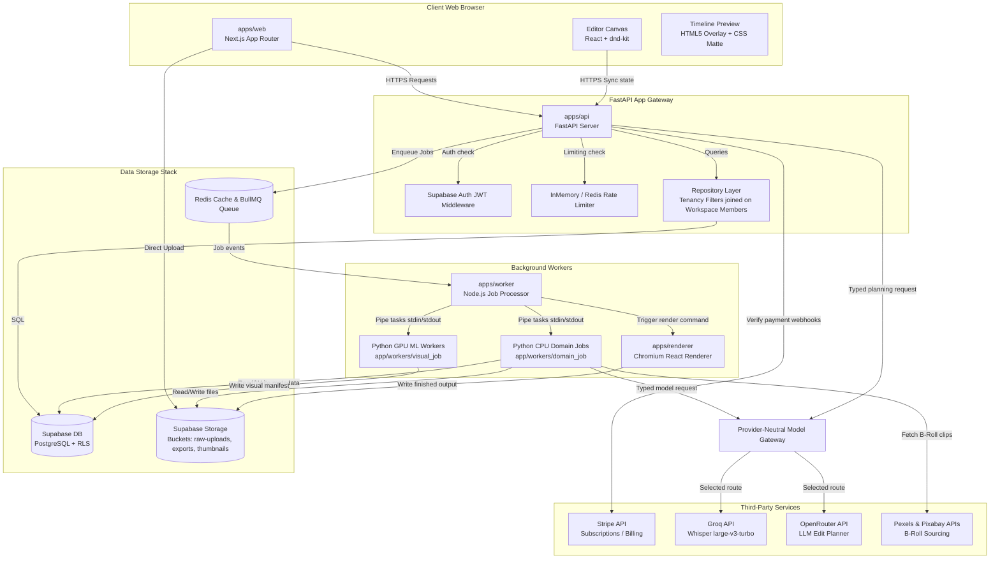

### Architecture Diagram Legend

- **Client Layer (Light Blue):** The Next.js client-side application running in the user's browser, handling interactive UI operations and local history.
- **FastAPI App Gateway (Dark Teal):** The gateway layer responsible for user authorization, API request validation, database connection pooling, and job scheduling.
- **Data Storage Stack (Orange/Yellow):** The database and object storage buckets managed by Supabase, and the Redis layer powering the job queue.
- **Background Workers (Purple):** The distributed job processors that handle computationally heavy workloads, isolated from the request-response thread of the API gateway.
- **Third-Party Services (Grey):** External network APIs queried asynchronously for billing, AI speech, LLMs, and media assets.

---

<div style="page-break-after: always;"></div>

# Part II — Repository & Tech Stack

## 1. Monorepo Map & Structure

Motionly is designed as a modular monorepo using **pnpm workspaces** and **Turborepo** for build orchestration and dependency management. A monorepo architecture was selected to keep the frontend code, Python FastAPI business logic, Node.js background workers, and shared schemas within a single repository. This prevents API schema drift and allows for single-command builds.

Below is the directory map of the codebase with descriptions of each system component:

```
.
├── apps/
│   ├── api/             # Python FastAPI backend (Uvicorn, Pydantic, httpx repositories)
│   ├── renderer/        # Remotion project for Chromium-based React video rendering
│   ├── web/             # Next.js App Router (Tailwind CSS, Supabase Auth client, Editor canvas)
│   └── worker/          # Node.js background job bridge (BullMQ, ioredis, subprocess runner)
├── packages/
│   └── shared/          # Shared contracts, OpenApi JSON schema, and TypeScript types
├── supabase/
│   └── migrations/      # PostgreSQL migrations (Ddl, custom plpgsql triggers, RLS policies)
├── .github/
│   └── workflows/       # CI pipelines (live contracts check, pre-check validation)
├── package.json         # Root pnpm configuration & task scripts
├── pnpm-workspace.yaml  # Workspace directory definitions
└── turbo.json           # Turborepo task configuration (build, test, lint dependencies)
```

### Why pnpm?

`pnpm` uses a global content-addressable store to save disk space and speed up installs. Instead of duplicating `node_modules` across all workspaces (`apps/web`, `apps/worker`, `apps/renderer`), `pnpm` hard-links files from the global store, leading to faster installs and isolated dependency trees that prevent packages from accidentally importing unlisted dependencies.

### Why Turborepo?

Turborepo (`turbo.json`) manages task execution across the monorepo. It parses the dependencies between workspaces and runs builds, checks, and tests in parallel.

- **Cache Hits:** If a package's files haven't changed, Turborepo skips running its build or test scripts, serving the cached output from `.turbo/` instead.
- **Dependency Graphs:** It guarantees that `packages/shared` is compiled _before_ `apps/web` or `apps/renderer` attempts to build, as defined in `turbo.json`:
  ```json
  "build": {
    "dependsOn": ["^build"],
    "outputs": [".next/**", "dist/**"]
  }
  ```

---

## 2. Language & Framework Inventory

Each service is built using specialized languages and frameworks tailored to its role:

| Application / Package | Primary Language   | Core Framework     | Key Dependencies & Versions                                                                                       | Architectural Rationale                                                                                                                                                                                                 |
| :-------------------- | :----------------- | :----------------- | :---------------------------------------------------------------------------------------------------------------- | :---------------------------------------------------------------------------------------------------------------------------------------------------------------------------------------------------------------------- |
| **apps/web**          | TypeScript (5.7.2) | Next.js (16.2.9)   | React (19.2.7)<br/>Tailwind CSS (3.4.17)<br/>Supabase SSR (0.5.2)<br/>Framer Motion (11.15.0)<br/>dnd-kit (6.3.1) | Next.js provides Server-Side Rendering (SSR) for SEO and routing, combined with React 19 for client-side state. Tailwind handles styling, Framer Motion does smooth transitions, and dnd-kit enables timeline dragging. |
| **apps/api**          | Python (>=3.12)    | FastAPI (0.115.6)  | Pydantic (2.10.4)<br/>Uvicorn (0.34.0)<br/>httpx (0.28.1)<br/>redis (5.2.1)                                       | FastAPI provides rapid, type-safe REST endpoint creation. Pydantic handles request/response serialization. Python is the industry standard for ML pipelines, simplifying service integration.                           |
| **apps/worker**       | JavaScript (ESM)   | Node.js (22+)      | BullMQ (5.78.0)<br/>ioredis (5.11.1)<br/>@supabase/supabase-js (2.49.4)                                           | Node.js excels at asynchronous I/O and event loop management. BullMQ is a robust Redis-backed queue manager. The worker manages job state and spawns sub-processes.                                                     |
| **apps/renderer**     | TypeScript (5.7.2) | Remotion (4.0.431) | React (19.0.0)<br/>@remotion/bundler<br/>@remotion/renderer                                                       | Remotion enables programmatic video composition in React, rendering web pages into video frames using Chromium.                                                                                                         |
| **packages/shared**   | TypeScript (5.7.2) | Static Types       | Generated OpenAPI schemas (openapi.json)                                                                          | Acts as the source-of-truth contract. Eliminates manually syncing types between Python and TypeScript.                                                                                                                  |
| **supabase**          | SQL (PostgreSQL)   | Postgres (15+)     | pgplsql<br/>Row-Level Security (RLS)                                                                              | Relational engine that manages authorization boundaries via RLS.                                                                                                                                                        |

---

## 3. Build, Dev, and CI/CD Tooling

### Turborepo Command Pipeline

The root `package.json` maps tasks to Turborepo:

- `pnpm dev`: Runs `turbo dev` to start Next.js, the FastAPI hot-reload server, and the BullMQ worker loop simultaneously.
- `pnpm build`: Compiles all packages and applications, verifying TypeScript and Next.js static layouts.
- `pnpm lint` / `pnpm typecheck`: Validates formatting and static types across all workspaces.
- `pnpm test`: Executes the test suites for Next.js unit tests, FastAPI pytest, and Remotion CLI smoke tests.

### GitHub Actions CI/CD Workflows

The project runs two workflows in `.github/workflows`:

1. **Live Provider Contracts Check (`live-provider-contracts.yml`):**
   Runs tests against live API providers (Groq, OpenRouter, Runway) using dummy payloads to ensure third-party response shapes have not drifted.
2. **Phase 0 Safety and Code Verification (`phase-0-safety.yml`):**
   Triggered on every Pull Request (PR) and push to `main`. It:
   - Sets up Node.js and Python environments.
   - Installs dependencies using `pnpm` and `pip`.
   - Runs `pnpm lint` and `pnpm typecheck`.
   - Runs database migrations on a local test database.
   - Executes `pytest` for the backend and `playwright` for the frontend.
   - Runs compiler smoke tests to verify Remotion frame generation.

### Production Compose Deployment

Production runs only on the single Azure VM Compose host. `infra/docker-compose.gpu.yml`
accepts required digest-pinned GHCR image inputs, while `infra/docker-compose.dev.yml` is
an explicit local source-build override. The signed release manifest, Azure OIDC deployment
workflow, host managed identity, Key Vault file secrets, and rollback process are documented
in `docs/ops/compose-vm-deployment.md`. Railway and managed-cluster deployment definitions
are intentionally unsupported.

### Dockerfile Breakdown

- **Root Dockerfile (`/Dockerfile`):**
  Uses `python:3.12-slim`. Installs `curl` for container health checks, copies the `app` code and project setup, and launches Uvicorn. Recommended for web gateways.
- **GPU Worker Dockerfile (`/apps/api/Dockerfile.gpu`):**
  Installs `ffmpeg`, `nodejs`, `npm`, and `libgl1`. Installs PyTorch compiled for CUDA 12.4 to leverage Nvidia GPU acceleration. Installs the `[visual-ml]` optional-dependencies and runs the Node.js BullMQ process wrapper:
  ```dockerfile
  CMD ["node", "src/worker.mjs", "--loop"]
  ```

---

<div style="page-break-after: always;"></div>

# Part III — Frontend (apps/web) Deep Dive

## 1. Routing & Screen Map

The Next.js frontend (`apps/web`) leverages the standard App Router under the `app/` directory. Access is separated into two layout folders: `(auth)` for public credentials entry and `(app)` for authentication-gated workspace screens.

Below is the routing directory map with detailed analysis:

| Route Path       | File Location                             | Access Gate | Client vs Server | Primary Actions & Data Hydration                                                         |
| :--------------- | :---------------------------------------- | :---------- | :--------------- | :--------------------------------------------------------------------------------------- |
| `/`              | `app/page.tsx`                            | Public      | Server/Client    | Landing page. Fetches static pricing tiers and visual theme selectors.                   |
| `/login`         | `app/(auth)/login/page.tsx`               | Public      | Client           | Auth entry point. Supabase sign-in with email and password.                              |
| `/dashboard`     | `app/(app)/dashboard/page.tsx`            | Auth-gated  | Client           | Lists user projects. Calls FastAPI `GET /projects` to populate bento grid elements.      |
| `/projects/new`  | `app/(app)/projects/new/page.tsx`         | Auth-gated  | Client           | Workspace creation. Post-validation submits project title and configuration parameters.  |
| `/projects/[id]` | `app/(app)/projects/[projectId]/page.tsx` | Auth-gated  | Client           | Core video workspace. Renders editor panels, timelines, previews, and progress bars.     |
| `/billing`       | `app/(app)/billing/page.tsx`              | Auth-gated  | Client           | Stripe checkout portal. Hydrates status from `GET /billing/status`, shows credit limits. |
| `/admin/ops`     | `app/(app)/admin/ops/page.tsx`            | Admin-gated | Client           | Launch Ops page. Retrieves active worker queues, cost attributions, and heartbeat stats. |

---

## 2. Component Architecture & Design System

The application layout is structured around an **asymmetric, boxy, pixel-art retro panel grid**. Styling tokens are declared inside `apps/web/app/globals.css` and mapped to Tailwind configuration properties.

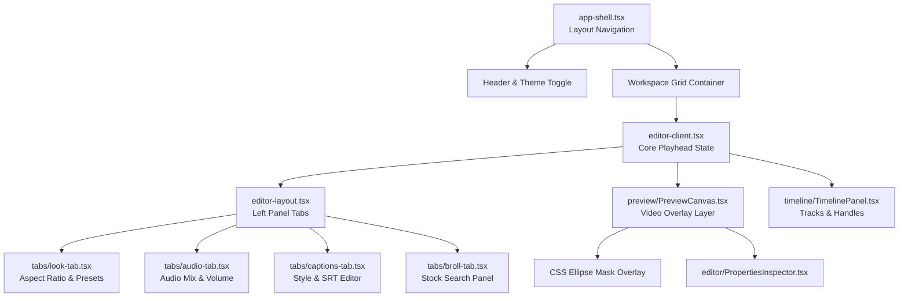

### Key Component Descriptions:

- **`app-shell.tsx`:** Coordinates the top-bar workspace menu, user profile badges, global pixel borders, and client-side notifications.
- **`editor-client.tsx`:** The state controller of the editor. It holds the active playhead milliseconds (`playheadMs`), active timeline tracks, loaded media manifests, and routes actions to history contexts.
- **`editor-layout.tsx`:** Manages responsive panels. If the viewport is above `1024px`, it displays a bento bisection; on smaller devices, it shifts blocks to collapsible sliders.
- **`TimelinePanel.tsx`:** Employs `useTimeline` hooks to measure screen pixel widths relative to timeline zoom variables, drawing segment blocks, drag-and-drop targets, and scrubber heads.
- **`ui.tsx`:** Houses shared UI elements: custom checkbox containers, retro pixel-styled command buttons (`pixel-button`), and range sliders with custom key listeners.

---

## 3. State Management & Data Fetching

### Editor History & State Flow

The editor uses a **local-first, server-sync** state pattern. The main state is derived from database records via `buildTimelineState(project, editPlan)` inside `apps/web/lib/timeline.ts`.

State modifications (splitting a clip, shifting captions, muting a track) are routed through a history framework declared in [`history-context.tsx`](apps/web/components/editor/history-context.tsx):

1. **Durable Actions:** User actions are stored as serialized `DurableHistoryAction` entries (API path, request body, and output target).
2. **Double Stack:** The state maintains standard `undoStack` and `redoStack` arrays.
3. **Debounced Persistence:** Stack arrays are saved to `window.localStorage` in the browser, debounced by `250ms`. If the browser tab crashes, the history is restored upon reload.
4. **Action Dispatching:** Undoing/redoing executes the action payload against the FastAPI endpoint using `client-api.ts`. This triggers updates in the database and refetches the timeline state.

### The Generated API Client

Frontend fetch requests use the generated API client in `apps/web/lib/client-api.ts`. The client reads endpoint shapes from the shared OpenAPI contract `packages/shared/openapi.json` to ensure type safety:

- **Strict Typing:** Request payloads (e.g., Timeline cut lists) must strictly match the Pydantic schemas defined in the backend API.
- **JWT Injection:** Supabase JWT auth tokens are injected automatically into the `Authorization: Bearer <JWT>` header of all requests.

---

## 4. Styling & Thematic Design System

The design features a retro retro-console theme using custom colors, flat block shadows, and hard corners:

- **`globals.css` Design Tokens:** Uses HSL values to define styling parameters.
  - `--primary`: `172 72% 34%` (Retro teal green)
  - `--background`: `210 20% 98%` (Crisp newsprint background)
  - `--border`: `220 13% 18%` (Sharp charcoal frame)
  - `--muted-foreground`: `220 12% 32%` (Gray for subtexts)
- **Pixel-Art Utilities:**
  - `.pixel-panel`: Draws thick, double-pixel borders with custom corner cuts.
  - `.pixel-button`: Implements offsets (`translate-y-1`) and shadow shifts on hover/active states.
  - `.pixel-skeleton`: Retro stepping loading skeletons to show background states.

---

## 5. Walkthrough of Core User Workflows

### 5.1 Video Upload Flow

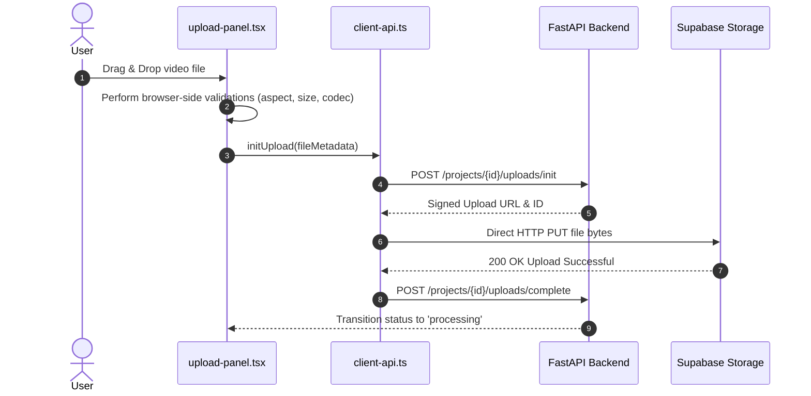

### 5.2 AI edit Flow

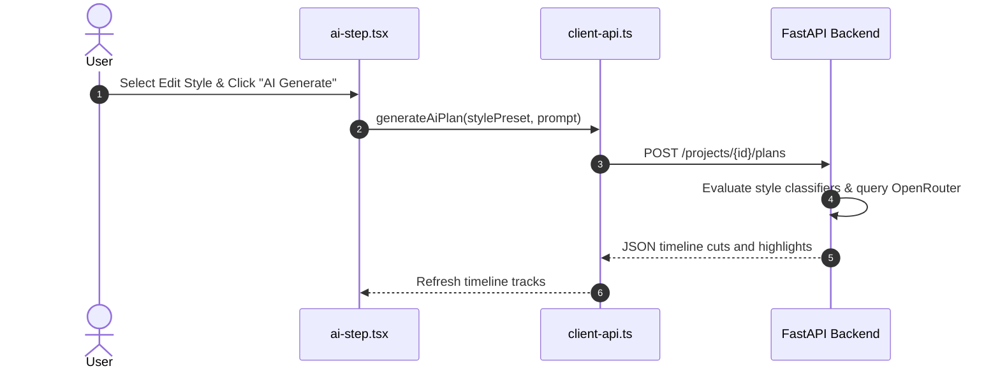

### 5.3 Manual Edit Flow

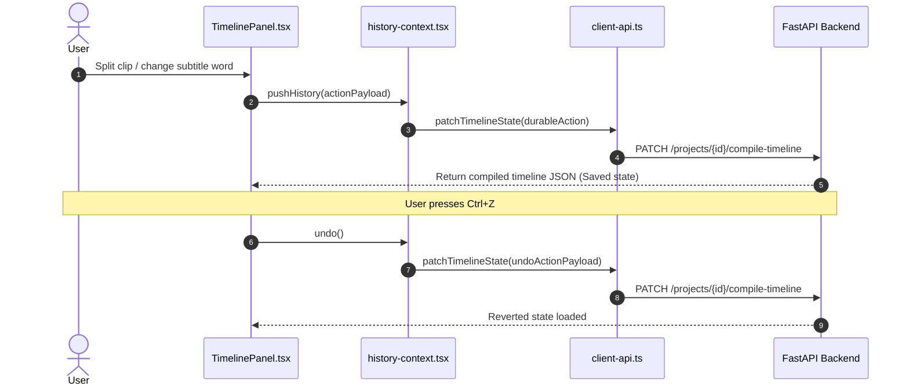

### 5.4 Export Flow

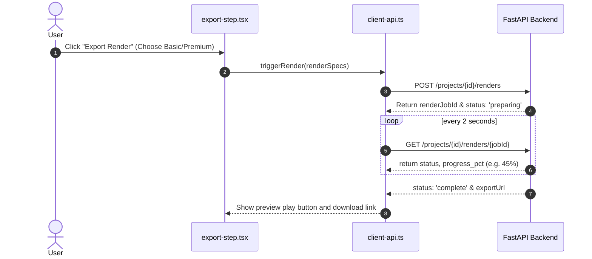

---

<div style="page-break-after: always;"></div>

# Part IV — Backend API (apps/api) Deep Dive

## 1. FastAPI Application Structure & Middleware

The backend core (`apps/api`) is built on **FastAPI (Python 3.12)**. The entry point is `app/main.py`, which initializes the FastAPI application instance, wires dependency injections, binds routes, and configures global middleware.

### Active Middleware Stack:

1. **Request ID & Tracing (`request_id_middleware` in `app/core/middleware.py`):**
   - Intercepts every incoming HTTP request.
   - Extracts or generates a unique `x-request-id` (e.g., `req_abc123...`) and a OpenTelemetry traceparent header.
   - Inject variables into context variables (`current_trace_id` and `current_request_counters`) for logging.
   - Measures database call frequency, worker queue calls, response payloads, and logs slow requests exceeding `1000ms`.
2. **CORS Middleware (`CORSMiddleware`):**
   - Configures origins specified in `API_CORS_ORIGINS` to allow browser clients to make cross-origin requests.
3. **Rate Limiting Middleware (`rate_limit_middleware` in `app/core/middleware.py`):**
   - Employs a Redis-backed token bucket key (`motionly:rate-limit:<window>:<actor_key>`) via `RedisRateLimiter`, falling back to an `InMemoryRateLimiter` if Redis is offline.
   - Limits API traffic to `120 requests per minute` by default, returning a `429 Too Many Requests` JSON response.
4. **Error Handlers (`api_error_handler` and `request_validation_error_handler` in `app/api/errors.py`):**
   - Catches custom `ApiError` exceptions and standard Pydantic validation errors, translating them into structured, client-readable error codes (e.g. `auth_token_invalid`, `project_not_found`).

---

## 2. Endpoint Index

Every router file resides under `app/api/*`. Below is a comprehensive index of the active endpoints:

| Route Path                        | Method | Purpose                                   | Auth Required | Primary Services & Repositories Called             |
| :-------------------------------- | :----- | :---------------------------------------- | :------------ | :------------------------------------------------- |
| `/projects`                       | `POST` | Create a new project                      | Yes           | `SupabaseProjectRepository`                        |
| `/projects`                       | `GET`  | List projects for active workspace        | Yes           | `SupabaseProjectRepository`                        |
| `/projects/{id}`                  | `GET`  | Fetch details of a single project         | Yes           | `SupabaseProjectRepository`                        |
| `/projects/{id}/uploads/init`     | `POST` | Generate signed URL for media upload      | Yes           | `SupabaseUploadRepository`, `StorageSigner`        |
| `/projects/{id}/uploads/complete` | `POST` | Mark upload complete, trigger processing  | Yes           | `SupabaseUploadRepository`, `PreprocessQueue`      |
| `/projects/{id}/plans`            | `POST` | Generate AI timeline cut edit plan        | Yes           | `SupabasePlanRepository`, `EditPlannerProvider`    |
| `/projects/{id}/captions`         | `GET`  | Get subtitle caption tracks               | Yes           | `SupabaseCaptionRepository`                        |
| `/projects/{id}/renders`          | `POST` | Start a video compilation render job      | Yes           | `SupabaseRenderRepository`, `RenderQueue`          |
| `/projects/{id}/renders/{jobId}`  | `GET`  | Check render job status and progress      | Yes           | `SupabaseRenderRepository`                         |
| `/billing/status`                 | `GET`  | Fetch user Stripe limits and subscription | Yes           | `SupabaseBillingRepository`, `StripeBillingClient` |
| `/billing/checkout`               | `POST` | Generate Stripe checkout portal URL       | Yes           | `SupabaseBillingRepository`, `StripeBillingClient` |
| `/admin/ops/overview`             | `GET`  | Retrieve queue metrics, cost data         | Yes (Admin)   | `OperationsRepository`, `QueueRegistry`            |
| `/internal/jobs/{id}/run`         | `POST` | API webhook called by workers             | Yes (Worker)  | `app.services.queue.run_job`                       |

---

## 3. Core Services Inventory (`app/services/*`)

Services represent isolated business logic modules:

- **`edit_planner.py` (`HttpEditPlannerProvider`):**
  Constructs prompts containing transcript structures and scene segmentation data, POSTs requests to OpenRouter LLM endpoints, and parses output timelines.
  - _Failure Mode:_ If OpenRouter is slow or returns malformed JSON, it captures the error and returns a deterministic local edit plan (cutting at silent boundaries) to guarantee workspace availability.
- **`visual_intelligence.py` (`WorkerOnlyVisualIntelligenceProvider`):**
  Coordinates GPU inferences for CLIP, BLIP-2, YOLOv8, and MediaPipe.
  - _Failure Mode:_ Catching CUDA Out of Memory (OOM) alerts. It clears PyTorch's memory cache, triggers database status flags, and throws a dedicated `cuda_oom` exception.
- **`stock_video.py` (`PexelsStockVideoProvider` / `PixabayStockVideoProvider`):**
  Searches stock libraries for related B-roll matching B-roll queries.
  - _Failure Mode:_ Falls back to a lexical query keyword parser if semantic embedding matches are missing.
- **`queue.py` (`BullMQQueueRegistry`):**
  Injects job variables into Redis, tracking execution progress and retries.
- **`billing.py` (`StripeBillingClient`):**
  Syncs Stripe customers, creates checkouts, and handles subscription portal links.

---

## 4. Multi-Tenancy & Auth Model

### The Actor Dependency

All user-facing endpoints inject `get_actor(request)` as a FastAPI dependency. The actor extraction flow is as follows:

1. Validates the `Authorization: Bearer <JWT>` header using `verify_supabase_jwt()` against the secret `SUPABASE_JWT_SECRET`.
2. Resolves the caller's unique `user_id`.
3. Checks the incoming header `x-motionly-workspace-id` containing the active `workspace_id`.
4. Runs `require_workspace_membership()` which queries the database:
   ```sql
   SELECT 1 FROM public.workspace_members
   WHERE workspace_id = :workspace_id AND user_id = :user_id AND status = 'active'
   ```
   If the user is not a member of the workspace, it raises a `401 Unauthorized` exception.
5. Returns a verified `Actor` dataclass containing `user_id` and `workspace_id`.

### Repository Level Tenancy Isolation

Every repository method enforces workspace containment by requiring `workspace_id` parameters:

- **Strict Filtering:** Queries do not fetch data by primary key alone. For example, `get_project(project_id, workspace_id)` executes:
  ```sql
  SELECT * FROM public.projects WHERE id = :project_id AND workspace_id = :workspace_id LIMIT 1;
  ```
  This prevents a user in workspace A from reading or modifying projects belonging to workspace B.

---

## 5. Config & Environment Variables (`app/core/config.py`)

All backend parameters are loaded from environment variables into a type-safe Pydantic `Settings` model.

### Key Configuration Variables:

| Group        | Variable Name                | Default Value                    | Purpose                                                                                      |
| :----------- | :--------------------------- | :------------------------------- | :------------------------------------------------------------------------------------------- |
| **System**   | `APP_ENV`                    | `"production"`                   | Set environment stage. Can be `production`, `development`, or `local`.                       |
| **System**   | `PROCESS_ROLE`               | `"api"`                          | Roles. Can be `api`, `worker`, or `ml-worker`.                                               |
| **Supabase** | `SUPABASE_URL`               | _None_                           | Supabase connection URL.                                                                     |
| **Supabase** | `SUPABASE_JWT_SECRET`        | _None_                           | Secret key to verify JWTs.                                                                   |
| **Supabase** | `SUPABASE_SERVICE_ROLE_KEY`  | _None_                           | Bypass key used to query tables.                                                             |
| **Uploads**  | `UPLOAD_MAX_FILE_SIZE_BYTES` | `536870912`                      | Max upload limit (default 500MB).                                                            |
| **Limits**   | `RATE_LIMIT_PER_MINUTE`      | `120`                            | Max rate limits per token bucket.                                                            |
| **Models**   | `TRANSCRIPTION_MODEL`        | `"whisper-large-v3-turbo"`       | Default transcription model.                                                                 |
| **Models**   | `EDIT_PLANNER_MODEL`         | `"openai/gpt-4.1-mini"`          | Callable model ID for the default gateway planning route; revision is configured separately. |
| **Models**   | `VISUAL_CLIP_MODEL`          | `"openai/clip-vit-base-patch32"` | Model used for semantic embeddings.                                                          |
| **Stripe**   | `BILLING_ENABLED`            | `False`                          | Boolean to enable/disable billing checks.                                                    |
| **Bypass**   | `SKIP_API_AUTH`              | `False`                          | Dev bypass. If True, bypasses JWT checks.                                                    |

### Production Validation Rules

To prevent critical security misconfigurations in production, `Settings` executes a `@model_validator(mode="after")` validation check:

- **Auth Bypass Check:** If `SKIP_API_AUTH` is enabled, it raises `ValueError` if `APP_ENV` is not `development` or `local`.
- **Secret Verification:** If `APP_ENV` is set to `production`, it raises `ValueError` if `SUPABASE_JWT_SECRET`, `SUPABASE_URL`, or `SUPABASE_SERVICE_ROLE_KEY` are missing.
- **Local Storage Check:** If `APP_ENV` is set to `production`, enabling `FORCE_LOCAL_MEDIA_STORAGE` raises a validation error, preventing production files from being stored on transient disk layers.

---

<div style="page-break-after: always;"></div>

# Part V — Background Processing & Workers

## 1. Job/Queue Architecture

To ensure high responsiveness of the API gateway, all computationally heavy and long-running operations are offloaded to an asynchronous **job/queue orchestration engine** built on top of **Redis** and **BullMQ** (managed by `apps/worker`).

### The Node.js Queue Bridge

Since the primary backend service is Python and BullMQ is a Node.js framework, Motionly implements a custom **interprocess bridge** inside [`apps/worker/src/queue-bridge.mjs`](apps/worker/src/queue-bridge.mjs):

- **Command Piping:** The FastAPI API gateway enqueues jobs by spawning a Node sub-process: `node src/queue-bridge.mjs enqueue` and piping the job configuration via stdin.
- **Result Return:** The queue bridge serializes the payload, registers the job inside Redis, and returns the normalized BullMQ job record via stdout to FastAPI.
- **Dual Queues:** High-priority visual jobs are sent directly to GPU instances, while standard rendering, transcription, and pre-processing tasks are processed by CPU nodes.

---

## 2. Worker Concurrency & Execution Process

### Worker Process Boundaries

The background worker daemon (`apps/worker/src/worker.mjs`) manages job polling.

- **Node.js Supervisor:** The supervisor listens to BullMQ queues. When a task is picked up, it spawns a python sub-process (e.g. `python -m app.workers.domain_job --serve` or `python -m app.workers.visual_job --serve`).
- **Communication Protocol:** Stdin and stdout of the Python processes are bound to Node. Node sends tasks as structured JSON lines and monitors stdout lines. This keeps Python modules loaded in memory, avoiding startup lag.
- **Concurrency Configs (from `core/config.py`):**
  - `worker_concurrency`: 3 (default for general CPU workers)
  - `render_worker_concurrency`: 1 (default for heavy Remotion rendering)
  - `visual_worker_concurrency`: 1 (default for GPU visual ML inference to prevent memory overflow)
  - `matte_worker_concurrency`: 1 (default for MediaPipe background removal)

---

## 3. Worker Job Profiles

1. **`video_preprocess`:** Runs FFprobe to capture video specs, extracts a `.wav` audio track, generates preview thumbnails, and writes records to `uploaded_videos`.
2. **`transcription`:** Uploads the extracted audio to Groq Whisper, parses timestamped word records, and writes segments to `transcripts` and `transcript_words`.
3. **`audio_intelligence`:** Performs local inferences on Pyannote (diarization), Wav2Vec2 (emotion), and YAMNet (applause/sound tags).
4. **`visual_analysis`:** Triggers frame extraction at 2fps, feeding frames to CLIP (semantic embeddings), BLIP-2 (captions), YOLOv8 (objects), and MediaPipe (face counts).
5. **`edit_planning`:** Queries OpenRouter to slice timelines, highlight keywords, and configure zooms.
6. **`caption_generation`:** Generates formatted Advanced SubStation Alpha (`.ass`) caption templates.
7. **`broll_matching`:** Queries Pexels/Pixabay APIs, parses response metadata, and maps video segments to timeline B-roll slots.
8. **`matte_generation`:** Runs MediaPipe SelfieSegmentation to extract the subject, writing a black-and-white mask video (`matte.mp4`) used for transparency composition.
9. **`render` / `export`:** Executes video rendering pipelines to create final clips.

---

## 4. GPU Autoscaling & Custom GPU Worker Pool

Heavy visual intelligence and rendering tasks can bottleneck standard CPU servers. Motionly runs a provider-neutral GPU compute backend (`app/services/compute_backend.py`). The default backend is a **static custom GPU worker pool** — a fixed set of Motionly-operated GPU workers (see `infra/docker-compose.gpu.yml`):

- **Backlog Observation:** The FastAPI app monitors queue sizes in Redis and compares each GPU worker group's backlog against the static pool's capacity. The backend never calls an external managed-GPU provider API; it reports per-group backlog, capacity, utilization, and a saturation/backpressure signal.
- **Static Pool:** Runs Nvidia GPU workers (`g5.xlarge` containing 16GB VRAM) with replica counts set by `GPU_POOL_VISUAL_REPLICAS`, `GPU_POOL_MATTE_REPLICAS`, and `GPU_POOL_RENDER_REPLICAS`.
- **Controlled capacity:** Desired-replica observations are capped at `gpu_max_worker_count` (default: 4). The static Compose pool is the only supported production placement; adjust capacity through an approved, immutable Compose release rather than remote runtime orchestration.

---

### 4.1 Provider-Neutral Model Gateway

`app/services/model_gateway.py` is the single routing boundary for every AI capability. Routes come from the declarative registry (`AI_REGISTRY_FILE`), built by `app/services/inference_runtime.py`: `openai_compatible` and `azure_openai` adapters (`model_adapters.py`), template adapters `generic_http` and `async_job`, `local` CPU/GPU runners and, in development and tests only, a `fake` adapter. Async operations (diarization, stems, video generation) are persisted in `inference_operations` and are route-affine: once a submit may have been sent, retries poll the original route and never submit elsewhere. A route separates the provider-callable `model` from immutable `model_revision` provenance.

Before a call, the gateway reserves a conservative dollar estimate against per-request and per-workspace/month limits. Production uses Redis for atomic cross-process budget leases and route+revision circuit state; expired crash leases are reclaimed on the next reservation. Route-local auth, quota, malformed-response, timeout, and availability failures may fall back to a compatible route, while request rejection terminates globally and video submission never fails over after a possibly accepted side effect. Every attempt emits low-cardinality metrics and independently persists typed usage, cost, tenant/request context, route, model, and revision to `provider_slo_events`.

Startup validation (`app/services/inference_validation.py`) applies the registry rules by route locality: planning and transcription are the only required capabilities; an invalid optional route is dropped and its capability reported unavailable at `GET /capabilities`. Production rejects fake adapters, plaintext public endpoints, floating revisions, unpriced remote routes (unless capped), free remote planning and remote routes without data-processor metadata. Model routing is intentionally separate from GPU placement in `compute_backend.py`.

## 5. Render Pipelines: Basic vs Premium

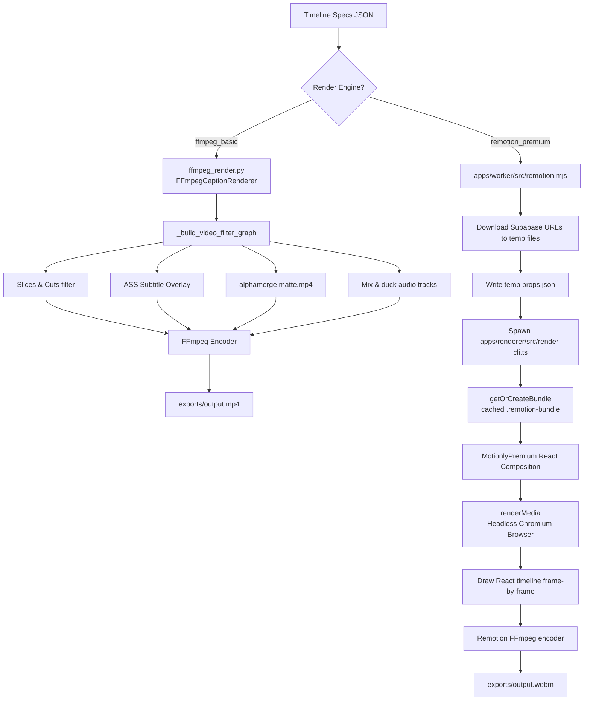

### 5.1 Basic FFmpeg Render Pipeline (`app/services/ffmpeg_render.py`)

Used for fast, cost-effective rendering:

- **Timeline Cuts:** The input specs are parsed into a single, complex FFmpeg filter-graph (`_build_video_filter_graph`) using trim/concat filters to stitch selected segments together.
- **Matte Extraction Overlay:** If background removal is active, the raw video is merged with `matte.mp4` using an `alphamerge` video filter to generate transparent sections.
- **ASS Subtitles:** Text tracks are compiled into standard `.ass` subtitle files and overlayed onto the video stream.
- **Audio Mixing:** Mixes background tracks with the vocal audio stream, applying auto-ducking to lower music volume when speech is active.

### 5.2 Premium Remotion Render Pipeline (`apps/renderer/src/render-cli.ts`)

Used for high-end, highly animated short-form templates:

1. **Web Packaging:** The worker bundles the React templates in `apps/renderer` into a Webpack bundle (cached as `.remotion-bundle` for future renders).
2. **Prop Resolution:** Downloads source files from Supabase Storage buckets, resolves them to local absolute file paths, and generates a structured `props.json` file.
3. **Chromium Frame Drawing:** Spawns a headless Puppeteer Chromium browser. Remotion mounts the React composition (`MotionlyPremium`) and plays the timeline frame-by-frame:
   - Captions are drawn using standard React components (enabling text pop-ins, emojis, and styling).
   - Motion effects (zooms, pans, transitions) are computed in React.
4. **Frame Encoding:** Chromium dumps individual frame images to a pipe, and FFmpeg compresses the image sequence into a final `.mp4` or `.webm` output video.

---

## 6. End-to-End Media Processing Sequence Diagram

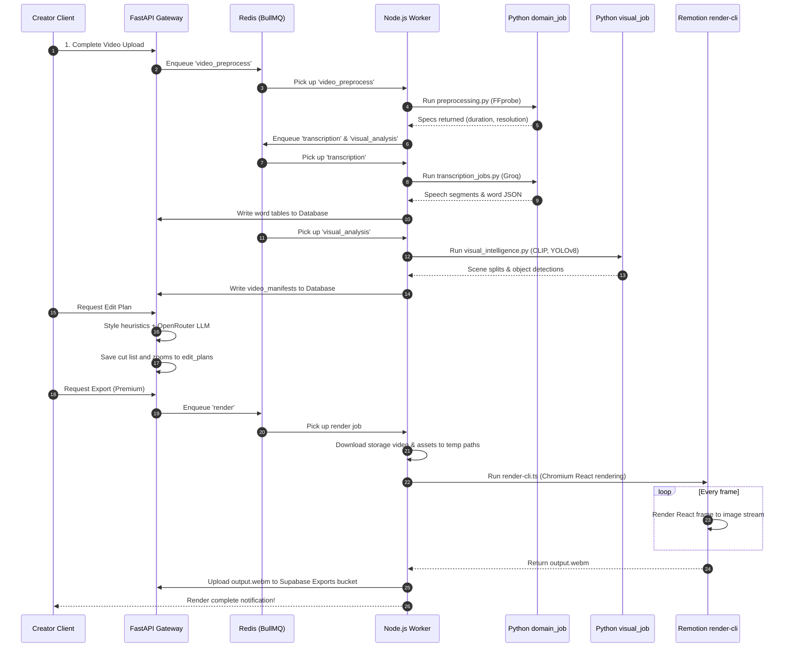

---

<div style="page-break-after: always;"></div>

# Part VI — AI / ML Capabilities

## 1. AI Capabilities & Models Architecture

Motionly is an "AI-first" video editor. Its capabilities span speech recognition, audio scene analysis, visual frame feature extraction, and text semantic planners.

Below is an overview diagram of how these capabilities chain together:

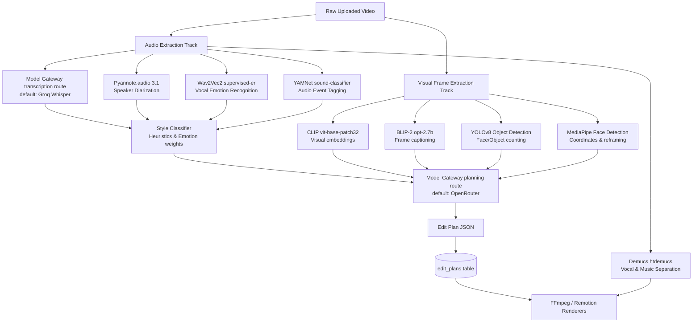

---

## 2. Capability Profiles

### 2.1 Speech-to-Text Transcription (Gateway; Groq default)

- **Problem Solved:** Decodes vocal conversations into timestamped word objects.
- **Model Name & Version:** `whisper-large-v3-turbo` (API hosted on Groq).
- **Service Location:** `transcription_jobs.py` calls `GatewayTranscriptionProvider`, which invokes `ModelGateway`; the Groq-compatible transport is one configured route.
- **Input Data:** Segmented `.wav` mono audio file (16kHz).
- **Output Data:** JSON list containing text segments, token confidence, start time, and end time per word.
- **Cost & Latency:** Latency is ~3-5 seconds for a 5-minute video. Groq cost is calculated per-token.
- **Fallback / Error Handling:** Compatible gateway routes may handle route-local provider failure. Production never falls back to fixtures; exhaustion, budget denial, revision mismatch, and open circuits are explicit failures.
- **Founder Explanation:** "If this fails, the video cannot be transcribed. The editor will load, but the captions panel will be empty and the AI edit generator will have no text to make edit cuts from."

### 2.2 Speaker Diarization (Pyannote)

- **Problem Solved:** Determines _who_ is speaking at any given millisecond (speaker tracking).
- **Model Name & Version:** `pyannote/speaker-diarization-3.1` (Loaded locally).
- **Service Location:** Called from `app/services/audio_intelligence.py` (`PyannoteSpeakerDiarizationProvider`).
- **Input Data:** Local `.wav` path.
- **Output Data:** Start/end timestamps associated with speaker IDs (e.g. `SPEAKER_00`, `SPEAKER_01`).
- **Founder Explanation:** "If this fails, the system won't know how many people are in the video. The AI editor will still work, but it won't be able to apply templates like 'alternating speaker cuts' for dual-podcasts."

### 2.3 Vocal Emotion Recognition (Wav2Vec2)

- **Problem Solved:** Detects the speaker's emotional state (anger, joy, sadness, neutral) from vocal tone.
- **Model Name & Version:** `superb/wav2vec2-base-superb-er` (Loaded locally).
- **Service Location:** Called from `app/services/audio_intelligence.py` (`Wav2VecEmotionProvider`).
- **Input Data:** Segmented vocal clips.
- **Output Data:** Probability arrays mapping emotional categories.
- **Founder Explanation:** "This helps the AI identify high-energy hooks. If it fails, the AI falls back to looking only at word meaning, missing verbal sarcasm or emotional highlights."

### 2.4 Audio Event Tagging (YAMNet)

- **Problem Solved:** Detects non-speech sound effects like applause, laughter, screaming, or silence.
- **Model Name & Version:** `google/yamnet/1` (Loaded locally).
- **Service Location:** Called from `app/services/audio_intelligence.py` (`YamnetSoundClassifier`).
- **Input Data:** Audio waveform arrays.
- **Output Data:** Categorical tags with start/end frames.
- **Founder Explanation:** "This automatically marks parts of the video where people laughed or clapped. If it fails, zoom transitions cannot be synced to applause hooks."

### 2.5 Semantic Visual Embeddings (CLIP)

- **Problem Solved:** Converts video frames into a 512-dimension vector to enable concept matching.
- **Model Name & Version:** `openai/clip-vit-base-patch32` (Loaded locally).
- **Service Location:** Called from `app/services/visual_intelligence.py` (`LocalMLVisualIntelligenceProvider`).
- **Input Data:** Sampled image frames.
- **Output Data:** 512 float-array embeddings.
- **Founder Explanation:** "This allows the system to match stock B-roll to video frames semantically. If it fails, stock footage matches revert to simple keyword searches."

### 2.6 Frame Captioning (BLIP-2)

- **Problem Solved:** Generates descriptive text for what is happening visually in a frame.
- **Model Name & Version:** `Salesforce/blip2-opt-2.7b` (Loaded locally).
- **Service Location:** Called from `app/services/visual_intelligence.py`.
- **Input Data:** Sampled image frames.
- **Output Data:** Text description strings (e.g. "a man sitting in front of a microphone").
- **Founder Explanation:** "If this fails, the editing LLM receives no visual context, and will not know what objects or settings are visible in the video."

### 2.7 Object Detection (YOLOv8)

- **Problem Solved:** Tracks visible objects (e.g., cellphones, laptops, cups) to feed context to B-roll rules.
- **Model Name & Version:** `yolov8n.pt` (Loaded locally).
- **Service Location:** Called from `app/services/visual_intelligence.py`.
- **Input Data:** Image frames.
- **Output Data:** Structured labels and bounding boxes.
- **Founder Explanation:** "This detects props. If a phone is detected in the frame, the system can overlay a phone-styled B-roll or transition."

### 2.8 Face Tracking & Reframe (MediaPipe Face Detection)

- **Problem Solved:** Coordinates subject face positions in 2D space to enable crop reframing.
- **Model Name & Version:** MediaPipe Face Detection (Loaded locally).
- **Service Location:** Called from `app/services/visual_intelligence.py`.
- **Input Data:** Frame image.
- **Output Data:** Normalized face box coordinates (`x_min`, `y_min`, `width`, `height`).
- **Founder Explanation:** "If this fails, horizontal videos cannot be cropped to vertical automatically. The speaker's face might be cut off on the sides."

### 2.9 Background Removal (MediaPipe Selfie Segmentation)

- **Problem Solved:** Separates the subject from the background to insert custom backdrops.
- **Model Name & Version:** MediaPipe SelfieSegmentation.
- **Service Location:** Called from `app/services/segmentation_matte.py` (`MatteQueue` / `matte_jobs.py`).
- **Input Data:** Video frames.
- **Output Data:** Transparency matte masks encoded into a black-and-white `matte.mp4`.
- **Founder Explanation:** "This removes the background. If it fails, the background toggle in the editor will have no effect, and the raw video background will remain."

### 2.10 AI Edit Planner LLM (OpenRouter)

- **Problem Solved:** Creates the timeline cuts, keyword highlights, camera zooms, and B-roll request slots.
- **Model Name & Version:** Dynamic via `EDIT_PLANNER_MODEL` (defaults to `openrouter/free` or configurable model).
- **Service Location:** Called from `app/services/edit_planner.py` (`HttpEditPlannerProvider`).
- **Input Data:** Dense prompt payload containing transcript paragraphs, scene timings, and style profiles.
- **Output Data:** JSON cut list schema.
- **JSON Repair Logic:** The plan validator (`app/services/edit_plan_validation.py`) verifies the returned LLM JSON. If keys are missing or timestamps overlap, it attempts to repair properties.
  - _Fallback:_ If JSON remains invalid or OpenRouter queries fail, it runs a local deterministic plan generator.
- **Founder Explanation:** "If this fails, the system will still cut your video, but it will rely on basic rules (e.g. cutting out silent gaps) instead of smart storytelling cuts."

### 2.11 Music Selection & Ducking

- **Problem Solved:** Recommends and places background music tracks based on the video's theme.
- **Service Location:** Called from `app/services/music.py`.
- **Founder Explanation:** "Selects music. If it fails, the video will render, but it will only contain the speaker's voice with no background track."

### 2.12 Stem Separation (Demucs)

- **Problem Solved:** Isolates vocals from background noise.
- **Model Name & Version:** `htdemucs` (Loaded locally).
- **Service Location:** Called from `app/services/scale.py` (`DemucsStemSeparator`).
- **Input Data:** Raw `.wav` audio.
- **Output Data:** Isolated vocal track `.wav` and background instrumental `.wav`.
- **Founder Explanation:** "Cleans up noisy recordings. If it fails, background noise will remain in the output video."

### 2.13 Generated B-Roll

- **Problem Solved:** Generates custom AI B-roll clips based on text descriptions.
- **Model Name & Version:** whatever `video.generation.submit` route the registry configures; none by default.
- **Service Location:** `app/services/scale.py` submits through the gateway and polls the same route; the operation is persisted in `inference_operations`. Without a route the API returns `503 capability_unavailable`.
- **Input Data:** Prompt string describing the scene.
- **Output Data:** Generated MP4 video URL.
- **Founder Explanation:** "Creates AI video assets. If it fails, slots will revert to stock video search engines."

---

## 3. Prefetching, GPU Memory & VRAM Configurations

To prevent cold-start latencies on GPU worker containers, the system includes a model prefetching daemon inside [`apps/api/app/workers/prefetch_models.py`](apps/api/app/workers/prefetch_models.py):

1. **Container Start Download:** During image start operations, the script runs snapshot downloads for Hugging Face repos, YOLO weights, YAMNet files, and Demucs models.
2. **GPU Memory Allocation Limits:** Large ML models can trigger CUDA Out of Memory (OOM) errors. The config variable `gpu_memory_ceiling_mb` (default: 16,000MB) acts as a safety limit:
   - PyTorch's VRAM usage is queried via `torch.cuda.memory_allocated()`.
   - If memory exceeds the threshold, the worker runs garbage collection and clears CUDA caches.
3. **Storage Cache Controls:** Large models consume significant disk space. The prefetching engine manages this via `enforce_worker_cache_budget`:
   - It monitors folders like `HF_HOME` and `TORCH_HOME`.
   - If total cached files exceed `WORKER_CACHE_MAX_BYTES`, it deletes the oldest cached models until usage fits within the limit.
   - It also removes temporary worker files starting with `motionly-` older than 6 hours.

---

<div style="page-break-after: always;"></div>

# Part VII — Database & Migrations Deep Dive

## 1. Database Schema Entity-Relationship Map

The database layer is managed via **PostgreSQL (Supabase)**. Access and security are enforced through Row-Level Security (RLS) policies based on user membership of the active workspace.

The core ER relationship layout is shown below:

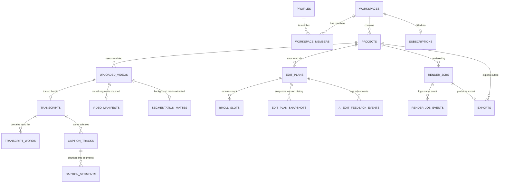

---

## 2. Table-by-Table Reference

### 2.1 Core Workspace & Membership Group

- **`public.profiles`**
  - _Purpose:_ Stores user identity details synchronized from Supabase auth.
  - _Key Columns:_ `id` (uuid, primary key), `email` (text), `full_name` (text), `avatar_url` (text).
  - _RLS:_ Users can read and update only their own profile row (`id = auth.uid()`).
- **`public.workspaces`**
  - _Purpose:_ The tenant unit grouping multiple members and assets.
  - _Key Columns:_ `id` (uuid, primary key), `name` (text), `owner_user_id` (uuid, references profiles).
  - _RLS:_ Members can read workspace rows if their user ID is in the `workspace_members` table.
- **`public.workspace_members`**
  - _Purpose:_ Association table mapping profiles to workspaces with roles.
  - _Key Columns:_ `workspace_id` (uuid), `user_id` (uuid), `role` (text: 'owner', 'editor'), `status` (text).
  - _RLS:_ Members can read records matching their active user ID.

### 2.2 Media Uploads & Processing Group

- **`public.projects`**
  - _Purpose:_ Main editing container project records.
  - _Key Columns:_ `id` (uuid, primary key), `workspace_id` (uuid), `title` (text), `status` (text: 'draft', 'rendered'), `active_video_id` (uuid).
  - _RLS:_ Members can read, insert, and update projects matching their member `workspace_id`.
- **`public.uploaded_videos`**
  - _Purpose:_ Tracks raw videos uploaded to `raw-uploads` bucket.
  - _Key Columns:_ `id` (uuid), `project_id` (uuid), `workspace_id` (uuid), `duration_seconds` (numeric), `resolution_width` (int), `resolution_height` (int), `status` (text: 'uploaded', 'processing', 'completed').
  - _RLS:_ Restricted to workspace members.

### 2.3 Transcription & Captions Group

- **`public.transcripts`**
  - _Purpose:_ Contains full paragraph-level transcript strings and language metadata.
  - _Key Columns:_ `id` (uuid), `uploaded_video_id` (uuid), `workspace_id` (uuid), `text_summary` (text), `language_code` (text).
  - _RLS:_ Enforces workspace containment checks.
- **`public.transcript_words`**
  - _Purpose:_ Tracks timestamped word blocks for timeline word highlights.
  - _Key Columns:_ `id` (uuid), `transcript_id` (uuid), `workspace_id` (uuid), `word` (text), `start_ms` (int), `end_ms` (int), `confidence` (numeric).
  - _RLS:_ Scoped to workspace members.
- **`public.caption_tracks`**
  - _Purpose:_ Subtitle tracks, storing custom colors and font styles.
  - _Key Columns:_ `id` (uuid), `uploaded_video_id` (uuid), `workspace_id` (uuid), `font_name` (text), `font_size` (int), `primary_color` (text).
  - _RLS:_ Scoped to workspace members.
- **`public.caption_segments`**
  - _Purpose:_ Segment groupings of subtitles shown at specific timestamps.
  - _Key Columns:_ `id` (uuid), `caption_track_id` (uuid), `workspace_id` (uuid), `text` (text), `start_ms` (int), `end_ms` (int).
  - _RLS:_ Scoped to workspace members.

### 2.4 AI edit plans & Timelines

- **`public.edit_plans`**
  - _Purpose:_ Stores timeline cut plans containing zooms and clips configuration.
  - _Key Columns:_ `id` (uuid), `project_id` (uuid), `workspace_id` (uuid), `timeline` (jsonb), `planner_version` (text).
  - _RLS:_ Enforces workspace membership check.
- **`public.edit_plan_snapshots`**
  - _Purpose:_ Captures the timeline JSON before and after manual user adjustments to enable rollbacks.
  - _Key Columns:_ `id` (uuid), `edit_plan_id` (uuid), `workspace_id` (uuid), `timeline_snapshot` (jsonb), `created_at` (timestamp).
  - _RLS:_ Enforces workspace membership check.

### 2.5 Billing & Subscriptions Group

- **`public.subscriptions`**
  - _Purpose:_ Stripe subscription record.
  - _Key Columns:_ `workspace_id` (uuid, primary key), `plan` (text: 'free', 'creator', 'pro', 'agency'), `status` (text: 'active', 'canceled').
  - _RLS:_ Workspace members can read subscription status.
- **`public.usage_ledger`**
  - _Purpose:_ Logs actions consuming compute resources to check plan limits.
  - _Key Columns:_ `id` (uuid), `workspace_id` (uuid), `event_type` (text: 'render_started', 'premium_action'), `cost_attribution_usd` (numeric).
  - _RLS:_ Scoped to workspace members.

---

## 3. Migration History Narrative

By analyzing the migrations sequence under `supabase/migrations/*`, we can trace how the database structure matured over time:

1. **Week 1 Foundation (`202605300001_week_01_foundation.sql`):**
   Provisions the initial multi-tenancy tables: `profiles`, `workspaces`, `workspace_members`, `projects`, `uploaded_videos`, `render_jobs`, `exports`, `subscriptions`, and the auth trigger function `handle_new_user()` to automatically create workspaces for new users.
2. **Weeks 2 & 3 Uploads & Audio (`202605300002` to `202605300003`):**
   Introduces the media upload tracking tables (`upload_events`) and sets up structures to persist Speech-To-Text records (`transcripts`, `transcript_words`, `caption_tracks`, `caption_segments`).
3. **Weeks 4 & 5 Renders & AI Planner (`202605310004` to `202605310005`):**
   Adds `render_job_events` to log worker updates. Introduces `edit_plans` to store JSON arrays containing cut lists.
4. **Weeks 7 to 9 B-Roll & Effects (`202605310007` to `202605310009`):**
   Enables stock video placement (`broll_slots`, `stock_assets`), background music selections (`music_tracks`, `project_music_selections`), and custom color filters (`visual_presets`).
5. **Week 11 Billing (`202605310011_week_11_billing_subscriptions.sql`):**
   Updates subscriptions with plan enum types ('free', 'creator', 'pro', 'agency') and adds `stripe_webhook_events` to prevent duplicate billing charges.
6. **June 2026 Schema Refactor & Security Hardening (`202606220001_phase_0_schema_repair.sql`):**
   Cleans up foundation-era columns (e.g. `plan_key`), replaces surrogate keys on `subscriptions` with `workspace_id` primary keys, and drops unused tables like `launch_ops_events` and `audit_logs` to simplify the schema surface.
7. **June 2026 Operations Telemetry (`202606220008_phase_8_operations.sql`):**
   Adds logging tables for background workers: `worker_heartbeats`, `provider_slo_events` to measure API latencies, and `cost_attribution_events` to trace spending.
8. **July 2026 Atomicity (`202607050001_phase_1_edit_plan_atomicity.sql`):**
   Applies integrity constraints and index definitions (`202607050002` to `202607050005`) to speed up visual manifest lookups and workspace token validation.

---

## 4. Tenancy & Row-Level Security Enforcements

Supabase enforces Row-Level Security policies globally. For any query, the database checks:

```sql
auth.uid() = user_id
```

For tenant-scoped tables, RLS verifies workspace membership using sub-selects:

```sql
CREATE POLICY "members read projects" ON public.projects
AS RESTRICTIVE USING (
  EXISTS (
    SELECT 1 FROM public.workspace_members
    WHERE workspace_members.workspace_id = projects.workspace_id
      AND workspace_members.user_id = auth.uid()
      AND workspace_members.status = 'active'
  )
);
```

### RLS Test Coverage

The project includes automated security tests written in pgTAP:

- **`phase_0_tenancy_rls_test.sql`:** Simulates different user credentials to verify that queries attempting to select or update projects belonging to other workspaces are blocked, returning empty results or raising errors.
- **`phase_9_rls_test.sql`:** Verifies that owners, members, outsiders and disabled members see only their own workspaces, projects and profiles, that signed-in clients cannot call the security-definer plan RPCs, and that the service role keeps its access.

---

<div style="page-break-after: always;"></div>

# Part VIII — Security, Billing & Ops

## 1. Authentication and bypass flags

### Route Security Model

API security relies on Supabase Auth JWT verification:

- Users log in via the frontend, obtaining a JWT.
- For each request, the JWT is passed as a Bearer authorization token header.
- The backend verifies the token using the configured `SUPABASE_JWT_SECRET`.
- The actor's workspace membership is checked to ensure they have permission to access the requested resources.

### Developer Auth Bypass Risks

During development, developers can set `SKIP_API_AUTH=true` to bypass auth verification.

- **Bypass Action:** If active, the dependency injector defaults all calls to a mock user `00000000-0000-4000-8000-000000000001` and workspace `00000000-0000-4000-8000-000000000002`.
- **Production Guard:** To prevent production vulnerabilities, `config.py` runs a validation check. If `SKIP_API_AUTH` is enabled while `APP_ENV` is not set to `development` or `local`, the application raises a startup error.

---

## 2. Billing & Subscription Integrations

The billing system is powered by **Stripe** (`app/services/billing.py`):

- **Pricing Plans:** Defines four plan tiers: `free`, `creator`, `pro`, and `agency` (mapped in `core/config.py` using variables like `stripe_price_pro`).
- **Checkout Portal:** The `/billing/checkout` endpoint generates a Stripe checkout session, redirecting users to payment forms.
- **Webhook Processing:** Stripe events (e.g. `customer.subscription.updated`) are processed by `/billing/webhook`.
  - **Idempotency Guard:** Webhook events are logged in the `stripe_webhook_events` table. If the same event ID is received again, the handler skips processing to prevent duplicate updates.

---

## 3. Analytics, Retention & Ops

### Outcomes & Cost Attribution

Compute resources (transcription, local ML, rendering) incur server costs. The system tracks these via the operations module (`app/services/operations.py`):

- **Cost Logs:** Workers log resource consumption to the `cost_attribution_events` table (e.g. tracking audio transcription seconds or visual analysis GPU run times).
- **SLO Checks:** Third-party API response times are logged in `provider_slo_events` to monitor external service performance.

### Data Retention Queue (`app/services/retention.py`)

To manage storage costs, a retention service runs periodic cleanup tasks:

- **Source Videos:** Deleted from `raw-uploads` after 365 days.
- **Render Exports:** Deleted from the `exports` bucket after 90 days.
- **Soft Deletion:** Soft-deleted records are enqueued in `storage_deletion_queue` and removed from storage buckets by a background worker task.

### Observability & Metrics

- **Heartbeats:** Active workers write periodically to `public.worker_heartbeats`. The admin dashboard flags workers as offline if their last heartbeat is older than 90 seconds.
- **Prometheus Metrics:** The `MetricsRegistry` tracks API request rates, database execution latencies, and queue depths.

---

<div style="page-break-after: always;"></div>

# Part IX — Testing & Quality

## 1. Test Suites Structure

Motionly implements an automated test suite across all levels of the stack. Code verification is performed before PR mergers and deployments.

```
.
├── apps/
│   ├── api/
│   │   └── tests/                   # Pytest suite for FastAPI backend (46+ test modules)
│   │       ├── integration/         # Integration checks (Supabase and Redis mocks)
│   │       ├── security/            # Tenant isolation checks
│   │       └── fixtures/            # Mock data (Word lists, visual segment clips)
│   ├── renderer/
│   │   └── src/
│   │       ├── golden-frames.test.ts # Remotion image render verification
│   │       └── timeline.test.ts     # Composition timing calculations
│   └── web/
│       ├── tests/                   # Node unit tests for Next.js (14+ test modules)
│       └── playwright.config.mjs    # Playwright end-to-end integration configs
└── supabase/
    └── tests/                       # PgTAP database verification
        ├── phase_0_schema_test.sql  # Schema structures
        └── phase_0_tenancy_rls_test.sql # Tenancy boundaries
```

---

## 2. Test Execution Profiles

### 2.1 Backend Tests (`apps/api/tests`)

Runs `pytest` verifying FastAPI controllers and local worker pipelines:

- **API Endpoint Checks (`test_projects.py`, `test_renders.py`, `test_plans.py`):**
  Asserts that request validations fail under malformed inputs and verify response structures.
- **Tenant Isolation Checks (`security/`):**
  Asserts that requests attempting to access projects or files of another workspace return `401`, `403`, or `404` errors.
- **Worker Failure Injection (`test_phase8_failure_injection.py`):**
  Mocks network dropouts and evaluates retry logic for Whisper transcription and OpenRouter APIs.
- **GPU OOM Recovery (`test_phase4_gpu_media_workers.py`):**
  Injects CUDA Out of Memory (OOM) errors to verify that the worker clears memory caches and rolls back job status flags safely.

### 2.2 Frontend & E2E Tests (`apps/web/tests`)

Runs unit checks and browser automation via **Playwright**:

- **Editor State Polling (`editor-polling.test.mjs`):**
  Tests playhead synchronization and updates when background transcription completes.
- **Undo/Redo History (`timeline.test.mjs`):**
  Simulates UI adjustments to check local storage serialization.
- **Responsive Layout (`responsive-editor.test.mjs`):**
  Simulates different screen resolutions (mobile, desktop) to ensure layout adapters are responsive.

### 2.3 Renderer Golden Frame Tests (`apps/renderer/src/golden-frames.test.ts`)

Ensures pixel-perfect rendering output:

- **Golden Comparison:** Renders specific test clips frame-by-frame.
- **Visual Assertions:** Compares output frames against pre-approved "golden" images in `renderer/src/goldens` to detect shifts in caption overlays or aspect ratios.

### 2.4 Supabase RLS Tests (`supabase/tests`)

Runs pgTAP assertions directly inside the Postgres engine:

- **Schema Assertions (`phase_0_schema_test.sql`):**
  Verifies tables, triggers, and foreign keys.
- **RLS Verification (`phase_0_tenancy_rls_test.sql`):**
  Bypasses the API layer and executes direct SQL commands using mock users, verifying that rows in `projects` and `uploaded_videos` remain protected.

---

## 3. Continuous Integration Pipeline (GitHub Actions)

When a developer opens a Pull Request (PR) to `main`, the CI runner executes the validation pipeline:

1. **Linting and Type Checks:** Runs `pnpm lint` and `pnpm typecheck` to verify code formatting.
2. **Database Migrations:** Spawns a local PostgreSQL container, applies migrations, and runs pgTAP tests to check RLS constraints.
3. **Pytest Suite:** Runs backend unit and integration tests.
4. **Node Test Suite:** Runs Next.js unit tests.
5. **Remotion CLI Verification:** Runs Remotion CLI smoke tests to confirm compiler dependencies are ready.
6. **Playwright Suite:** Automatically runs headless Chrome/Firefox instances to verify the signup and upload walkthrough flows.

---

<div style="page-break-after: always;"></div>

# Part X — Known Risks, Gaps & Recommendations

Based on the engineering and frontend audits, this chapter consolidates and prioritizes the architectural risks, codebase gaps, and security concerns inside Motionly.

---

## 1. Prioritized Risk Register

### 1.1 Priority P0 (Immediate Launch Blockers)

1. **Security Bypass Configuration (`SKIP_API_AUTH`)**
   - _Risk:_ The presence of developer bypass options (`SKIP_API_AUTH`) in `get_actor` allows unauthenticated access to database records in development. If the `APP_ENV` variable is misconfigured or set incorrectly in production, the system is exposed.
   - _Fix:_ Ensure the validation checks in `core/config.py` are strictly enforced, raising fatal startup errors if bypass parameters are active outside local or development environments.
2. **Missing Live Stripe Webhook Checks in Tests**
   - _Risk:_ Webhook verification is bypassed in test environments. If payment flows are not validated, invalid event payloads could trigger incorrect subscription upgrades.
   - _Fix:_ Add Stripe webhook signature validation checks to test suites.
3. **Low Contrast in Light Mode Design System**
   - _Risk:_ In light mode, the contrast ratio of the muted foreground color against the background is 3.2:1, which fails to meet the WCAG AA requirement of 4.5:1, impacting readability.
   - _Fix:_ Increase `--muted-foreground` in `globals.css` from `220 12% 32%` to `220 16% 24%`.

### 1.2 Priority P1 (Scalability & Performance Gaps)

1. **Selfie Segmentation Compute Costs**
   - _Risk:_ Background removal via MediaPipe SelfieSegmentation processes frames individually. Encoding alpha mattes with source videos via FFmpeg is CPU/GPU intensive, risking worker queue bottlenecks.
   - _Fix:_ Deploy these tasks to dedicated, auto-scaling GPU workers with concurrency limits.
2. **TIMELINE Playhead Performance Lag**
   - _Risk:_ Updating the `playheadMs` state in `TimelinePanel.tsx` on every frame triggers full component re-renders. Large timelines with multiple clips may suffer from playhead lag.
   - _Fix:_ Use `React.memo` to isolate timeline track components, updating the playhead position using a CSS custom property rather than triggering full React render lifecycles.
3. **Lexical Fallback for Real B-Roll Providers**
   - _Risk:_ stock video APIs (Pexels, Pixabay) do not return CLIP embeddings for videos. The B-roll engine falls back to lexical keyword matching instead of semantic similarity matching, leading to less relevant B-roll recommendations.
   - _Fix:_ Set up a background worker task that generates semantic embeddings for stock video metadata to enable vector similarity searches.

### 1.3 Priority P2 (UX Polish & Trust Gaps)

1. **Matte Preview Discrepancy in Editor**
   - _Risk:_ The editor preview uses a static CSS ellipse mask to simulate background removal, whereas the final rendered video uses a frame-by-frame alpha matte generated by FFmpeg. This can lead to visual discrepancies between the editor preview and the exported video.
   - _Fix:_ Render the actual frame-by-frame alpha matte on the client side using Canvas overlays when available.
2. **Lack of Inline Form Validation**
   - _Risk:_ Form validation errors (e.g., weak passwords) are processed on the server, causing full page reloads and redirecting users with error query parameters.
   - _Fix:_ Implement client-side validation using Form validation libraries before form submissions.

---

## 2. Next-Steps Roadmap

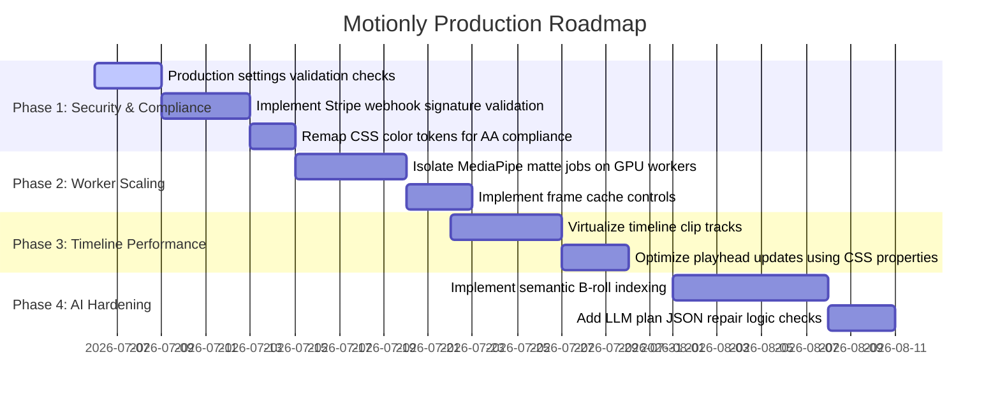

---

<div style="page-break-after: always;"></div>

# Appendices

## Appendix A: Environment Variables Reference

Below is a complete index of all active environment variables across the system, grouped by subsystem:

### A.1 Shared & Application Runtime Config

- **`APP_ENV`** (Default: `production`)
  - _Purpose:_ Runtime stage flag (`production`, `development`, `local`). Restricts security bypasses to non-production envs.
- **`LOG_LEVEL`** (Default: `INFO`)
  - _Purpose:_ Log verbosity levels (`DEBUG`, `INFO`, `WARNING`, `ERROR`).
- **`PUBLIC_ORIGIN`** (Default: _None_)
  - _Purpose:_ The one public origin. Browsers reach the web app at `/`, the API at `/api`, and Supabase at `/supabase`. The web server reads it at startup (never at build time); it is also the fallback origin for sign-up confirmation links.
- **`API_INTERNAL_URL`** (Default: _None_)
  - _Purpose:_ The private-network URL the web server uses to call the FastAPI service.
- **`API_PUBLIC_BASE_URL`** (Default: _None_)
  - _Purpose:_ The API as browsers reach it (`<origin>/api`); used for local-storage links.

### A.2 Supabase & Database Config

- **`SUPABASE_URL`** (Default: _None_)
  - _Purpose:_ The private-network endpoint of the Supabase gateway, used by the web server, API, and workers for Auth, REST, and Storage.
- **`SUPABASE_PUBLIC_URL`** (Default: `SUPABASE_URL`)
  - _Purpose:_ Supabase as browsers reach it (`<origin>/supabase`); signed Storage links handed to browsers use it. Required in production.
- **`SUPABASE_ANON_KEY`** (Default: _None_)
  - _Purpose:_ Public API key to read data with RLS filters.
- **`SUPABASE_SERVICE_ROLE_KEY`** (Default: _None_)
  - _Purpose:_ Service key to bypass RLS, used exclusively by backend API and background workers.
- **`SUPABASE_JWT_SECRET`** (Default: _None_)
  - _Purpose:_ HS256 JWT key used to verify user login authorization headers.
- **`SUPABASE_DATABASE_URL`** (Default: _None_)
  - _Purpose:_ Postgres connection string for migration and backup tools.

### A.3 Storage & Render Parameters

- **`UPLOAD_STORAGE_BUCKET`** (Default: `"raw-uploads"`)
  - _Purpose:_ Bucket name storing raw uploaded user clips and matte files.
- **`EXPORT_STORAGE_BUCKET`** (Default: `"exports"`)
  - _Purpose:_ Bucket name storing finished, compiled output files.
- **`MEDIA_WORK_DIR`** (Default: `"/var/data/motionly/storage"`)
  - _Purpose:_ Transient local storage path on worker disks used to compile video layers.
- **`REMOTION_ENABLED`** (Default: `"false"`)
  - _Purpose:_ Boolean flag. Set to `true` to enable premium Chromium-based React renders; defaults to basic FFmpeg encoding.

### A.4 Redis & Queues (BullMQ)

- **`REDIS_URL`** (Default: _None_)
  - _Purpose:_ Connection string to the Redis server backing the BullMQ queue registry.
- **`WORKER_CONCURRENCY`** (Default: `3`)
  - _Purpose:_ Number of parallel standard jobs processed concurrently by a single CPU worker.
- **`RENDER_WORKER_CONCURRENCY`** (Default: `1`)
  - _Purpose:_ Concurrency limit for video renders on worker nodes to manage CPU/GPU usage.

### A.5 AI Models & API Integration Keys

> Updated October 24, 2026 (provider-neutral inference, Tier 1). AI providers are no longer configured with per-vendor variables; see the [inference registry guide](../ai-registry/README.md).

- **`AI_REGISTRY_FILE`** (Default: _None_; required in production and staging)
  - _Purpose:_ Path to the declarative inference registry, or a comma-separated list of registry fragments. Every AI capability (planning, transcription, objects, diarization, stems, …) is a route in it.
- **`AI_SECRETS_DIR`** (Default: `/run/secrets`) / **`AI_SECRETS_BUNDLE_FILE`** (Default: _None_)
  - _Purpose:_ Where registry `file:` and `bundle:` secret references are read from.
- **`AI_QUOTA_SCOPE`** (Default: `"feature"`)
  - _Purpose:_ Plan quotas count by Motionly feature; `provider` is a temporary stop-gap that restores per-provider counting.
- **`PEXELS_API_KEY`** / `PIXABAY_API_KEY` (Default: _None_)
  - _Purpose:_ Search tokens for stock B-roll retrieval.
- **`ALLOW_FIXTURE_PROVIDERS`** (Default: `"false"`)
  - _Purpose:_ Boolean flag. If `true`, runs mock responses for stock B-roll searches (useful for isolated staging tests). Development and test runs without a registry use built-in fake planning and transcription routes.

---

## Appendix B: Repository Folder & Key File Map

Below is a detailed inventory of directories and key files across the Motionly repository:

### B.1 `apps/api` (FastAPI Backend)

- `app/main.py`: Entry point establishing dependencies, routing configurations, and middleware.
- `app/api/`: Endpoint modules mapping REST paths to repository calls.
  - `plans.py`: Handles AI planner requests.
  - `renders.py`: Handles export submissions.
- `app/services/`: Services implementing business logic.
  - `edit_planner.py`: Manages LLM prompts and plans validation.
  - `visual_intelligence.py`: Runs local PyTorch models.
  - `ffmpeg_render.py`: Manages basic FFmpeg filter graphs.
- `app/repositories/`: Classes executing Supabase SQL calls.
- `app/workers/`: Worker modules.
  - `prefetch_models.py`: Handles pre-fetching ML models during container startup.

### B.2 `apps/worker` (BullMQ Node Worker)

- `src/worker.mjs`: Node background loop processing BullMQ jobs.
- `src/queue-bridge.mjs`: Bridge tool parsing stdin commands from Python to queue tasks.
- `src/remotion.mjs`: Node supervisor launching Chromium React render pipelines.

### B.3 `apps/renderer` (Remotion React project)

- `src/render-cli.ts`: Render compiler that runs compositions frame-by-frame.
- `src/Composition.tsx`: Main premium timeline React layout drawing styled text, animations, and zooms.

### B.4 `apps/web` (Next.js Web Client)

- `app/(app)/projects/[projectId]/page.tsx`: Workspace page rendering the video editor canvas.
- `components/editor-client.tsx`: State coordinator tracking playhead timestamps and changes.
- `components/editor/history-context.tsx`: Context manager handling undo/redo operations.
- `components/editor/timeline/TimelinePanel.tsx`: Interactive timeline tracking clip widths.

---

## Appendix C: Glossary of Technical Terms

- **Row-Level Security (RLS):** Database security rules that evaluate permissions on a row-by-row basis, restricting access based on tenant membership.
- **Monorepo:** A repository strategy containing multiple distinct applications and packages in a single code repository.
- **pnpm workspaces:** Dependency grouping rules that share package dependencies across monorepo workspaces using hard-links.
- **Turborepo:** A build system for monorepos that caches task outputs and runs tasks in parallel.
- **BullMQ:** A Redis-backed message queue library for Node.js, used to manage background jobs.
- **Queue Bridge:** An interprocess communication bridge that lets the Python FastAPI backend queue tasks by piping JSON payloads to a Node.js process.
- **Remotion:** A framework that compiles React code into videos frame-by-frame using a headless browser.
- **Matte Job:** A background worker task that uses MediaPipe SelfieSegmentation to extract the subject from a video, generating a black-and-white transparency mask video (`matte.mp4`).
- **Edit Plan:** A structured JSON object describing timeline cuts, keyword highlights, and zoom timestamps.
- **Tenancy Boundary:** Security isolation rules ensuring users can only access data belonging to their active workspace.

---

## Appendix D: Third-Party Services Dependencies

Below is an overview of the third-party integrations required by the platform:

| Integration                | Subsystem / Role               | What breaks if this service goes down?                                                                                                       |
| :------------------------- | :----------------------------- | :------------------------------------------------------------------------------------------------------------------------------------------- |
| **Supabase**               | DB and Object Storage          | The application goes offline. Users cannot log in, projects cannot load, and uploads fail.                                                   |
| **Stripe**                 | Subscriptions & Billing        | Stripe portal redirects fail, and webhook payments are delayed. Users cannot change pricing tiers.                                           |
| **Transcription route**    | Speech-to-text (registry)      | Video preprocessing is blocked, preventing speech transcription and AI edit planning; a second route by priority takes over when configured. |
| **Planning route**         | LLM Edit Planner (registry)    | Auto-cuts and AI edit plans fail, falling back to a rule-based silence cut list.                                                             |
| **Pexels & Pixabay**       | Stock B-roll                   | stock video search fails. B-roll recommendations fall back to empty slots.                                                                   |
| **Video generation route** | AI Video Generation (optional) | Generated B-roll fails, reverting slots to stock video search engines.                                                                       |

---
